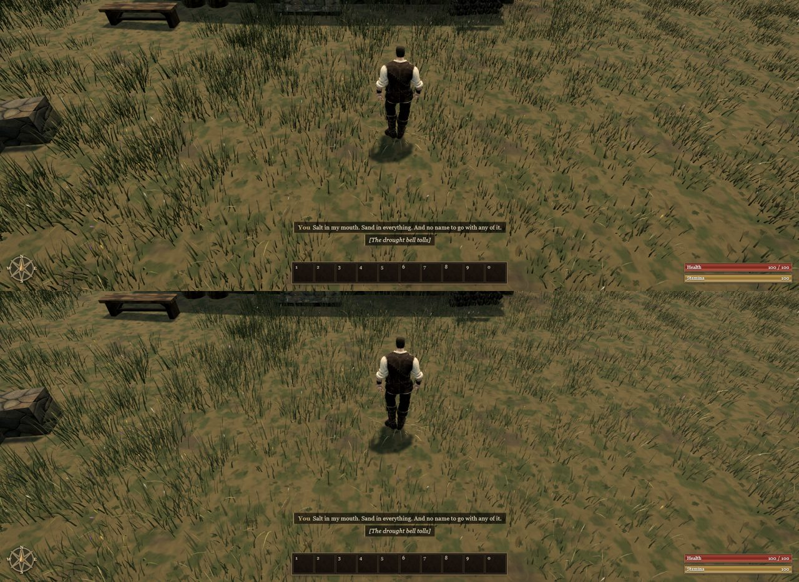
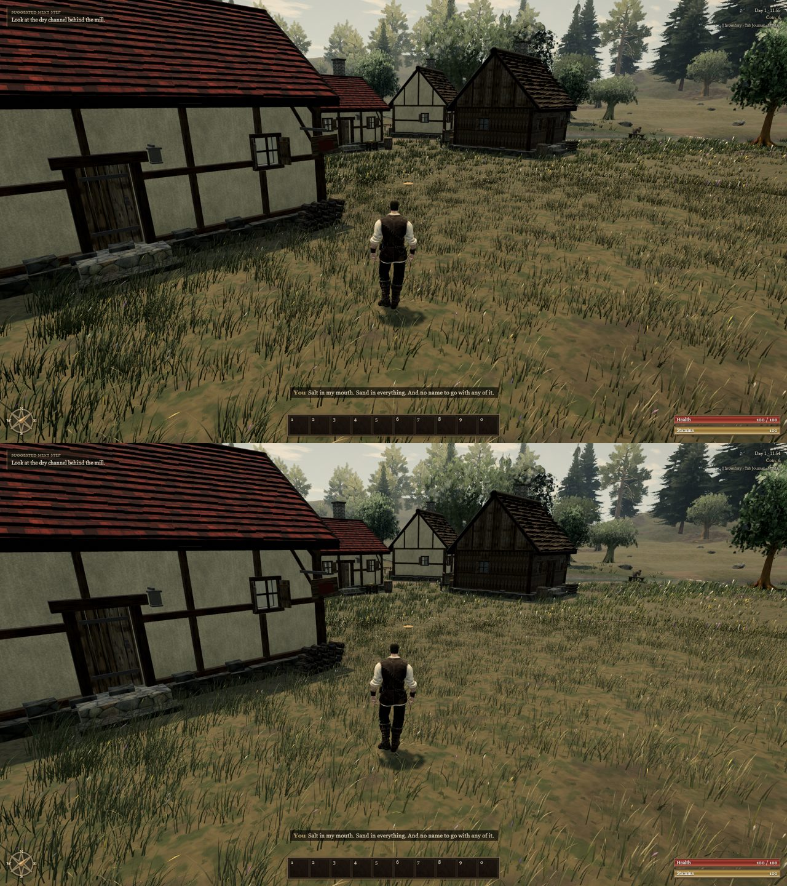

# Grass that sits in the light (A116, 0.0.13)

Ael's recording near the house and fence showed the meadow as near-black strokes on bright, bare-looking ground. Each
blade darkened from 70% of its height down to 34% brightness at the root (`rootShade`, A61). From the raised
third-person camera, most of what is seen of a tuft is that lower part, so at noon every tuft read as a dark ribbon
against the sunlit ground. Leaning the blade normals further toward the sky made almost no difference. The root shade
made all of it.

**Change.** `rootShade` 0.34 → 0.9: the base of a blade keeps a hint of depth, and the rest stands in the same light
as the ground around it. The distant band, drawn by the same material, blends into the field as well.

Before (top) and after (bottom), from Ael's camera at 11:51 and from a wider angle:

What remains: the tufts are still clumped, with ground showing between them. Spreading them more evenly is the next
grass change.
