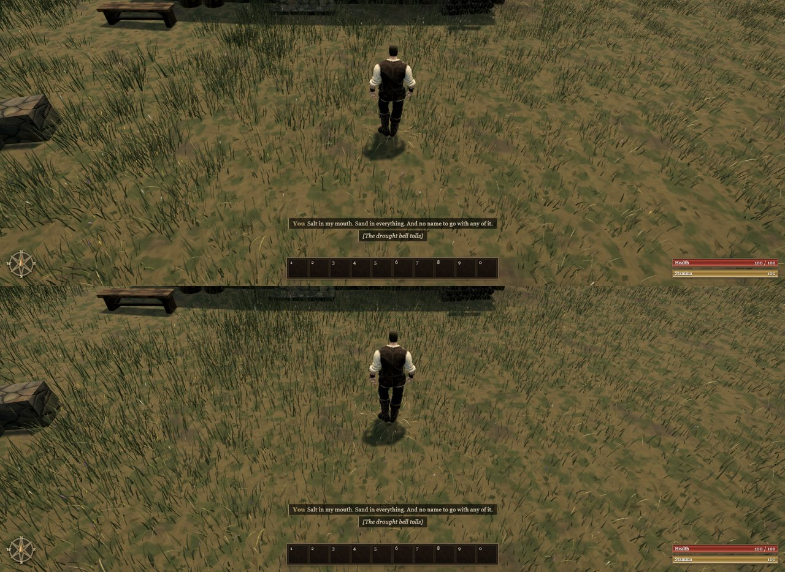

# Grass spread across the ground (A117, 0.0.13)

After A116 the blades stood in the right light, but they still grew in tight tufts with bare ground between them. On
High a square metre held about 4.2 tufts of 32 blades, each tuft 0.3 m across.

**Change.** Twice as many tufts with half the blades each, sown over a 0.4 m radius rather than 0.3:

| Preset | Before | After |
| --- | --- | --- |
| High | 4.2 tufts/m² × 32 blades | 8.4 × 16 |
| Medium | 3.0 × 24 | 6.0 × 12 |
| Low | 1.9 × 17 | 3.6 × 9 |

The number of blades and triangles a square metre draws is unchanged (Low's is 0.3% higher). The blades cover the
ground evenly instead of leaving bare patches between tufts.

Before (top) and after (bottom), from Ael's camera at 11:51:

