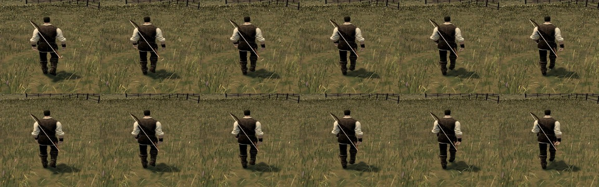

# Arms in at his sides (A119, 0.0.13)

From behind, as Ael plays, the authored walk and run hold the hero's upper arms out from his sides. Their swing barely
shows from that angle, and he reads stiff.

**Change.** While he walks or runs (weighted by how much he is moving, not while swimming), each upper arm comes
0.15 rad (8.6°) in toward the body after the clips are sampled. Forearms, hands and legs are exactly the clips'. The bow
and blade poses that use the arms are laid over this afterwards.

Before (top) and after (bottom), walking from behind (the comparison was taken at 0.12 rad; 0.15 is a little further):

