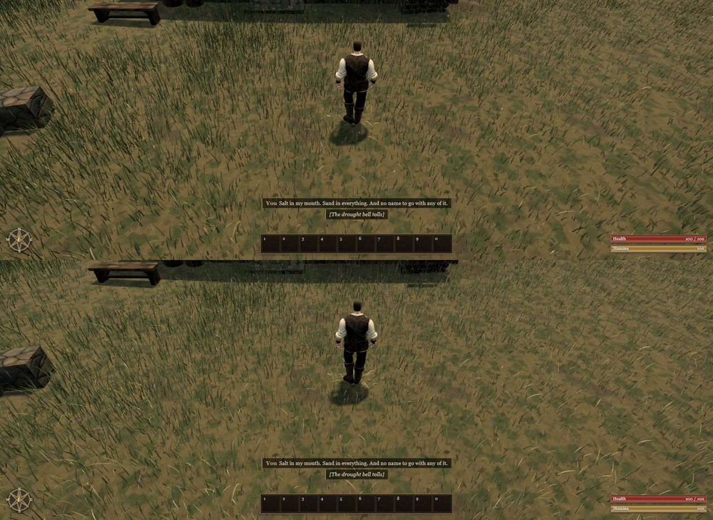

# An even, lighter meadow (A121, 0.0.13)

After A117 the grass still read as somewhat clumped and dark from Ael's camera: olive tufts over ochre ground.

**Change.**

- High sows 11.2 tufts/m² of 12 blades (was 8.4 × 16), the same number of blades and triangles, spread more evenly.
- The meadow's four tints (fresh, lush, gold, shade) are about 12% lighter, closer to the ground's own tone under the
  noon sun, so a gap between tufts no longer reads as a dark edge.

Before (top, live A117) and after (bottom), from Ael's camera at 11:51:

