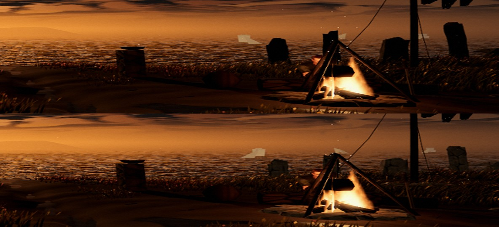

# The vigil's standing stones read as stone (A122, 0.0.13)

In Ael's playtest of the title screen, several tall, dark, flat slabs stood in front of the sea and blocked the view. They
are the camp's standing stones: an old stone ring and a dolmen beside the fire. The banner pole with its guy ropes also
stands there by design. The stones faced the camera with the low sun behind them, and only a dim sky fill reached their
faces, so they drew as pure black cut-outs. From the vigil's camera, the tallest (3.1–4.3 m) crossed the horizon.

**Change.**

- The stones stand at 72% of their former height (about 1.9–3.1 m), below the horizon from the vigil's camera. The
  dolmen's cap still rests on its uprights.
- The menu's rock (a material only the menu uses) has a faint warm emissive drawn from its own texture. It stands in
  for the dusk sky's bounce, so the stones show as dark, weathered stone instead of black slabs.

Two other approaches were tried and not kept: a paler per-stone tint (vertex colours cannot go above 1), and a longer
reach for the fire's light (too weak at 8 m to show against the sunset).

Before (top) and after (bottom):

