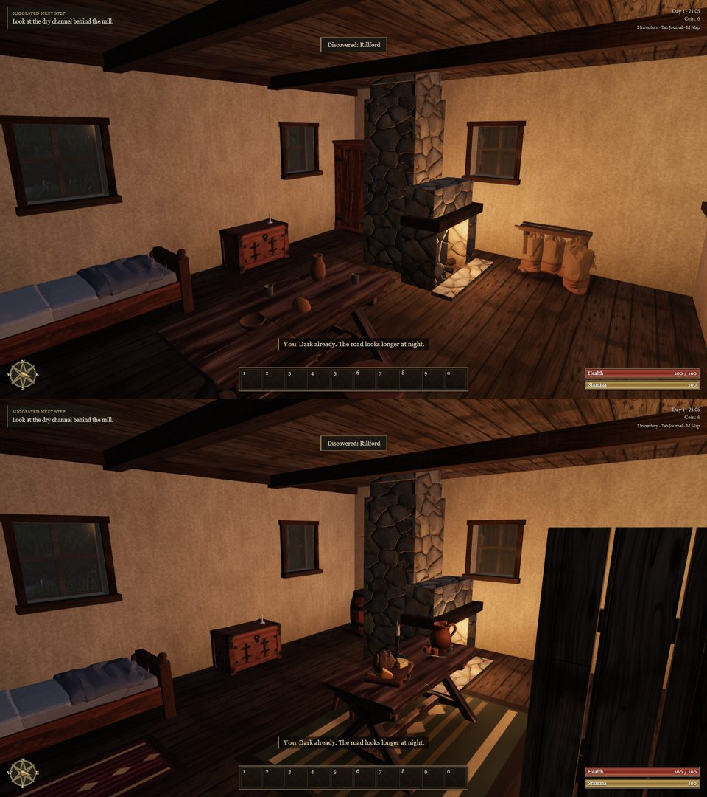
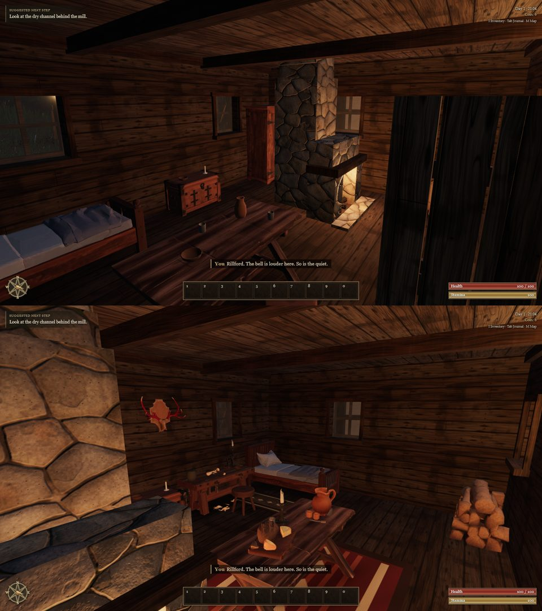
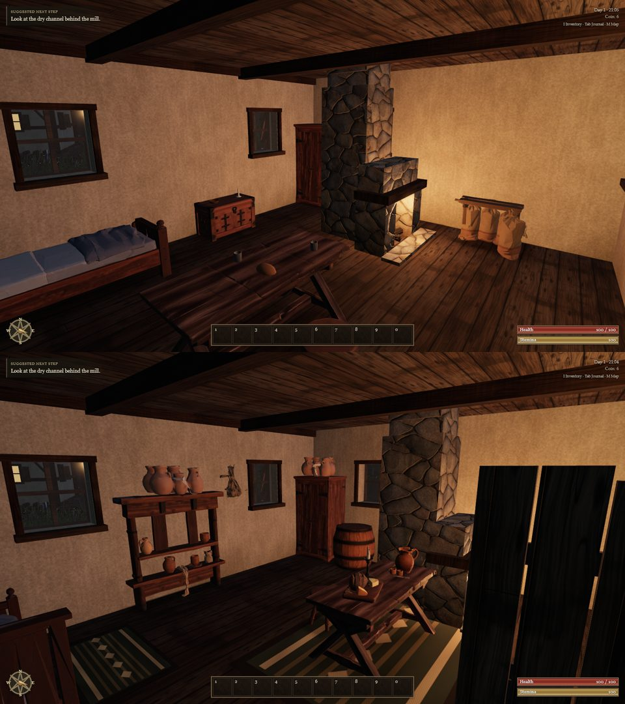
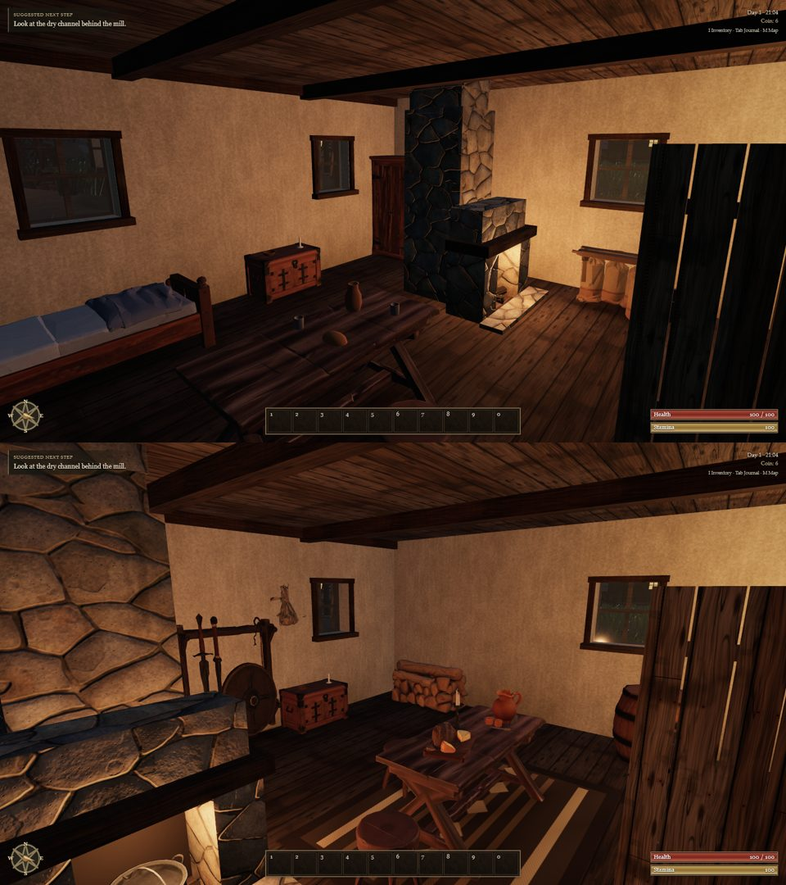
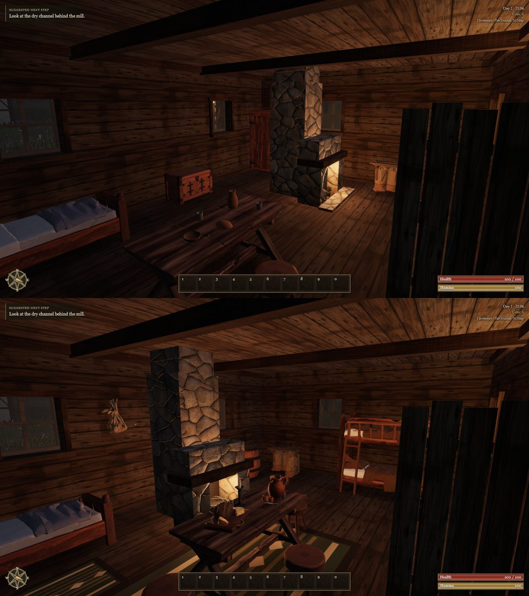
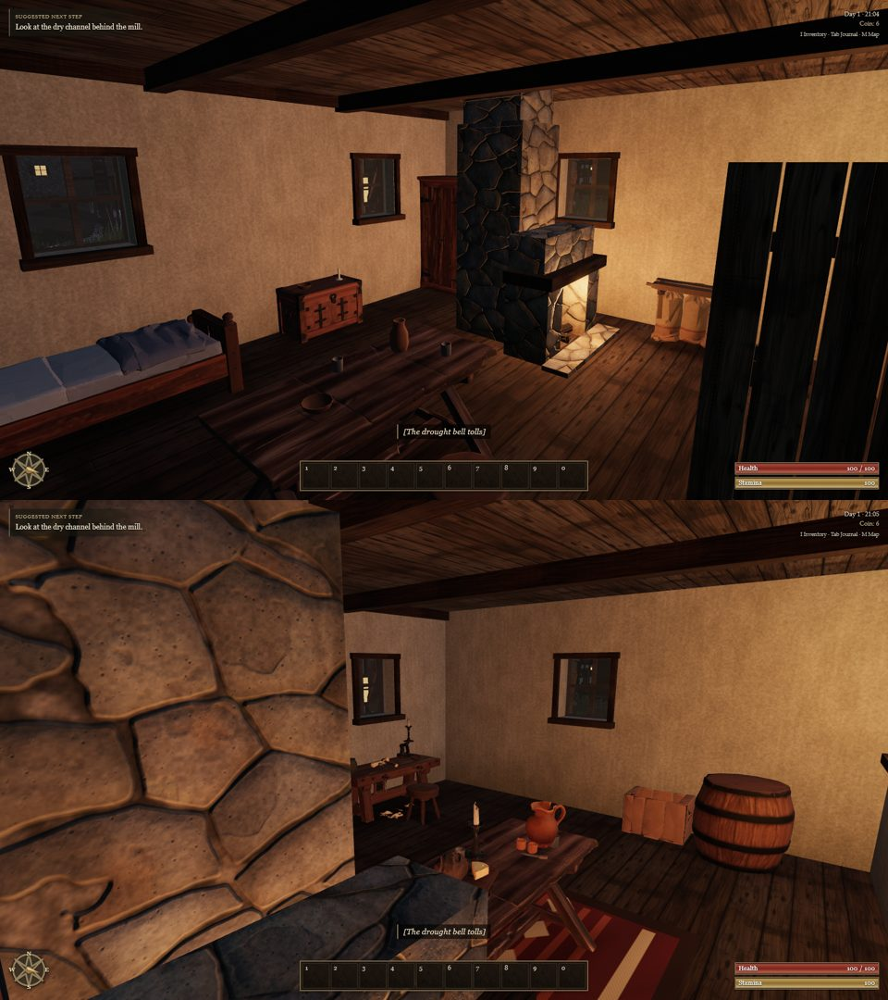

# Houses that are lived in (A123, 0.0.14)

Ael's playtest 4, with six Gothic 3 interiors as the reference: every house should be its own, homey and lived in. The
village's six houses shared one wish list. Each had the same bed, chest, table, shelf, cupboard and sacks, and nothing
on the tables, walls or hearth.

**Each house is a household.** Each house now furnishes its own trade, with its hearth (and chimney) on its own side:

| House | Household | Furniture and props |
| --- | --- | --- |
| house_a | weaver | loom, chest, table for the cloth, crate of wool, barrel |
| house_b | woodcutter | workbench and stool, split firewood, farm tools, antlers |
| house_c | herbalist | shelves and a cupboard of clay pots, a writing desk, three bundles of herbs |
| house_d | hunter's family | bow rack, a big table, firewood, antlers and a stretched hide |
| house_e | farmer's family | a bed and a bunk for the children, a table for four, tools, sacks of harvest |
| house_f | brewer | barrels along the walls, a workbench, crates |

**What makes a room lived in** (`world/dressing.ts`), laid out from the furniture already placed, so it never stands in
the way in, across a window or inside another piece, and never collides:

- on every table, a board of bread and cheese, a jug with cups, and a candlestick; a candle on desks and workbenches;
- clay pots on shelves and cupboards;
- a black iron cooking pot in the hearth;
- the household's things on the walls between the windows: antlers, a stretched hide, and herbs drying near the fire;
- woven wool rugs under the tables and beside the beds, in four patterns of earthy reds, ochres and browns.

Twelve new props were generated with Meshy (barrel, crate, firewood, bread, jug, pots, cooking pot, herbs, antlers, pelt,
candlestick, farm tools): 180 credits of the 200 the interiors may spend, under a hard cap that
`tools/meshy-props/generate.mjs` checks against the live balance before every task. They are 1,100–2,600 triangles and
100–180 KB each. The table's code-built loaf, jug and candle (A76) gave way to the modelled ones; its bowl and cups stay.

Before (top, live 0.0.13) and after (bottom), at 21:00 with the hearth lit:

