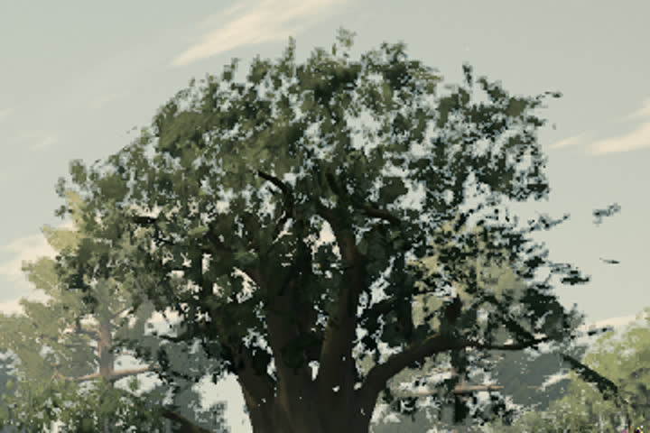
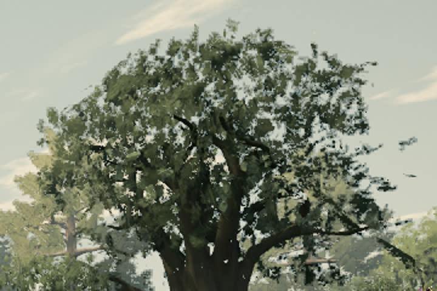
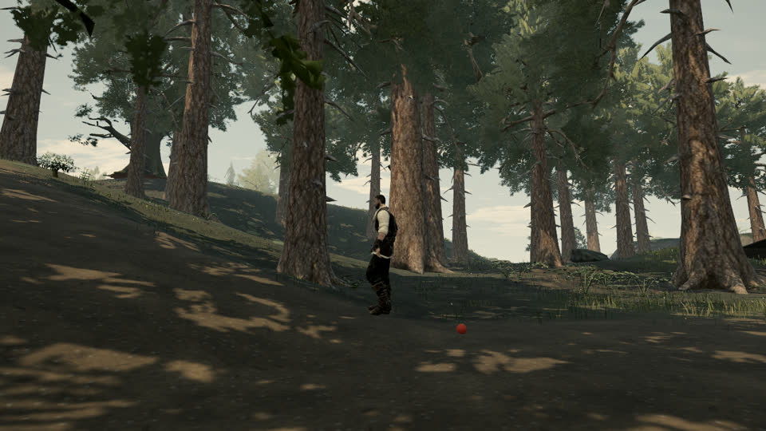
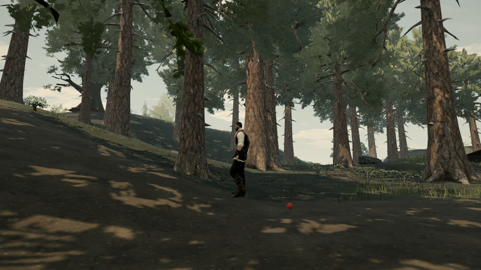
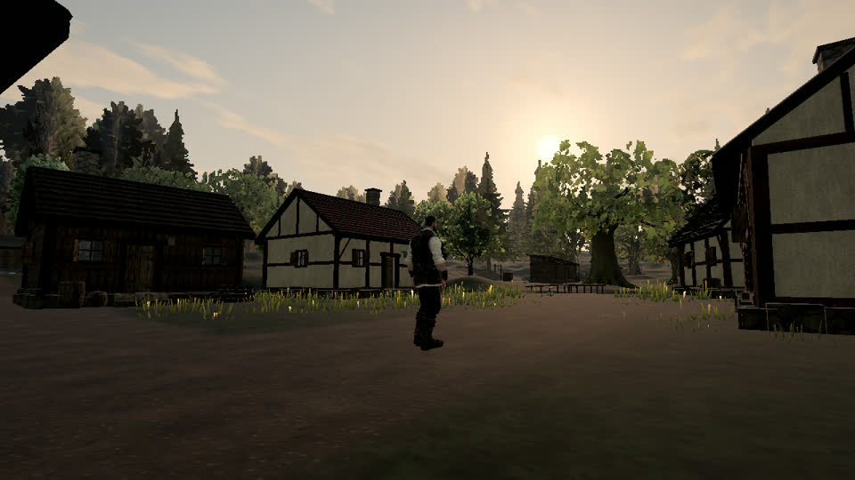

# Tree crowns and falling leaves (A127, 0.0.14 playtest item 4)

## What was wrong

Crowns at play distance read as dark, flat, noisy and blocky.

- **Not the textures.** Every leaf atlas is 1024 or 2048 px with trilinear mips and 16x anisotropy, and the leaf
  materials use alpha-to-coverage on the 4x MSAA target. Nothing is magnified or point-sampled.
- **Sparse atlases.** Each 256 px atlas view holds a few small sprigs with much empty space between them. With
  distance, the box-filtered mips thin that alpha toward the cut-off. Many card pixels then fall just below it, and
  the crown breaks into single-pixel sky speckles and ragged, stair-stepped holes. The per-mip alpha lift (A69, 0.12 per
  level) was too weak for these atlases.
- **Dark undersides.** The crown normal tilted up only slightly, so the lower half of a crown faced the ground half of
  the sky light. Those leaves are also in the crown's own sun shadow, so they kept only ambient light, further dimmed
  toward the heart (innerShade 0.82). The lower crown and its interior went near-black.
- **Falling leaves.** Each falling leaf had one flat cream-green tone across its whole fan, and read as an untextured chip.

A test of snapping alpha-to-coverage to whole samples, against a possible driver dither, made no visible difference
on the GPU. It was dropped.

## What changed

All in the existing leaf program and its uniforms. No new pass, texture or triangle.

- `foliageMaterial.ts`
  - The alpha lift per mip level rises from 0.12 to 0.22. Distant crowns keep their body, with fewer sky speckles
    through them. A75 and A107 left the near edge ramp unchanged.
  - The crown spheroid's upward bias rises from 0.12 to 0.45 (over the vertical radius). The underside now takes more
    of the sky's half of the ambient light, and the crown still shades from its top to its bottom.
  - `innerShade` rises from 0.82 to 0.95 and `shadeThrough` from 0.55 to 0.8. A crown's heart and its self-shadowed
    leaves keep more light, so the crown reads as one lit mass. The A79 clump settings stay off.
- `fallingLeaves.ts`: the blade's two halves differ in tone, and its margin, tip and stalk fall darker, so a midrib
  shows. Per-leaf tints range from summer green through yellow to russet. They were one pale cream before.

## Before and after

Served builds of main and of this change, captured on the GPU (High, 1280x720).

| View | Before | After |
| --- | --- | --- |
| Overlook oak, 11:00 (crop) |  |  |
| Deepwood pines, 11:00 |  |  |
| Rillford, Low, 07:00 |  |  |

## Not addressed

The stump or blob seen poking out of the ground was not found in these views and is unchanged here.
