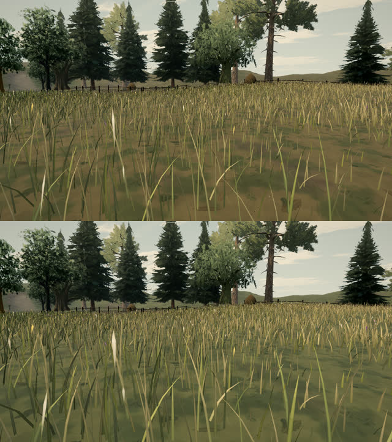
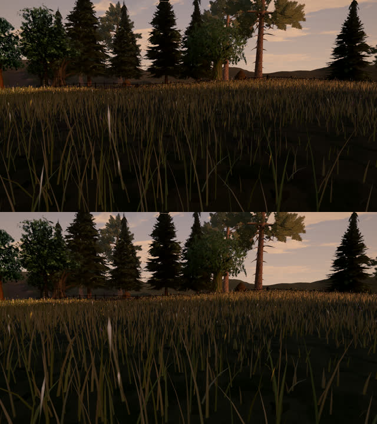
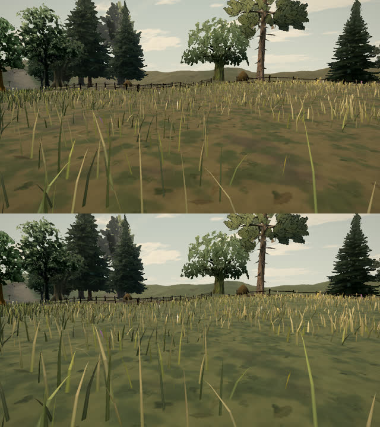
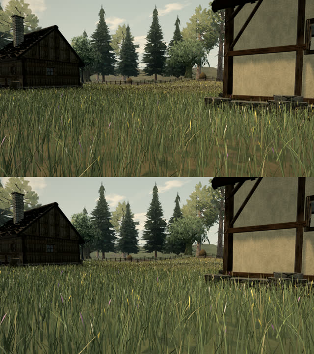

# A full, evenly lit meadow (A128, 0.0.13)

Standing in the Rillford meadow, the grass near the camera read as thin pale blades over olive-brown ground, while a
dense band further out looked like a ring around the player. Neighbouring tufts leant over together in the wind, and
at dusk the near field went very dark.

**What was wrong.**

- The ground under the meadow was the grass and heath layers' own ochre, only darkened (the A61 "sward floor"). Between
  near blades, which are narrow and seen from above, that read as bare dirt. The far level's blades are wider and seen
  at a grazing angle, so it covered its ground and looked denser.
- Near blades were 15 mm wide on High and narrowed to 60% within 5 m of the eye (A79), so the near field had little
  cover for its blade count.
- Every clump in a gust had the same stiffness and wind phase apart from its blades' own flutter, so whole patches
  sheared over in lockstep.
- Blade normals leant only 26% toward the sky; in shadow (most of the near field at dusk) the sky light reached them
  weakly.

**Change.**

- Terrain: where the grass and heath layers lie, the floor takes the blades' green at its own brightness (72% of the
  sward share) with a lighter shade multiply (0.84, 0.86, 0.8 instead of 0.7, 0.76, 0.6). Gaps read as low growth.
- Near blades are wider: High 0.015 → 0.019 m, Medium 0.018 → 0.022, Low 0.022 → 0.027; close to the eye they narrow to
  72% rather than 60%, still vanishing before the near plane.
- Each clump has its own stiffness (0.72–1.28) and wind phase offset.
- Blade normals lean 40% toward the sky.

Tuft counts, blades, segments, tiles, the trample field, the gust wind and the 0.88 seed-head row are unchanged, so
the triangles and instances drawn are the same on every preset (High 1.62 M, Medium 0.42 M, Low 0.16 M in the near
view).

Before (top) and after (bottom), near view at 11:00 and 18:00, Low at 11:00, and a wider view at 11:00:

What remains: at dusk the near field lies in long shadows and the shadowed ground stays dark; that is the scene's
ambient light, not the grass.
