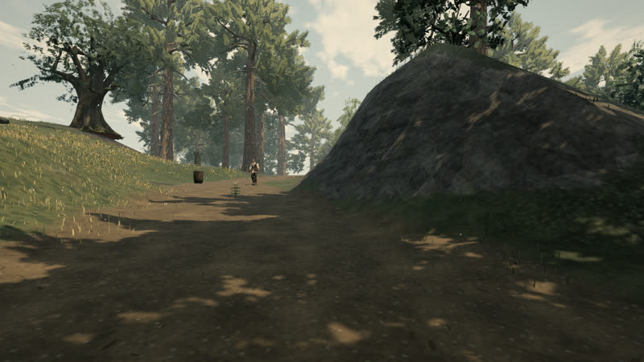
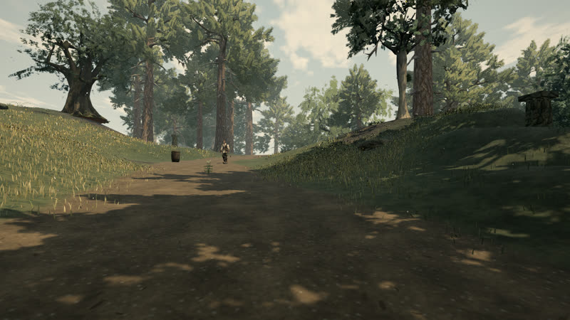

# Road banks that follow the land (A131, 0.0.15, playtest item 6)

The playtest's "smooth bare dirt mound" beside the waystation trail was not a mound. The arrival trail is levelled to a
grade along its length, and that grade blended back into the land over a fixed band of 2.5 to 6.1 m from the trail's
centreline. Where the trail passes a knoll west of the waystation, the ground stood six metres above the grade 8.6 m
away, so the band left a wall of about 45°. The terrain shader paints so steep a face as bare earth.

**Change.** The blend now widens with the height it takes up (`ROAD_BANK_SLOPE` 0.45, about 24° at the steepest; at
most `ROAD_BANK_REACH` 18 m further), so a cut or fill always runs out as a slope. Beside the knoll the drop over the
six metres next to the peak fell from 6.1 m to 1.1 m. Across the world, ground steeper than 39° fell by 6%.
The full test suite passes; buildings and props keep their footing.

| Before (live) | After |
| --- | --- |
|  |  |
