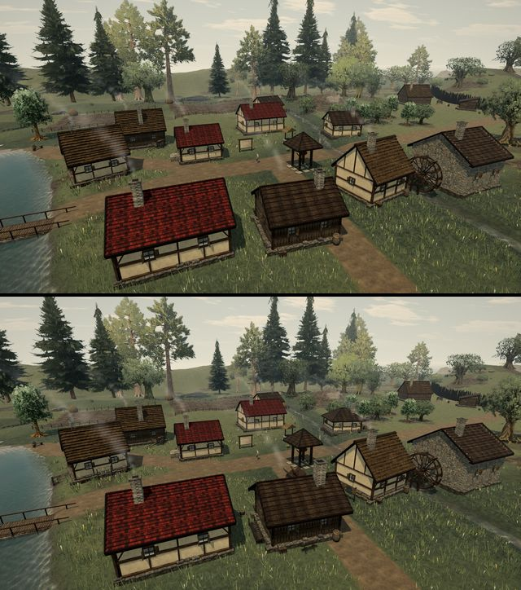
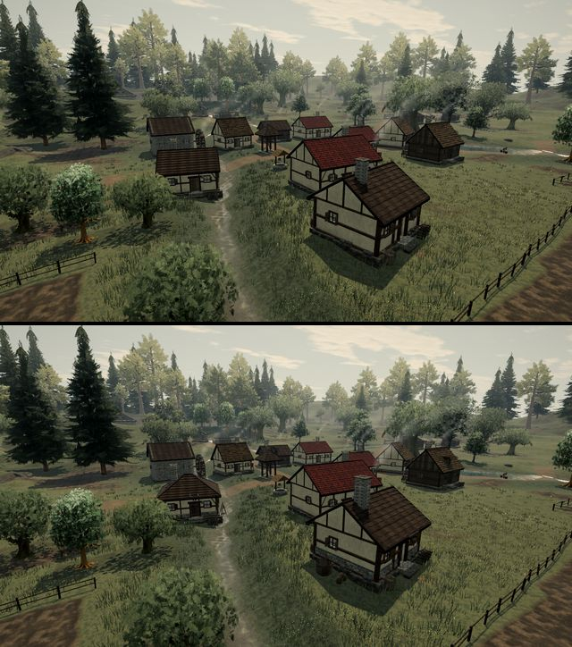
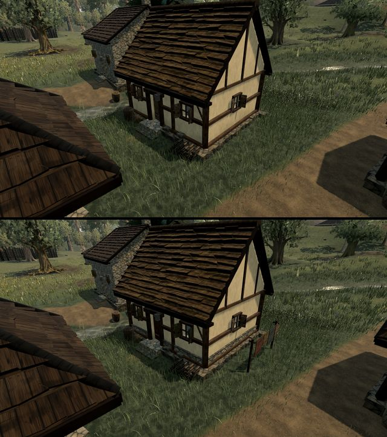
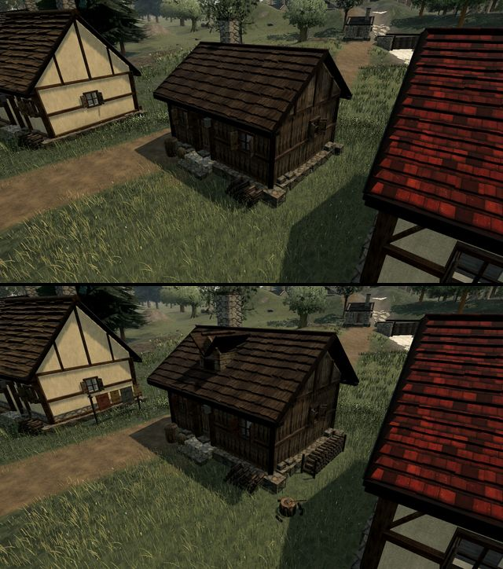
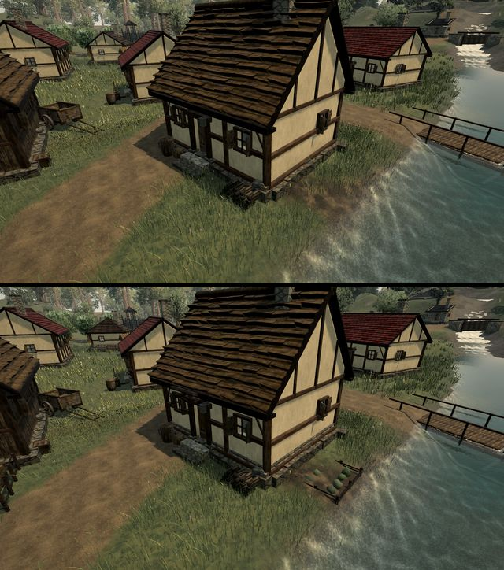
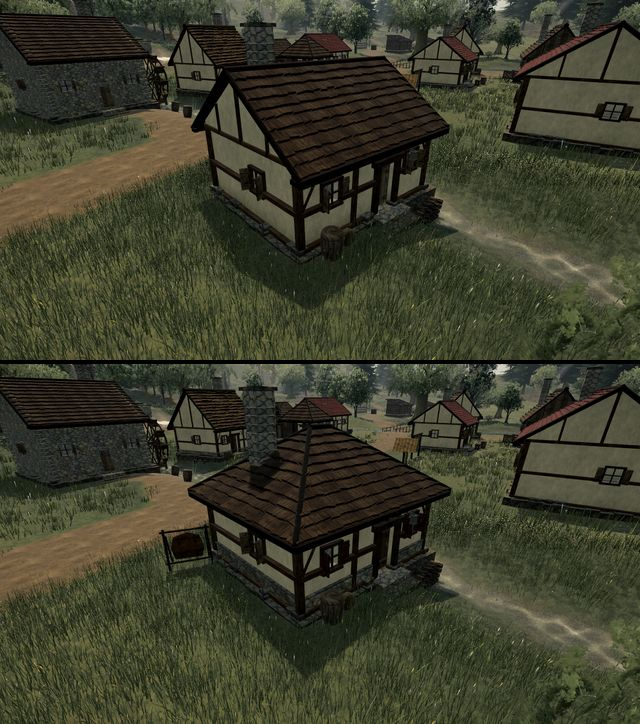
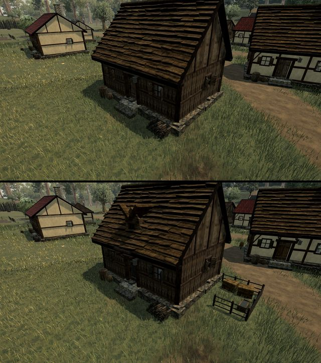
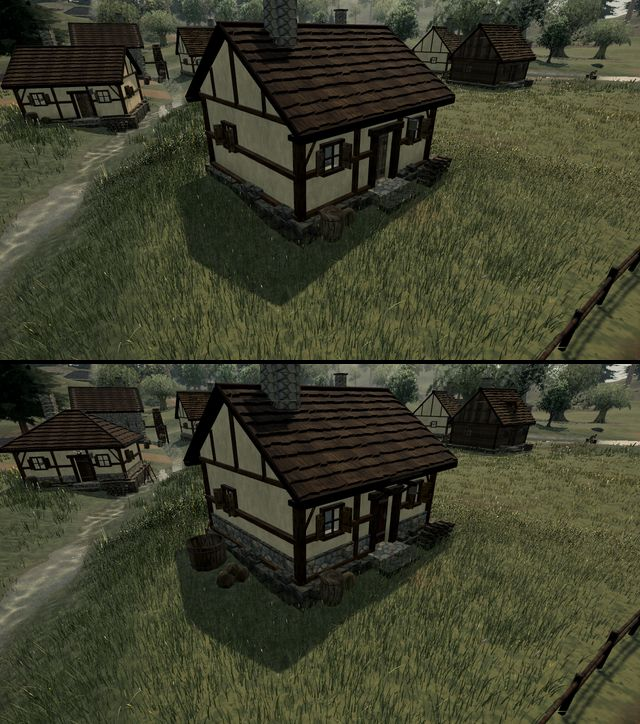

# Village houses that read as homes from outside (A132)

Playtest item: the six village houses looked like one house built six times. Inside, each one already belongs to a
household (A123). Now the outside shows it too, through the household's trade in the yard and a look of its own. All of
it is built in code from the existing materials, with no new assets.

**What each house got**

| House | Household | Yard | Look |
| --- | --- | --- | --- |
| house_a | weaver | bench by the west wall with baskets of yarn; a line of dyed cloth drying on two posts | sage shutters, madder door, stone plinth course |
| house_b | woodcutter | long stack of split logs along the east wall; chopping block with an axe in it; a sawhorse with a log behind the house | umber shutters, deep eaves, wide tall chimney, dormer |
| house_c | herbalist | small wattle-fenced herb bed; a rack of herbs drying against the back wall; two bee skeps on a stand | sage shutters, ochre door, low plinth, slim chimney, hood over the door |
| house_d | hunter | hide laced on a stretching frame; a rack of meat drying over a cold fire ring | **hipped roof**, oxblood shutters, antlers over the door, high plinth |
| house_e | farmer | fenced yard with hay bales and a trough; a cart wheel and a rake and pitchfork against the west wall | woad shutters and door, hood over the door, thatched dormer |
| house_f | brewer | three casks stacked on a cradle; a mash vat with its paddle; sacks of malt | ochre shutters, oxblood door, tall plinth, tall chimney, hood over the door |

**How it is built**

- `world/houseYards.ts` holds each trade's yard in the building's own frame. The drawing and the colliders both use it.
  Anything a walker would bump into (0.4 m or taller) gets a box collider as tall as the prop. The cloth line and the
  leaning tools have none.
- `presentation/houseExteriors.ts` holds each house's look and draws the yard. It runs on its own random sequence,
  seeded from where the house stands, so a house always looks the same. The shell's own sequence is unchanged. The
  shutter and door paints go through the same calls as before. When the hipped house skips its gable timbers, it still
  takes their random draws, so its windows, shutters and clutter fall where they did.
- Footprints, doors, windows, rooms, furniture and the room colliders are untouched. The hipped roof and the eaves are
  drawn only, and the roof collider still covers the footprint. A dormer rises from inside the roof, above the room's
  ceiling, so nothing of it shows indoors.
- Everything merges into the village region's existing batches, so the draw count stays the same.

**Checks.** `tests/world/houseYards.test.ts` checks that every household has a yard of its own. It also checks that
every prop stands outside the walls, off the door approach and more than 0.3 m clear of every road edge, with its
collider inside no other static collider. The shell test now expects the hipped roof on house_d.

**Cost.** The village region went from 104,774 to 111,872 triangles (+6.8%), and the whole frame from 3.43 to 3.44 million. It still has 14 meshes, and the frame still makes 356 draw calls, so the draw
count is unchanged.

Before (top) and after (bottom), at 11:00:

