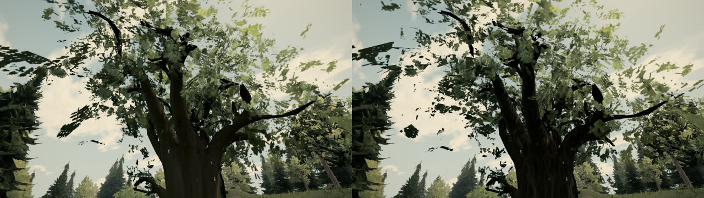
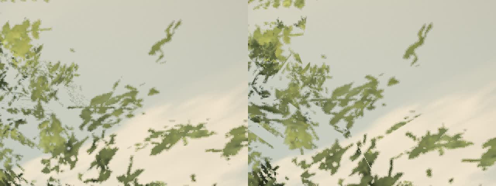
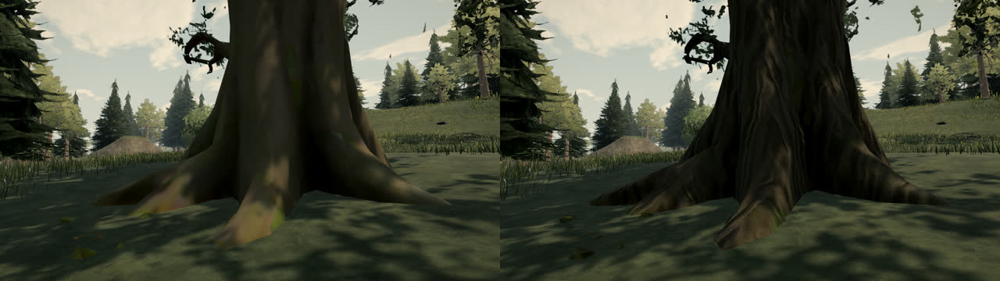
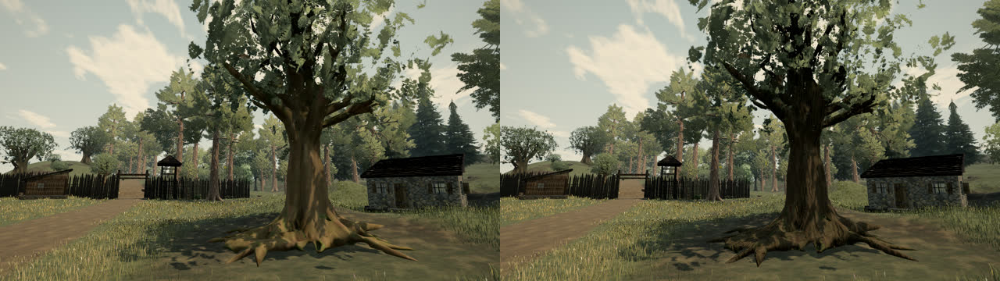
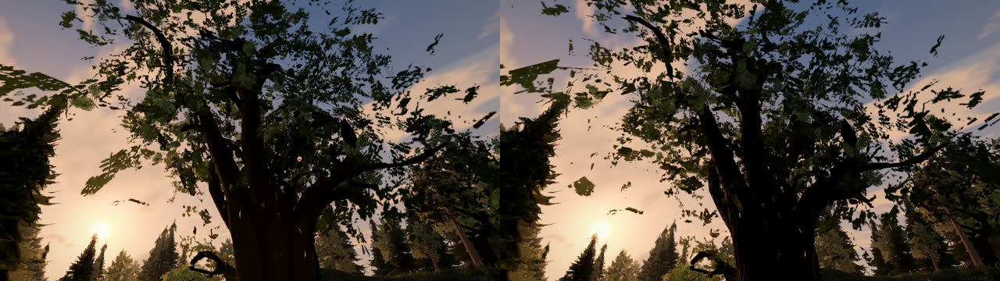
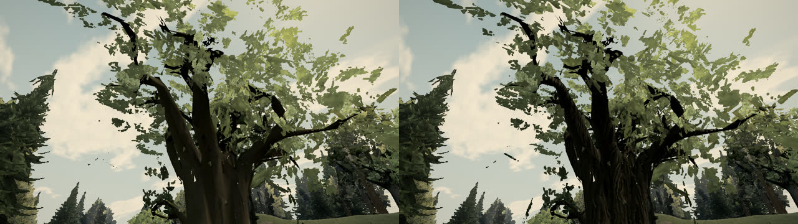

# Broadleaf crowns and bark (A133, 0.0.14 playtest)

## What was wrong

The broadleaf oaks around Rillford (the giant oak north-west of the mill and the oak by the west fence are `tree-0208`
and `oak-elder`) read as flat cut-out cards with stepped edges, and their trunks as smooth, untextured, low-poly wood.

- **Large flat sheets.** Each broadleaf crown carries two kinds of card: small cluster cards (well under a metre) and
  large curved sheets, 7 x 7 vertex grids 5-8 m across, set along the crown's axes. About half the crown's triangles are
  in these sheets. Each holds one leaf picture, so close up a sheet reads as a single flat cut-out.
- **The inner layer copied them.** The near crown's added layer (A70/A79) is the same cards turned about the crown's
  heart, so it added a second copy of each large sheet.
- **Alpha-to-coverage is active.** Every crown material draws with alpha-to-coverage into the 4x multisampled grade
  target on High and Medium, and the shadow copies cut at the leaves' own threshold. The edge ramp was already centred
  on the cut-off. What reads as steps is (a) the five coverage levels of 4x MSAA along long card edges, and (b) up close,
  bilinear alpha cut at a threshold, which traces each magnified texel. On Low (no MSAA) the cut was a hard discard.
- **No bark detail.** The source trunks carry one soft baked colour atlas and no normal map. The metre-scale bark that
  the procedural trees and pines use was never applied to them.
- **No depth.** Ambient light at a crown's heart was left at 0.95 of the open (A127), so a crown lit as one even sheet.

## What changed

- `meshyTrees.ts`
  - `splitSheets`: near and middle broadleaf crowns cut every sheet over 3 m into pieces of whole grid cells about 2 m
    across. Each piece gets its own vertices, is pushed up to 0.35 m in or out along the sheet's normal and tilted up to
    7 degrees. A sheet becomes a loose volume of smaller cards. Triangles, UVs and normals are unchanged.
  - The inner layer is built from the cut pieces. Each card is drawn at 0.85 of its size and spun about its own face
    (`shrinkClusters`), so the layer adds separate clusters, not a turned copy of the same sheet. At 0.6 the crown lost
    too much cover on the GPU.
  - Oak, orchard, shrub and dead trunks take the metre-scale triplanar oak bark (`installBarkDetail`, 1024 px). It
    mixes in at 0.6 with 3.5 cm of relief, against the procedural trees' 0.45 and 1.2 cm.
- `treeMaterials.ts`: `installBarkDetail` takes an optional mix and relief. The defaults and program key are unchanged.
- `foliageMaterial.ts`
  - Where the atlas is magnified, leaf alpha is read with a cubic B-spline (four taps), so close leaf outlines are
    smooth curves rather than texel diamonds.
  - Alpha gains 1.3x before the cut. The atlases are feathered (A110), so leaves grow into their soft margin.
  - A stable screen-space dither of a quarter coverage step inside the edge ramp spreads the 4x MSAA levels into a smooth
    gradient. Low (no MSAA) dithers its cut over about a pixel and a half of alpha. Both are fixed to the pixel grid,
    with no temporal noise.
  - `innerShade` drops from 0.95 to 0.72. A crown's heart is darker than its shell, and with the A127 sky bias on the
    crown normal it never goes black.

## Cost

There are no new triangles, draws or passes. Rillford, under the giant oak, 1280x720, on the GPU:

| Preset | Foliage tris (before / after) | Foliage draws | Frame tris (before / after) |
| --- | --- | --- | --- |
| High | 461,632 / 461,632 | 9 / 9 | 2,892,622 / 2,891,974 |
| Medium | 458,996 / 458,996 | 13 / 13 | 2,325,638 / 2,325,398 |
| Low | 92,409 / 92,409 | 13 / 13 | 605,218 / 605,104 |

The cut sheets add vertices only, about 1,600 per near broadleaf. The cubic alpha costs four extra texture reads, and
only where the atlas is magnified. The extra bark texture is generated once and shared with the procedural oaks.

## Before and after

Served builds of main (left) and this change (right), captured on the GPU.

| View | Before / after |
| --- | --- |
| Giant oak crown from below, 11:00 |  |
| Crown edge, full-resolution crop (2x) |  |
| Giant oak trunk |  |
| West-fence oak |  |
| Crown, 18:00 |  |
| Crown, Low |  |

A 90-frame walk from the mill to under the giant oak, recorded for before and after, showed no shimmer or crawl from
the dither.

## Not addressed

- **Broken branch tips.** The giant oak's upper branch tips are flat, jagged shards. They show black against the sky
  from below. They are in its wood mesh, which is an open shell in the source as well as in the simplified near model.
  A runtime filter (thin, flipped or open-edged triangles) cannot single them out. They need a remodel or a re-export
  of that tree's wood.
- **Seams between cut pieces.** Pieces of a cut sheet show straight edges where they part in depth.
- **Long-edge aliasing at a distance.** Minified leaf detail still aliases at one sample per pixel along long edges.
  Better would need more samples or a per-mip coverage-preserving alpha for the atlases.
- **Darker trunks.** Trunks read darker than before, because the bark albedo pulls the warm atlas toward grey-brown.
