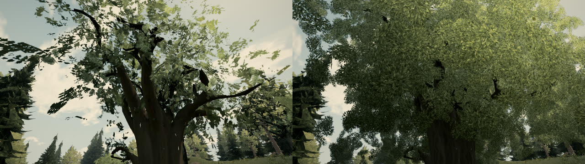
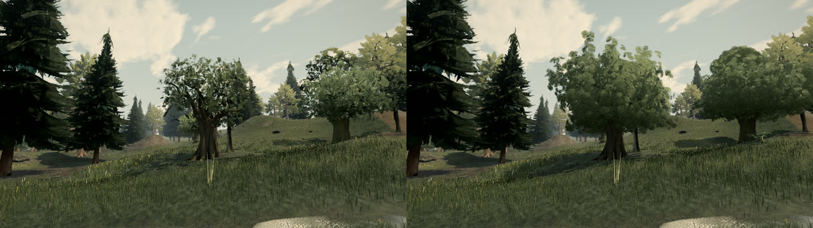
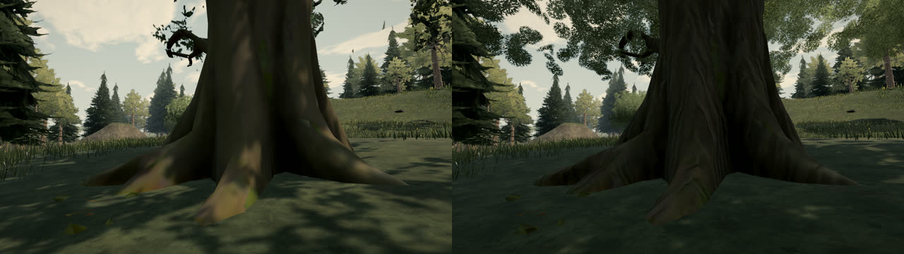
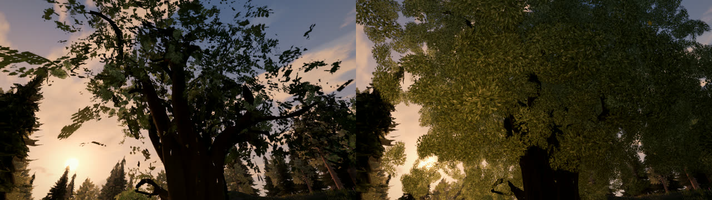
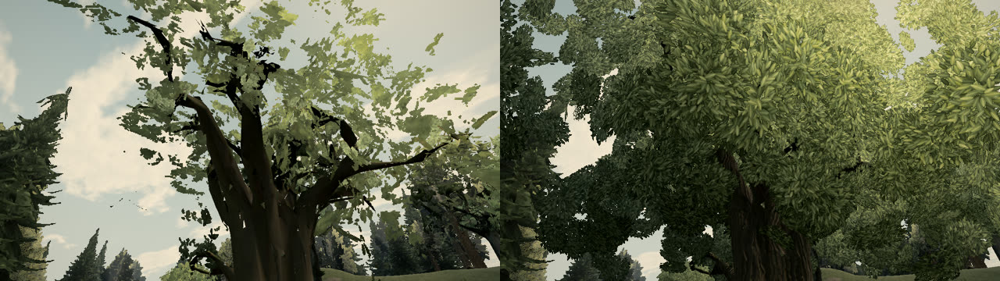
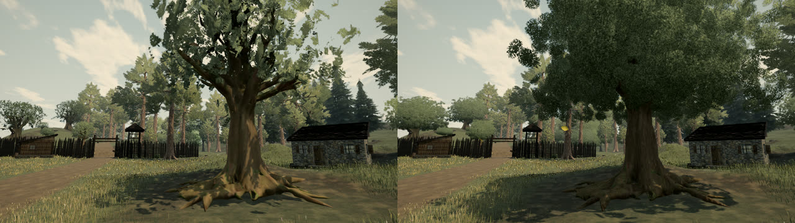

# Cluster canopies for broadleaf trees (A134)

## What was wrong

A133 cut the broadleaf crowns' large leaf sheets into 2 m pieces, but the crowns still read as sparse, floating card
clusters with sky through large holes. About half of each source crown is curved sheets 5-8 m across, each carrying one
leaf picture. Cutting them up keeps the same picture and the same holes. The crown needs a different representation.

## What changed

- `canopy.ts` (new)
  - `buildCanopy` rebuilds a near or middle broadleaf crown from many small leaf-cluster cards. The source crown is used
    only as a density field: clump centres are drawn from its leaf surface, area-weighted and kept a minimum distance
    apart. The wood's outer branch tips (`branchTips`) are claimed first, so every bough end sits inside a clump.
  - Each clump has several crossing cards, set on its outer face, facing outward and upward, with random roll. No clump
    reads flat from any angle. The outer shell takes the full share of cards and the heart about a third. Most samples
    in the heart and the lowest fifth of the crown are skipped, so trunk and boughs show beneath the canopy. Clumps are
    pulled in by part of their radius, which keeps the source crown's outline.
  - Vertex normals blend the clump's sphere, the crown's outward direction and the card's own facing, so clumps shade
    as rounded masses.
  - The result is deterministic per tree and LOD (the seed comes from the asset id) and is cached with the variant. It
    carries the replaced cards' attributes (position, normal, uv), so wind, shadow casters, distance fades, water
    reflections, leaf sites and falling leaves work unchanged.
  - `trimExposedWood` drops wood triangles above the crown's lower part that are clear of every canopy card. This
    removes the giant oak's flat, open branch-tip shards where they poke out of the crown. Shards inside the crown are
    covered by the tip clumps.
  - `canopyAtlas` / `canopyAtlasTexture` build a procedural 1024 px atlas of 2 x 2 dense leaf clusters at load. It
    holds about 340 small pointed leaves per cluster in olive greens, with a lighter midrib and darker edges. Back leaves
    are darker than front ones, and leaves thin toward the cluster rim for a soft edge. Its mips are box-filtered with
    alpha-weighted colour. Each mip's alpha is then scaled so the share of texels past the cut-off matches the full-size
    level (coverage-preserving mips).
- `meshyTrees.ts`
  - Oak, birch and orchard near and middle LODs use the cluster canopy and a leaf material on the shared atlas. Far
    LODs keep the source cards.
  - Near crowns have up to 6,000 cards, within the 19,800-triangle tree budget. Middle crowns have 1.2x the source
    middle crown's triangles, in fewer, larger cards (1.0-1.9 m against 0.6-1.2 m).
  - Broadleaf bark mix is 0.4, down from 0.6. Trunks were too dark.
- `foliageMaterial.ts`: materials with coverage-preserving mips (`TV_COVERAGE_MIPS`) skip the per-mip alpha lift. The
  sharpened alpha-to-coverage ramp (High/Medium) and the stable screen-space dither (Low) are unchanged.
- `flora.ts`: a leaf material can carry its own foliage look. Cluster crowns use crown normal 0.6 (from 0.85), so
  each clump shades round within the crown's overall light.

## Cost

Rillford, under the giant oak, 1280x720, on the GPU. Before is A133.

| Preset | Foliage tris (before / after) | Foliage draws | Frame tris (before / after) |
| --- | --- | --- | --- |
| High | 461,632 / 443,624 | 9 / 9 | 2,891,974 / 2,886,474 |
| Medium | 458,996 / 440,988 | 13 / 13 | 2,325,398 / 2,316,740 |
| Low | 92,409 / 98,606 | 13 / 13 | 605,104 / 610,314 |

There are no new draws or passes. Building the atlas and the canopies happens once per load, per tree variant.

## Before and after

Live build (left) and this change (right), captured on the GPU.

| View | Before / after |
| --- | --- |
| Giant oak crown from below, 11:00 |  |
| Giant oak from the mill path |  |
| Giant oak trunk |  |
| Crown, 18:00 |  |
| Crown, Low |  |
| West-fence oak |  |

A 90-frame walk from the mill to under the giant oak was recorded before and after.

## Not addressed

- Up close, single leaves in the atlas are visible as a regular, slightly busy texture. A second atlas variant with
  larger leaves, or a normal map, would help.
- Trunks are still darker than the live build's untextured wood in shade.
- The giant oak's shards inside the crown are hidden, not repaired. The wood mesh still needs a re-export.
- Birch and orchard crowns use the same oak-like cluster atlas.
