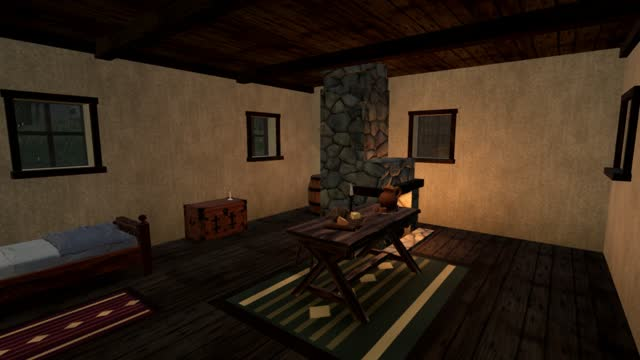
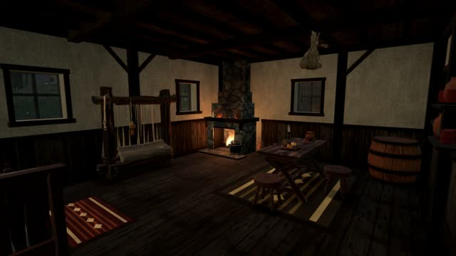
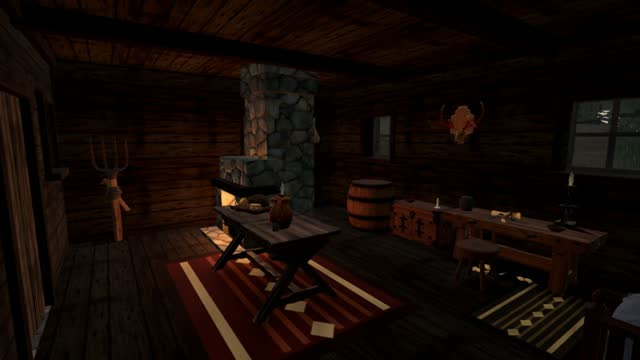
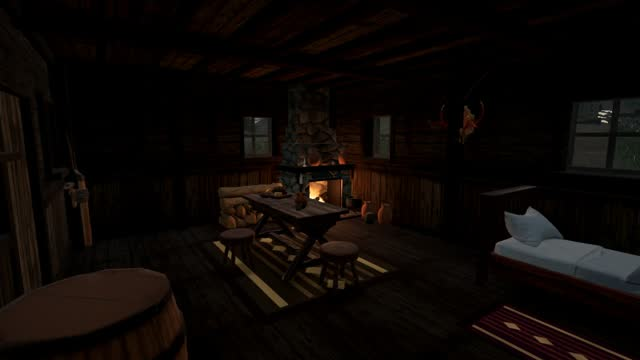
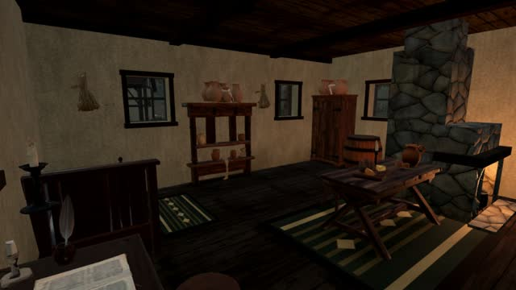
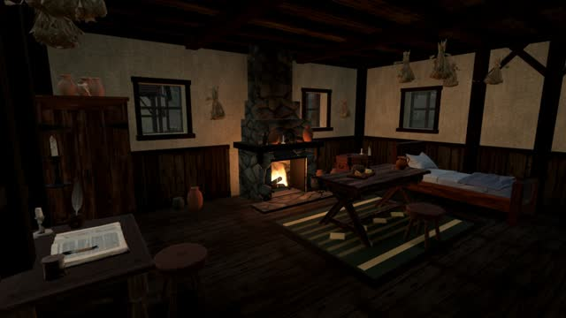
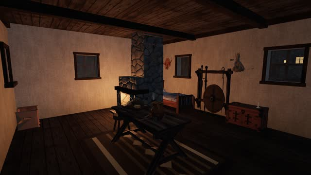
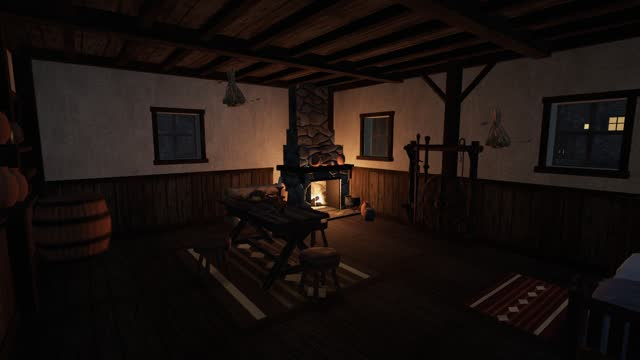

# A135: Gothic interiors

The village houses read as clean plaster boxes with their furniture spread out evenly. Each fireplace stood free in
the room as a stone column, and the clay jars were knee-high. This change moves the rooms towards the Gothic 3
house interiors: exposed timber, crowded walls, warm low firelight and a fire you can see burning.

## Hearth

- **Against a wall.** `HEARTH_AT` (src/world/interiors.ts) now names a wall and a place along it. Each hearth is a
  chimney breast that stands 0.3 m out from the wall's inner face. Its stack is centred inside the wall, on the same
  centre (`chimneyOf`) as the exterior chimney, which now rises from the ground as a stone breast proud of the wall
  and then on up through the roof. Chimney smoke uses the same centre. The side-wall hearths sit in the back corner.
  Where one shares a wall with a side window, `sideWindowZ` moves that window forward, clear of the chimney. The
  back-wall hearths sit between the two back windows.
- **Open hearth.** Stone piers, a soot-black firebox, an ash bed with firedogs and logs, a stone lintel, a timber
  mantel shelf with a few things on it, a stone hood that narrows into the breast, a hearthstone, and the cooking pot
  on an iron trivet at the side of the mouth (`HEARTH_SHAPE`, `HEARTH_DRESS`).
- **Fire.** `presentation/hearthFire.ts` draws every fire in the valley in one additive draw: three crossed flame
  cards per hearth over a breathing ember bed. The flames are shaped by noise in the shader, so only the clock is
  uploaded each frame. The room's light flickers within ±15 % (`interiorFlicker`) and never moves, so a shadow map, if
  one is drawn, never has to follow it.
- Colliders and furniture reservations use the breast's footprint inside the room (`hearth.breast`).

## Room structure

`roomFrame` (presentation/buildings.ts) adds corner and wall posts with knee braces up to the wall plates, ceiling
joists every 0.6 m (`joistsOf`), and a plank wainscot to waist height with a rail and a skirting. Posts keep clear of
the windows, the doorway and the hearth. Everything is merged into the building's shell and uses the existing
weathered timber and plank textures.

## Light and grime

`roomShade` multiplies the vertex colour of everything drawn inside a room through a new `Ctx.shade` hook. Floors
darken towards the walls, walls darken towards the floor and the ceiling, the corners darken most, and the side of the
room away from the fire is a little darker. The hearth's wall is smoked black above the fire, and the floor before it
is dulled with ash. The room floor and ceiling are subdivided more finely so these gradients show. Furniture keeps
its existing contact shadow cards.

## Dressing and scale

- Prepared pots and jugs are drawn at 0.62 and 0.68 scale (`MODEL_SCALE`), so the pots stand about 26 cm and a jug
  about 20 cm. New code-built small things (jar about 30 cm, bottle, spool, plus the existing bowls, cups, pots and
  candles) crowd wall shelves on brackets, with a second board below where nothing stands under it. They also line the
  mantel and stand in groups in the floor's corners. Bunches of herbs hang from the joists over the tables and the work.
- Each household's furniture is grouped around its own hearth (`HOUSE_PLANS`):
  - **Weaver (house_a).** Hearth in the right back corner. The loom stands under the back windows, the bed and chest
    in the left corner, the table by the fire, and wool and a cupboard by the door.
  - **Woodcutter (house_b).** Hearth in the left back corner. Split wood is stacked by the fire, the workbench and
    tools are along the right wall, the bed is in the right back corner, and the table is at the fire.
  - **Herbalist (house_c).** Hearth on the back wall. A cupboard of jars is in the corner, the writing desk by the
    left window, the bed along the right wall, and seven herb bunches hang from the joists.
  - **Hunter (house_d).** Hearth in the left back corner. The rack of bows and snares is on the back wall, the bed and
    chest are on the right, and a big table and firewood are by the fire.
  - **Farmer (house_e).** Hearth on the back wall. The bed is in the left back, the children's bunk in the right back,
    a table for four is at the fire, and sacks and tools are along the walls.
  - **Brewer (house_f).** Hearth on the back wall. Barrels stand in a row, a cupboard of jugs and the workbench are
    along the walls, and the bed is by the front.

## Before and after

| Before | After |
| --- | --- |
|  |  |
|  |  |
|  |  |
|  |  |

## Cost

Measured on the GPU from the same corner in each house: 330–470 draw calls and 3.8–6.4 M triangles per frame for
the whole view, which includes the village seen through the open windows. This is in line with or below the live
build (310–720 calls, 3.5–8.9 M). The fires are one draw for the whole valley, and the shelves, brackets and new
vessels add one instanced draw per kind.

## Still short

The walls above the wainscot are still plain plaster with no framing between the posts. The rugs are the only
textiles. Shelf contents are generic vessels rather than trade tools. The contact shading on the upper plaster is
only as fine as the shell's 0.7 m wall cells.

## Tests

`tests/world/hearths.test.ts` checks that every breast stands on a wall's inner face, that its stack sits in the wall
on the exterior chimney's centre, and that each house has its own hearth place clear of the doorway and the windows.
It also checks the light's position and flicker, one fire per hearth, believable vessel sizes, and the dressing
density per house.
