# A136: fuller hearth rooms and the inn's sign

Playtest 7 scored the hearth room 8 and the inn's hanging sign 8.5. The rooms had their hearth, fire, pot and mantel
but still read sparse: wide bare plaster above the wainscot and little on the walls. The sign was a plain board on a
bar. This change works on both, keeping the rooms as cheap as they were.

## Rooms

- **Framed walls.** `roomFrame` (presentation/buildings.ts) adds studs between the posts, about 0.8 m apart, from the
  wainscot rail to the plate. Walls with windows also get a sill girt at the windows' sill line, wall to wall, stopping
  at each window's frame. A first version ran a rail at 2.05 m that read as a cross nailed beside each window. The
  timber avoids windows, the doorway and the hearth, and is merged into the shell.
- **Plaster.** The plaster walls are cut into 0.3 m cells (were 0.7 m) so `roomShade` can colour them per vertex. The
  lime wash is uneven (value noise), each panel between studs has its own shade, the plaster darkens under the
  ceiling, and soot spreads round the hearth. The boards overhead are dark between the joists. No texture or draw is
  added.
- **Ceiling.** The tie beams are heavier (0.26 by 0.29 m) and the joists deeper (0.12 by 0.15 m), with the boards
  between them shaded dark. The ceiling stays closed at the wall top.
- **Things hung up.** World/dressing.ts adds peg rails (`RAILS`, one strip with six pegs) hung with each household's
  things: pans, ladles, sickles, coils of rope, axes, a frame saw, baskets and strings of onions (`HungKind`). The
  first rail looks for wall near the hearth. Rows that find no free wall hang from the ceiling joists instead, in a row
  near the hearth and never over the fire. Every hearth also has a pan and a ladle on hooks under the ends of its
  mantel.
- **By the fire.** Firewood is stacked unevenly against the breast on whichever side has room (`firewood`). Some logs
  are whole and some split in half, and they vary in length and turn. One small canvas texture holds bark, sawn end
  rings and split grain. A rug lies before the hearthstone where no table rug is already there. Onions and a bunch of
  herbs hang from the joist in front of the hearth.
- **Window walls.** A short peg rail under a window's sill, where nothing stands in front of it, holds two of the
  household's tools (`WINDOW_TOOLS`).
- **Stores.** Sacks and wicker baskets stand together against a wall (`STORES`).
- **Firelight.** The fire module draws a soft pool of warm light on the floor before each hearth. It is a fourth card
  in the same additive draw, falls off with a smooth power curve and flickers with the flames. The room's point light
  now decays linearly (decay 1, was 1.25), so its warmth reaches the far walls.

All the new pieces are built in code (presentation/clutter.ts). They are a few dozen triangles each, with wood, iron,
rope and wicker told apart by vertex colour, and share one material. Each kind is one instanced mesh, shown only for
rooms near the camera, like the existing shelves.

## Sign

`presentation/innSign.ts`: the bracket moved to the east end wall near the front corner, so the board faces the street
and no longer hangs across a window.

- **Bracket.** A wrought-iron wall plate with two bolts, an arm with a curled tip and knob, a strut, and two scrolls
  between them. A ring sits round the arm at each hanging point.
- **Board.** Three boards, the top one arched, hung from four-link chains on eyes. Iron corner straps hold it.
- **Painting.** Both faces are painted with a tankard of ale (body, hoops, handle, foam) and a sprig of hops on a dark
  green ground in an ochre border.
- **Weathering.** The border has gaps, the paint has flaked to grey wood in patches, rust runs below the straps, the
  bottom edge is stained, and the lowest board has lost a corner.
- **Sway.** The board and chains are built apart from the shell (`BuildOut.apart`). They swing about the arm by
  `signSway`, a slow sway of up to about 7° that strengthens in gusts. With Reduced Motion the board hangs still.

## Before and after

Room stills are at dusk unless marked noon.

| Before | After |
| --- | --- |
| 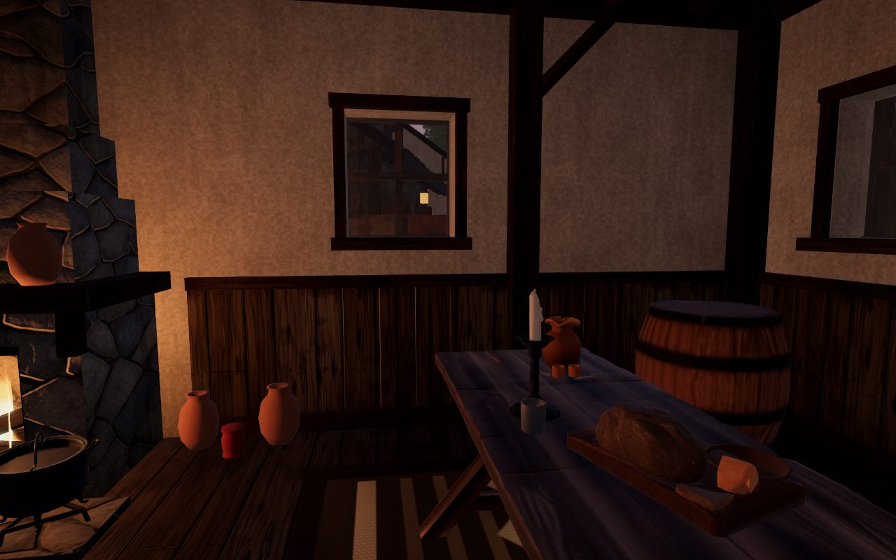 | 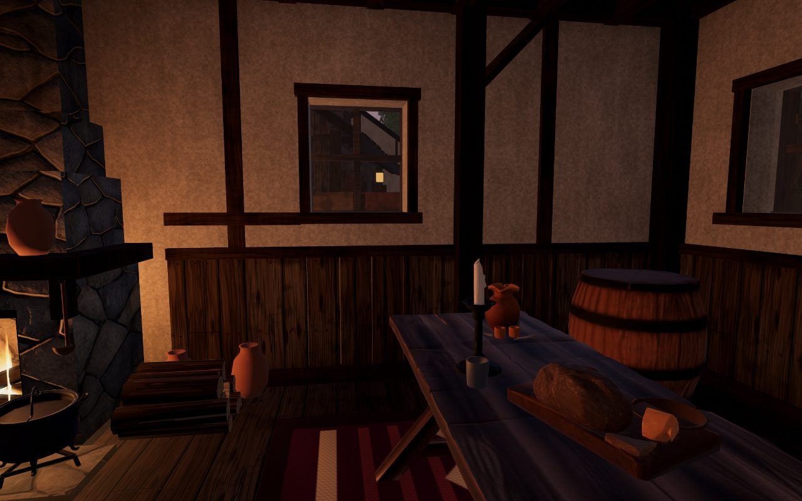 |
| 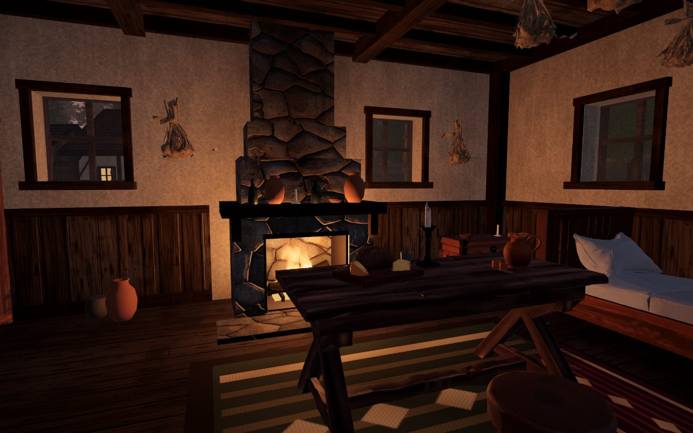 | 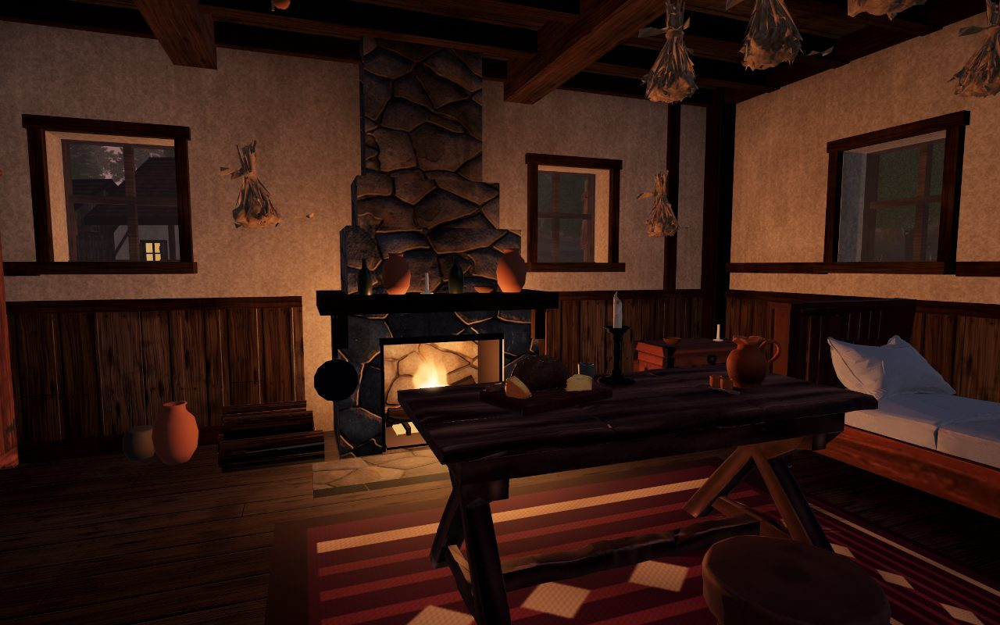 |
| 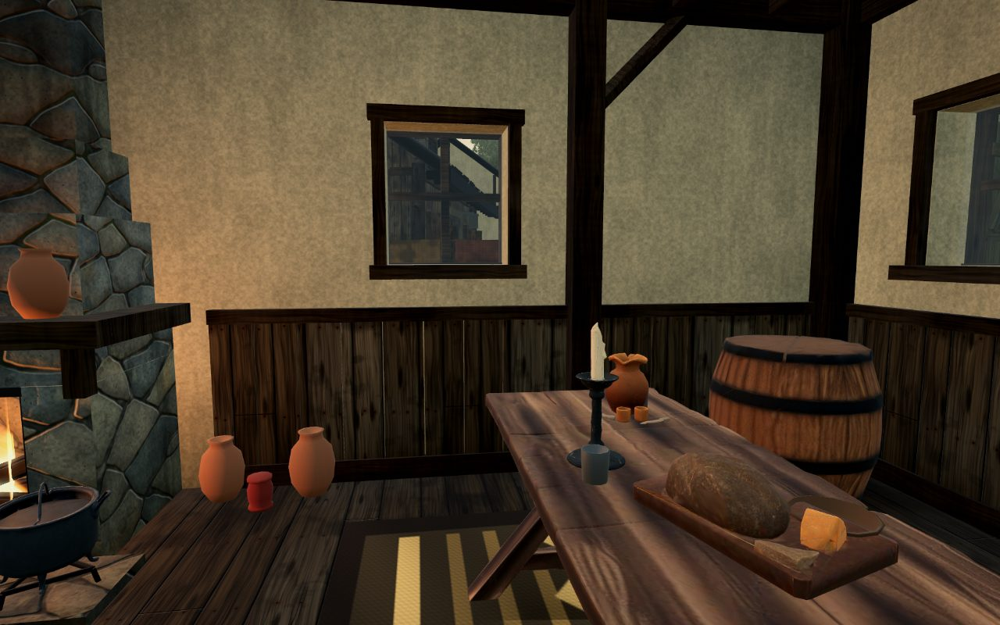 | 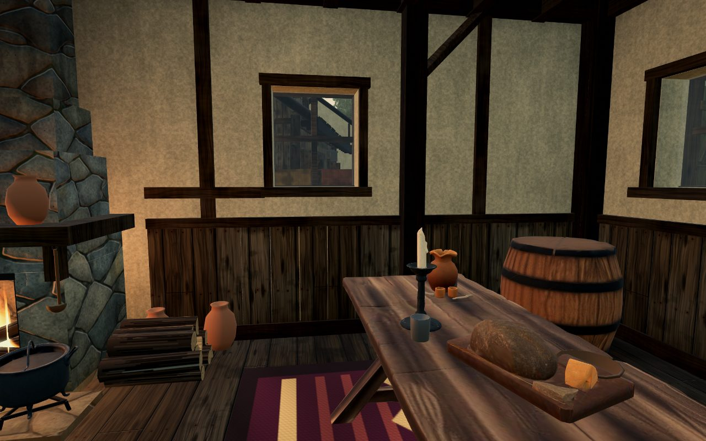 |
| 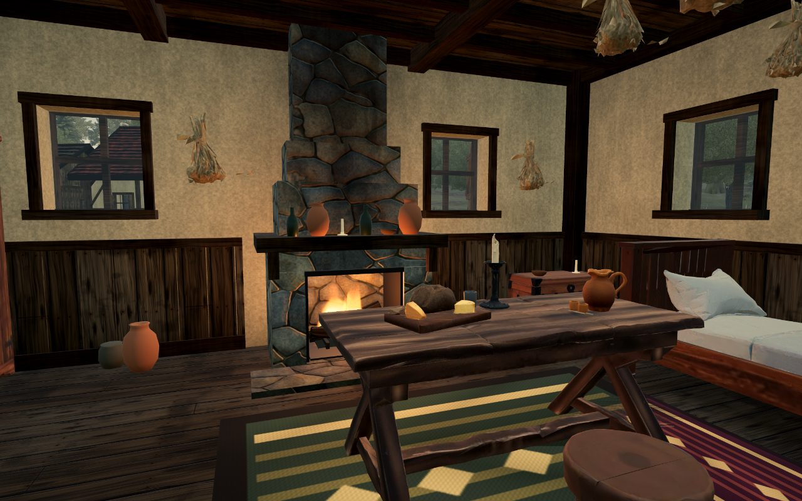 | 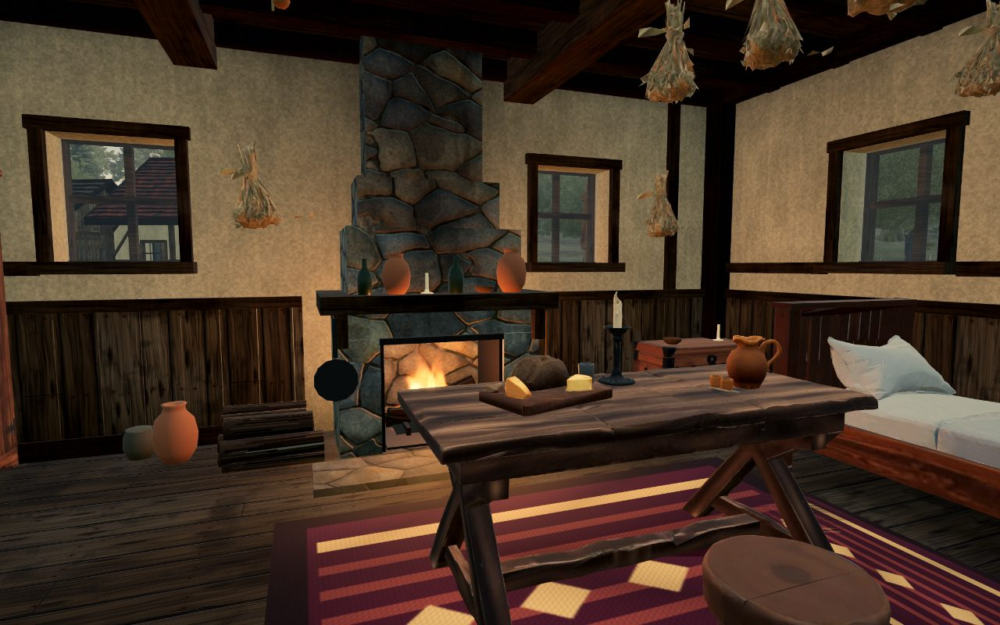 |
| 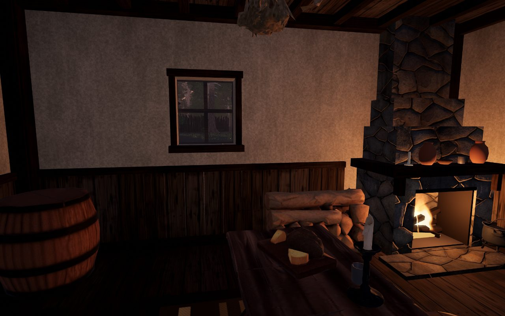 | 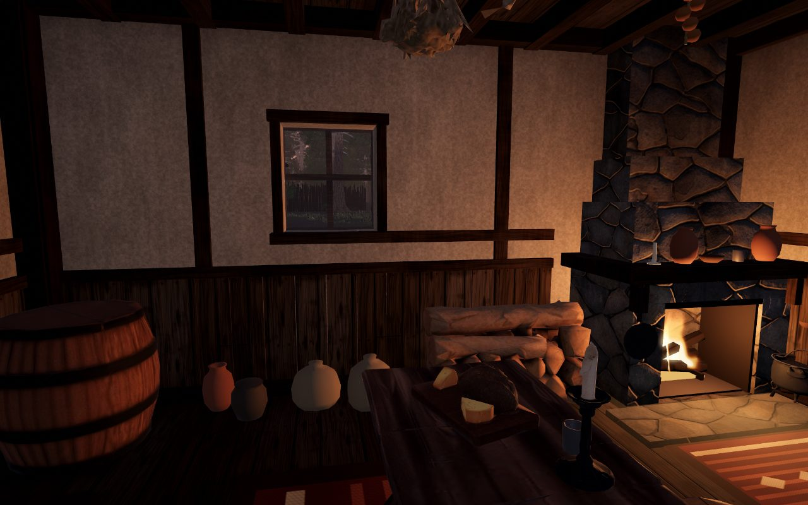 |
| 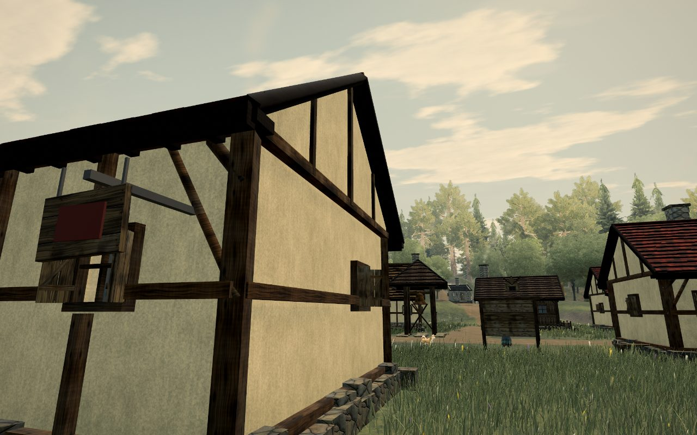 | 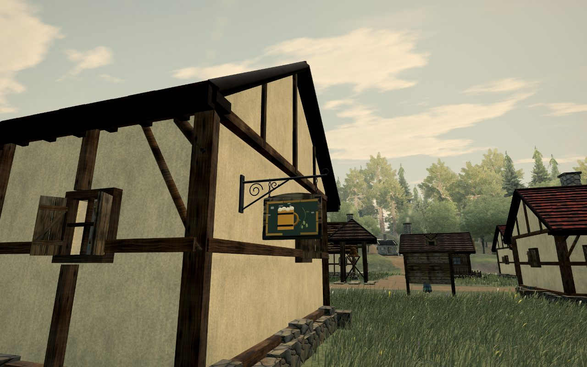 |
| 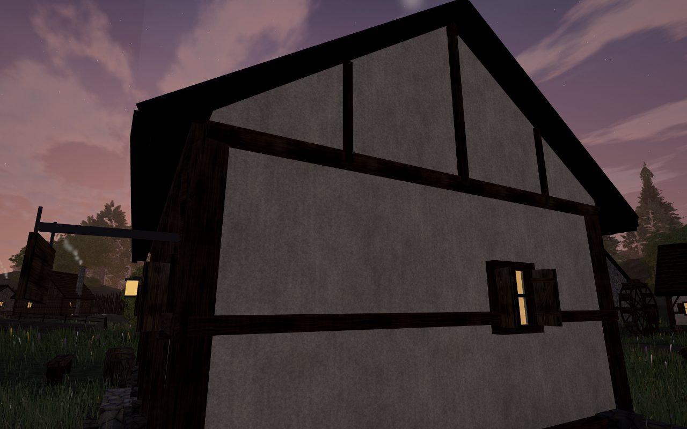 | 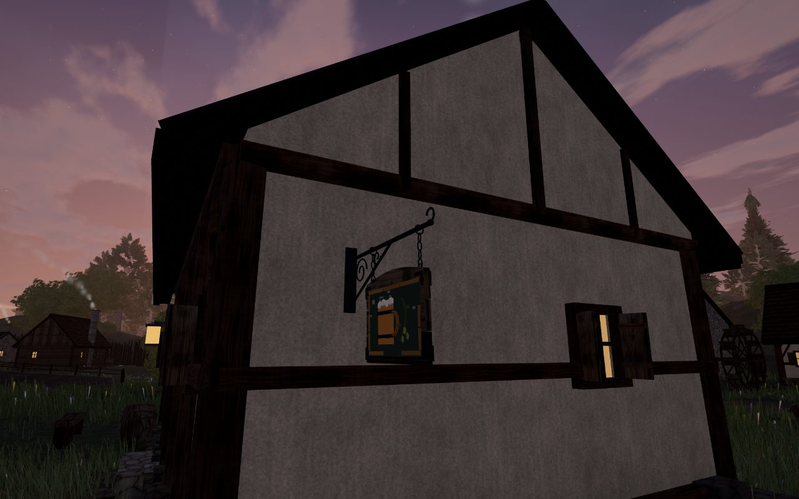 |

The visual gate has new interior spots (`room_b`, `room_c`, `room_d`, `room_f`), and its `sign` spot now looks at the
sign in its new place.

## Still short

The ceiling stays boarded at the wall top, so no rafters or roof boards show. The plaster's variation is per vertex
(0.3 m), not a baked texture, so it is soft rather than crisp. The sign's emblem is relief in vertex colour, not a
painted texture.

## Tests

`tests/world/hearths.test.ts` checks that every house has at least four hung things, each clear of the ceiling and the
floor. It checks that most hearths have firewood beside them and that the sign's sway stays under about 7° while
moving most of the time.
