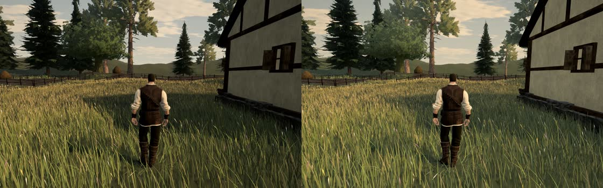
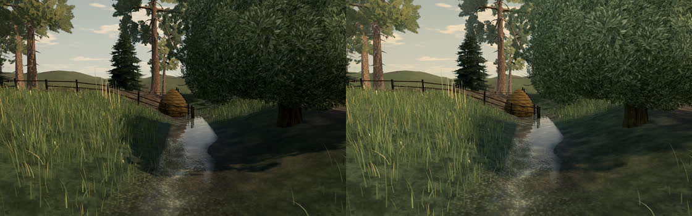
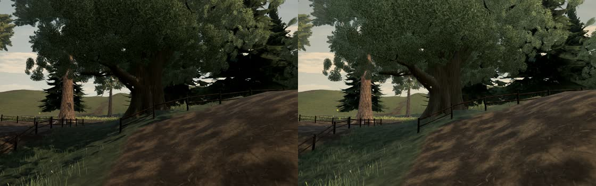

# A137: shade fill and soft sun shadows

Playtest 6 reported a hard-edged bright square of light and shadow following the hero across the ground, and near-black shade under the trees by the stream. Both came from one cause. The square was the real, static shadow of a village house under a low sun (16:30). Shaded ground was near black beside bright sunlit grass, and the shadow's edges were razor-hard and straight, so the long house shadow read as a dark slab around the hero as he walked through it. Shadow projection was correct. The fault was in the lighting.

## Changes

| Where | What |
| --- | --- |
| `softShadows.ts` (new) | A cheap PCSS for the sun built from comparison samples only. Three's PCF reads a comparison sampler, so a blocker's depth cannot be read directly. It can be bracketed instead: a comparison made 2 m or 7 m nearer the light than the receiver says whether the blocker stands at least that far above it. Five rotated taps across the widest penumbra (0.42 m), plus the pixel's own tap, tell whether the pixel is near an edge at all. Pixels that are fully lit or fully shaded stop there, at six taps where Three's PCF uses five. The pixel's own tap keeps a thin shadow, such as a rail or a blade, from being lost between the ring's taps. Near an edge, the two brackets estimate the distance to the caster, and an eight-tap disc of 2.8 cm per metre of that distance (at least 3.5 cm) gives the edge. Contact shadows from feet, fence posts and roots stay crisp, and a house shadow 15 m from its eaves gets a soft edge. The patch applies only to a shadow whose `radius` is negative (the sun's), so any other shadow keeps Three's PCF. |
| `sky.ts` | The sun uses it (`shadow.radius = SOFT_SUN_SHADOW`). By day the hemisphere fill is 4.5× its former value (`DAY_FILL_LIFT` 3.5) and the sun is at 0.88 (`DAY_SUN_SCALE`). Both fade out with `day`, so dawn, dusk and night are unchanged. When the sun is low, its shadow blocks 0.78 of the sun's light (`LOW_SUN_SHADOW`) instead of all of it: long evening shadows sit under a wide, bright sky. `SKY.ambient` (water) is unchanged. |
| `environment.ts` | The generated sky's image-based light is 1.12× by day (`ENV_DAY_LIFT`). A first pass lifted it further and greyed the whole frame. It also made the mottled ground texture under near grass read as blue and orange smears, which was not a shadow artefact: the same frame with Three's hard PCF looked the same. |
| `terrainMaterial.ts` | Under a crown, ground keeps 0.86 of the sky's diffuse light (it was 0.74), so the stream bank under the mill's oak is not a pit. |
| `grade.ts` | By day the sunlit tint is a touch warmer and saturation is 8% higher, so sunlit grass stays warm and golden against the bluer shade. Night is unchanged. |

The earlier experiment of a uniform `shadow.radius` of 1.5 to 2.5 washed out thin casters and showed a grid. Here the penumbra grows only where the caster is far, so thin casters near the ground stay sharp.

## Measurements

These were measured on a GPU at 1440×900. The figures are mean linear luminance of a shaded patch over a sunlit grass patch in the same frame, with the display-space (sRGB) ratio in brackets.

| Spot | Before | After |
| --- | --- | --- |
| Meadow by the houses, 16:33, house shadow beside the hero | 0.13 (0.36) | 0.26 (0.52) |
| Stream under the oak by the mill, 15:00 | 0.11 (0.27) | 0.21 (0.43) |
| Same, 11:00 | 0.22 (0.43) | 0.34 (0.58) |
| Giant oak by the haystacks, 15:00, shaded trunk luminance | 0.0044 | 0.0109 (×2.5) |

Under a crown the ground stays darker than in an open shadow, because the terrain's canopy sky-occlusion still applies. That is intended.

Bench (High, 1440×900, two laps per run): GPU frame median was 7.2 to 10.9 ms before, across sessions, and 7.6 to 7.8 ms after. The machine's run-to-run spread is larger than the change. Edge-free ground pays one tap more than before, and only edge pixels pay the brackets and the disc.

## Tuning

Raise `DAY_FILL_LIFT` for lighter shade. Lower `DAY_SUN_SCALE` for less glare on the sunlit side. Keep `ENV_DAY_LIFT` small, because it lifts sunlit surfaces too and greys crowns and ground. The penumbra is set by `PENUMBRA_PER_METRE` and `PENUMBRA_MAX` in `softShadows.ts`.
