# A139: lime-washed walls, open roofs and a lived-in hearth

The village houses' rooms after A135 and A136 still read as a little bare: plain plaster, a flat boarded ceiling, and
tools that hung where the usual views did not reach. This pass gives the plaster a real surface, opens the room to its
roof, and puts the household's things where people look, by the fire.

## What changed

- **Lime wash.** A new procedural texture, `lime` (presentation/buildingTextures.ts), at no more than 512 px: cloudy
  coats, brushed patches, grey-brown grime, fine grit, chips and hairline cracks. It is laid as a 12 mm skin over the
  inner faces of plaster-walled rooms (`roomWalls` into `R.lime`), with the same doorway and window openings, so the
  outside walls keep their approved render. `roomShade` still darkens it towards the floor and ceiling, per panel and
  with soot about the hearth. It is generated, never baked, so it is not in `TEX_KEYS` and is skipped when the baked set
  arrives. One more batch per region, no new shader.
- **Open roof.** Under a gable roof the boarded ceiling is gone (`openRoof` in presentation/buildings.ts): roof boards in
  strips between rafters about 0.6 m apart, a purlin half way up each slope, the eaves closed over the front and back
  walls, the gable ends lime-washed inside, and the chimney breast carried up to the roof in slices under the slope.
  Everything up there is darkened by tint with smoke, more towards the ridge and over the fire; `roomShade` stops at the
  wall top so the roof's outer tiles are untouched. The tie beams and joists stay, and so does the room's ceiling
  collider at the wall top: only the look changed. Hip and lean roofs and the stone hall keep their boarded ceilings.
- **Tools by the fire.** A short peg rail either side of the breast on the hearth's own wall, or, where the breast stands
  near a corner, on the next wall round, past the breast's cap (`HEARTH_TOOLS` in world/dressing.ts). Each rail is
  shortened a tool at a time until it clears the windows, the doorway and anything tall. They are placed before the
  other wall things, so those find their room elsewhere.
- **At the hearth.** A sooty iron kettle on the hearthstone across from the pot, a three-legged stool drawn up before
  the fire, and a wicker basket of split logs against the breast on the side the stacked wood is not: real sizes
  (kettle about 0.25 m, stool seat 0.3 m up, basket 0.44 m across), each one instanced mesh with its colours in the
  vertices, like the hung things.

Stills are at dusk (19:30) unless marked noon (11:00). The roof views look up from the rooms' middles.

| Before | After |
| --- | --- |
| 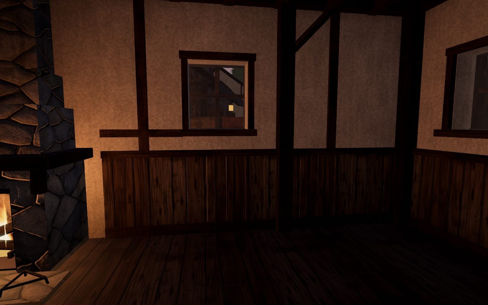 | 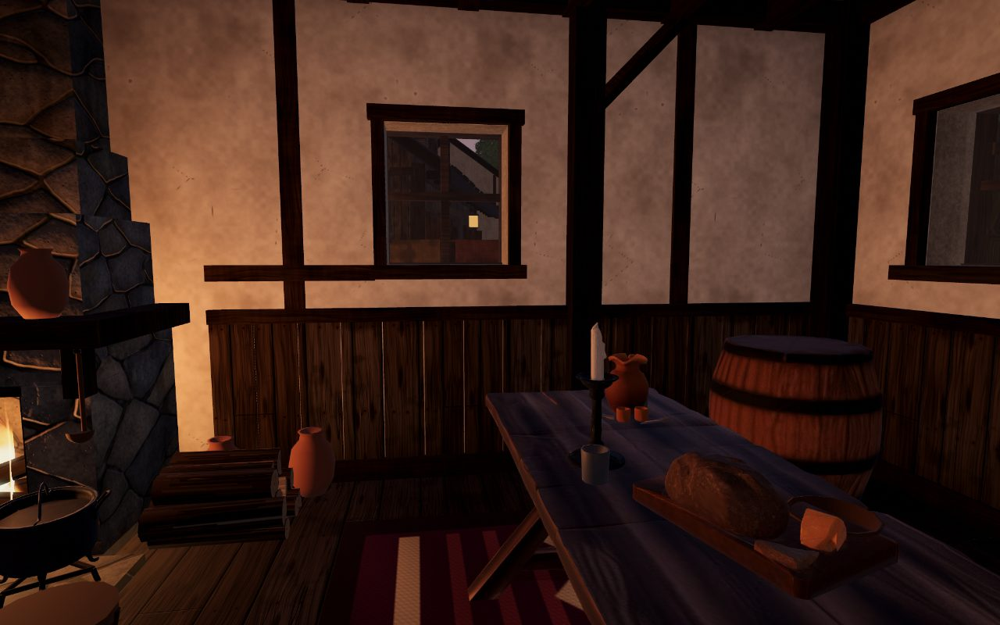 |
| 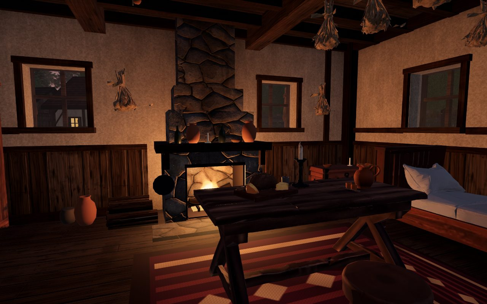 |  |
| 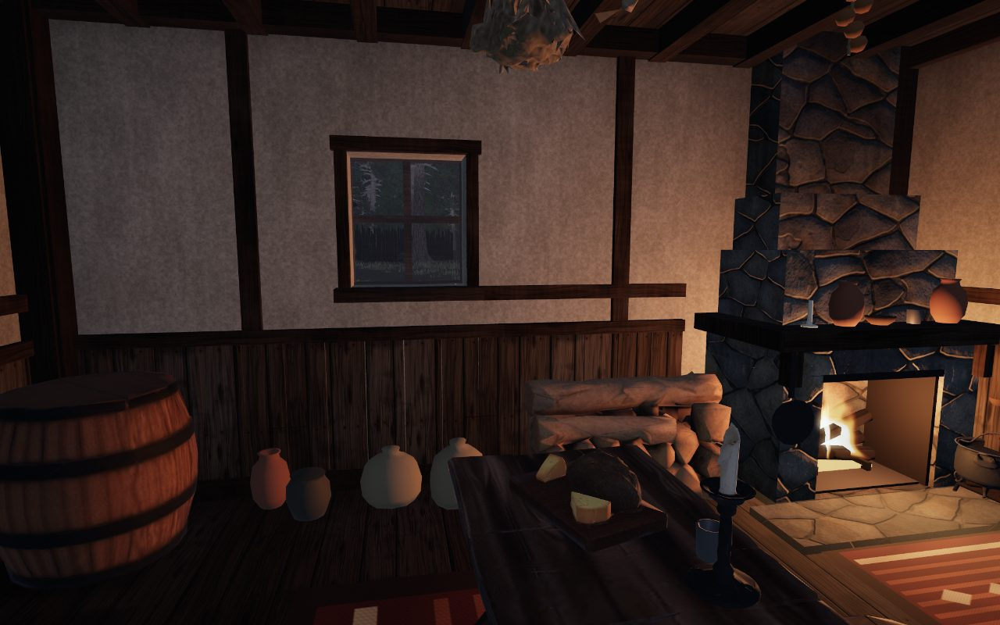 | 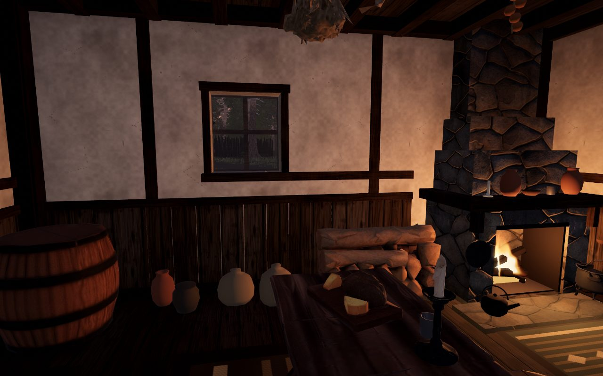 |
| 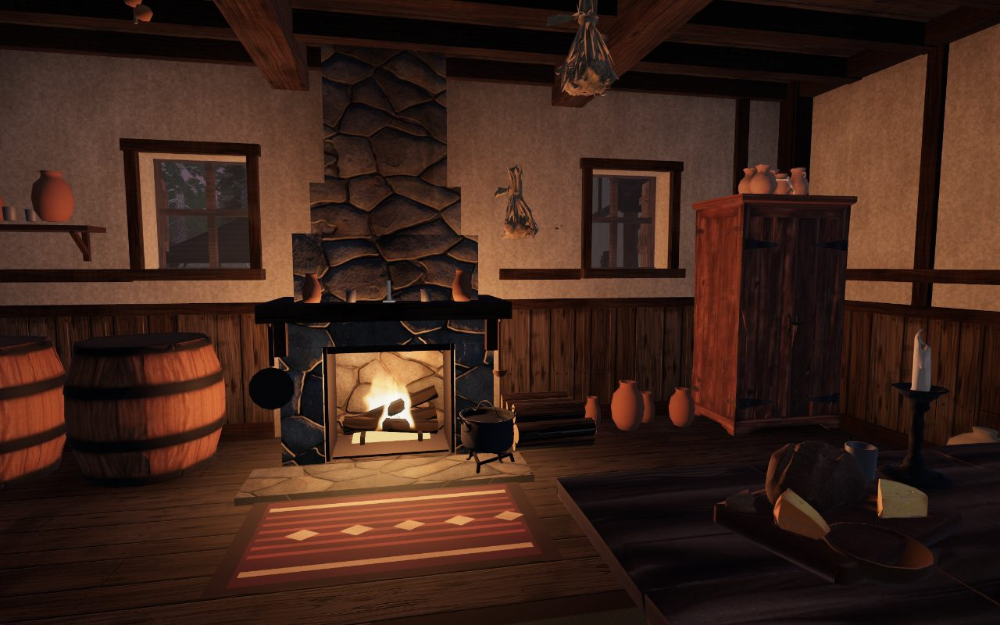 | 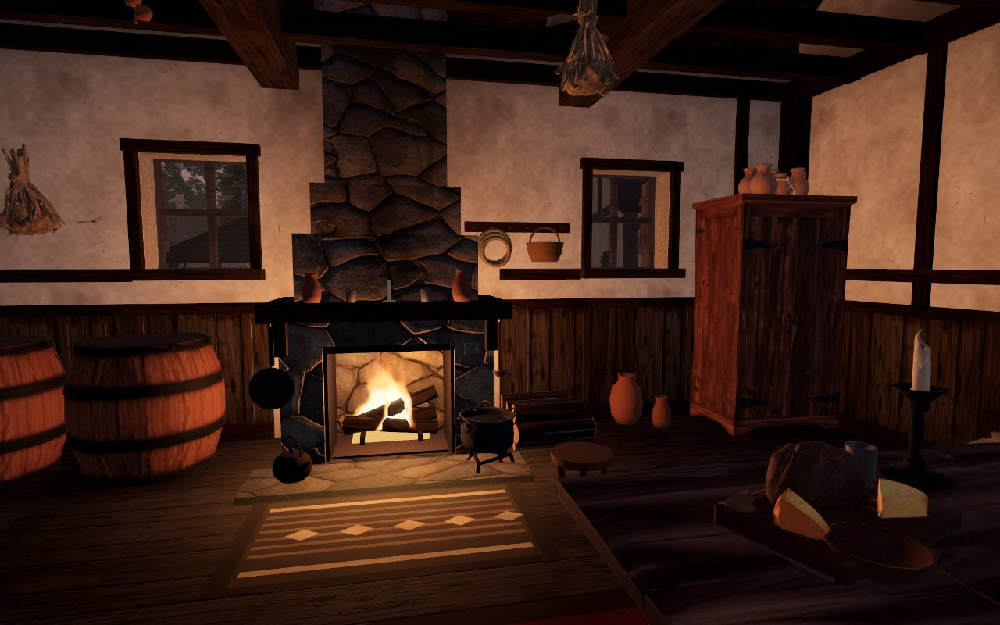 |
| 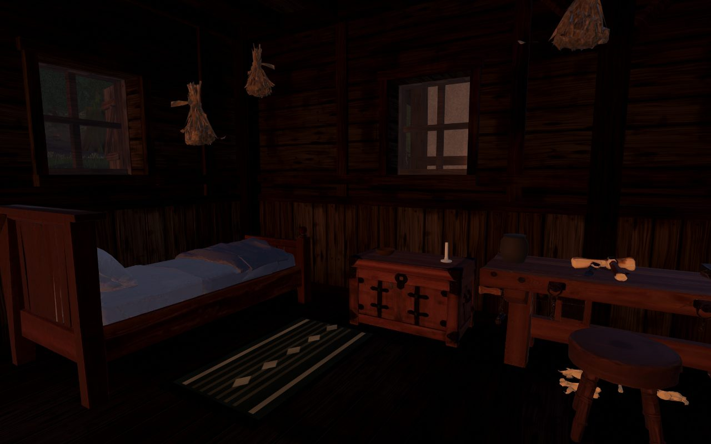 | 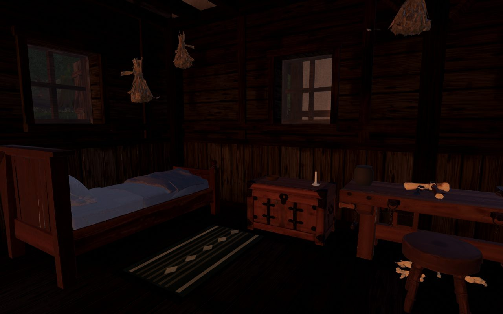 |
| 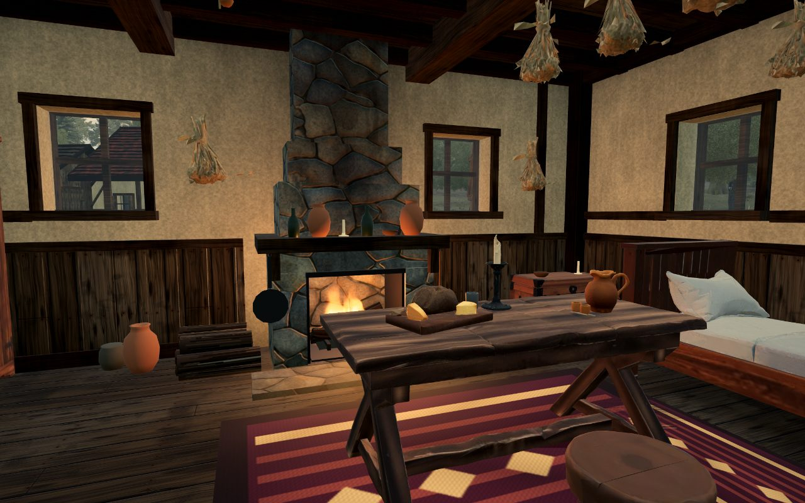 |  |
| 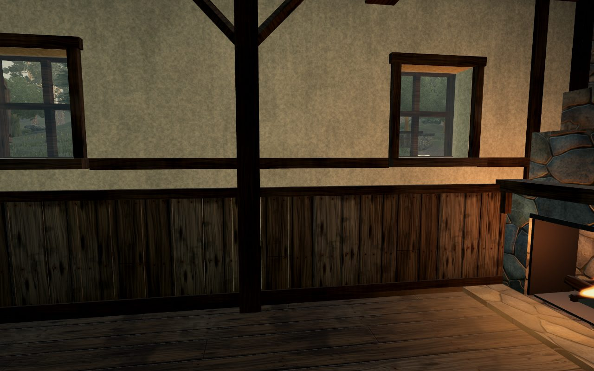 | 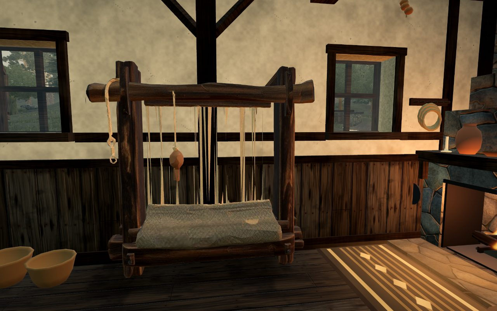 |

| Open roof (after) | |
| --- | --- |
| 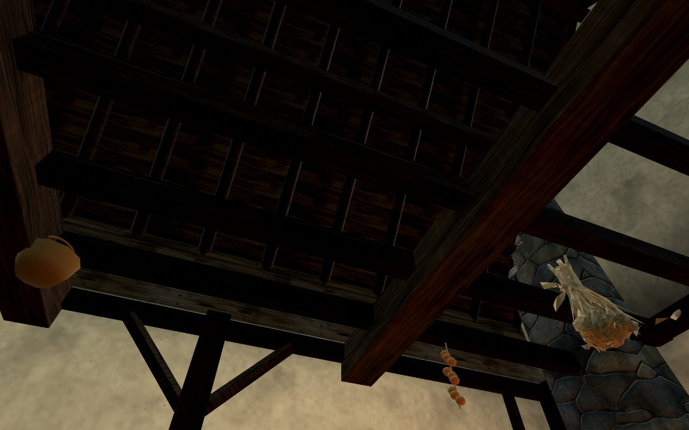 |  |

## Cost

The play gate's inside-window phase holds a 16.7 ms median (p95 17.1 ms, max 17.3 ms); 0.1% of the whole run's frames
went over 25 ms. The lime texture is one generated map pair; the roof, skin and gable faces are merged into each
building's shell; the kettle, stool and log basket add three instanced meshes in all.

## Not done

The lime wash repeats every 1.5 m with no per-panel offset; the per-panel variation is the vertex shading's. The
woodcutter's walls are planks, so they take no lime wash. Hip-roofed variants keep a flat ceiling. The gable ends stay
lighter than the roof boards, as whitewash would.
