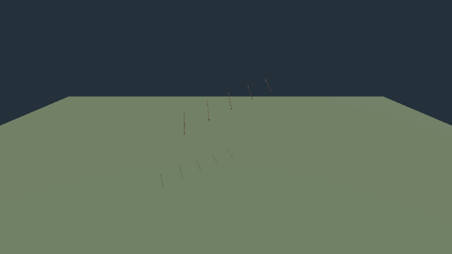

# Arrow release resource churn

Baseline: 0.0.16 · 9ab40b3, https://ael-dev3.github.io/Tervain/.

Every flight created five geometries and three patched materials, then disposed them on expiry or clear. Retain one lazily created resource template per flight owner; clone independent object transforms and release shared resources only when the owner is disposed. The nocked-arrow shader-variant warming remains unchanged.

A native lit/shadowed SwiftShader fixture runs 30 launches across 90 ballistic frames, with repeated clear/relaunch:

| Metric | Before | After |
| --- | ---: | ---: |
| Geometries created | 150 | 5 |
| Materials created | 90 | 3 |
| Buffer upload bytes | 75,000 | 2,500 |
| Draw calls | 2,943 | 2,943 |
| Triangles | 21,846 | 21,846 |
| Pixel-channel differences | — | 0 |
| Transform differences | — | 0 |

All 90 frames contain visible arrow pixels. Counts include six comparison capture renders in addition to the 90 measured frame pairs. The floor is warmed before counting uploads. Clear/expiry retains the shared resource set; owner disposal releases all five geometries and three materials exactly once, including repeated dispose calls. This isolated repeated-release workload does not establish whole-game frame times or removal of the first-shot hitch. Resource sharing is internal to one flight owner; nocked and animal-owned arrow effects retain their existing ownership.

[Receipt](arrow-resources/report.json)




```sh
node tools/repro-arrow-resources.mjs arrow-resource-proof
npx vitest run tests/presentation/huntingArrow.test.ts tests/presentation/huntingController.test.ts tests/presentation/playerHunting.test.ts
npm run build
```

81 focused arrow/controller/hero tests and production build/typecheck pass. Hardware play gate remains pending.
