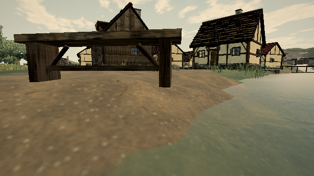
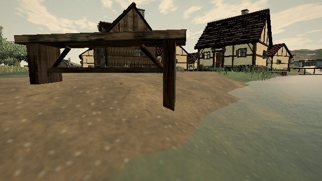

# Outdoor bench support on sloped ground

Reference: [published 0.0.18 · 421d34b](https://ael-dev3.github.io/Tervain/), [playtest checklist #326](https://github.com/ael-dev3/Tervain/issues/326).

The village bench at `(44, 32.4)`, rotated one radian, has a downhill foot **17.76 cm above soil**. The builder places both feet at the terrain height under the bench centre. The slope drops away under one support, leaving a visible air gap.

For outdoor callers, sample terrain at the four corners of each foot and extend that leg down into the lowest soil beneath it. Preserve its top, the seat, braces, placement, rotation, colour sequence and geometry counts. The original 4 cm embed allowance remains. Indoor callers omit the terrain callback and keep their original geometry; flat-ground output is also byte-identical. Terrain is sampled only when building the static prop.

## Reproduce

```sh
node tools/repro-live-bench-grounding.mjs --out bench-ground-proof
npx vitest run tests/presentation/benchGrounding.test.ts tests/presentation/propsGeometry.test.ts tests/presentation/propGrounding.test.ts --testTimeout=90000
npm run build
```

The browser loads the published world and casts upward rays against its actual village timber. All six foot heights from the original builder match the delivered mesh. Both comparison builders then use the published terrain, the same three native placements and the same random sequence. For screenshots, only triangles wholly inside those bench envelopes are replaced; the surrounding scene and materials remain. Characters are hidden only in these matched diagnostic captures to expose the foot. This is not a whole-scene image-quality comparison or hardware performance evidence.

The [receipt](proofs/bench-grounding/report.json) records every centre contact and source hash. Before: downhill gap **+0.177607 m**. After: **−0.089538 m**, below soil; all six feet have no positive gap. The deeper centre embed on the sloped foot comes from seating its whole flat footprint against the lowest corner rather than merely touching the centre.

The new regression checks the witnessed bench, unchanged seat/planks, byte-identical flat-ground geometry, and 216 footprint samples across 12 rotated slopes. The selected suites pass **31 tests**, and the production build passes. The original builder fails the grounding regressions.

A temporary mirror can fetch the same published assets through verified HTTPS when the browser lacks the public certificate authority. TLS and asset checksum verification stay enabled. Hardware play-gate remains outstanding; this fixes bench supports, not every floating sign or prop.



