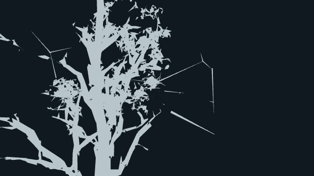
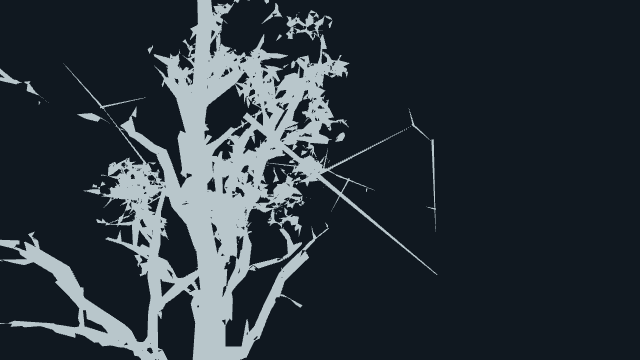

# Birch twig roots orphaned by canopy linking

Feature `18db8960e`, [PR #690](https://github.com/ael-dev3/Tervain/pull/690). Primary native baseline: **0.0.30 · 4dd0dae**. Repro target: `tree:wild:71:20`, `birch/verdant-sentinel`, tree base approximately (70.898, 2.166, -39.023).

## Cause

`buildCanopy` can anchor a child twig to an earlier parent twig. Its later clump-linking pass moves a clump and deletes that parent plan, but leaves children at the deleted parent. Four retained logical roots lie **exactly** on removed segments. They miss the remaining rendered wood by 0.27–1.31 local m. Trimming was ruled out: the original-wood and trimmed-wood gaps agree.

The leaf-distance audit accepts any nearby wood triangle. It therefore cannot establish that the supporting twig itself connects to the tree. This correction adds an independent root-contact check; it does not claim to close the remaining detached-leaf reports.

## Repair and regression tests

During birch construction only, separated roots reconnect to retained wood or previously emitted twig centrelines. The small existing-graft allowance is 0.12 template-local m. Targets and original planned ring counts stay fixed, including a graft that grows beyond the bend-length threshold. Zero-length plans remain skipped. Leaf buffers, index values and source wind assignments stay unchanged. No material, palette, shader or render-pass change.

Five root-ring centres move on the affected near variant; four previously exceeded the root-centre threshold. The other **eight** birch wood/LOD buffers remain bit-identical. Real-asset tests cover every birch leaf attribute/index, all planned triangle counts, supported variants, unchanged plan inputs, longer grafts and skipped degenerate plans. **29 focused tests and production build pass.**

## Native geometry and independent contact proof

All nine baseline wood buffers rebuilt through the original helper match the actual registered live buffers exactly. No prepared substitute mesh is used. Source prefixes and plans come from the loaded native trees.

| Metric, near verdant birch | Before | Candidate |
| --- | ---: | ---: |
| Root-ring centres >0.12 local m from all other wood | 4 | 0 |
| Worst root-ring-centre distance | 1.2653 m | 0.0844 m |
| Four affected first stem segments intersecting **preceding** rendered wood triangles | 0 | 4 |
| Registered near wood triangles | 8,588 | 8,588 |

The distance is from the rendered root-ring centre, not a literal residual surface gap. The separate ray test uses the actual first stem segment and earlier wood triangles only: neither its own geometry nor a later child can satisfy contact. All four corrected stems cross earlier wood. [Native contact rows](proofs/birch-twig-contact/stem-contact.json) · [deleted-parent trace](proofs/birch-twig-contact/deleted-parents.json) · [source validation](proofs/birch-twig-contact/source-validation.json). The public contact helper also reproduces all eight native intersection rows on retained real GLB geometry: [validation](proofs/birch-twig-contact/helper-validation.json).

All **28** native birch targets retain identical unmasked detached-card/group reports at every LOD: near 244/41, middle 3,780/69, far 142/88. Those remaining flags are still open. [Complete audits](proofs/birch-twig-contact/audits.json).

## Diagnostic views, not game appearance

The images below isolate registered wood geometry using an unlit grey double-sided material, with no leaves or wind, in a separate software WebGL renderer. They show the missing support span clearly. They are **not** a claim about native bark, lighting or canopy appearance. Both use the same native target matrix and tested buffers; each is one draw / 8,588 triangles. Restored-before controls match exactly.




[Second diagnostic angle, before](proofs/birch-twig-contact/wood-only-before-1.png) · [after](proofs/birch-twig-contact/wood-only-after-1.png) · [diagnostic metadata](proofs/birch-twig-contact/wood-only.json)

## Actual native scene captures

[Paired camera preview](proofs/birch-twig-contact/paired.mp4) · [before](proofs/birch-twig-contact/before.mp4) · [candidate](proofs/birch-twig-contact/after.mp4)

High, 640×360 DPR1, hour 15, actual `renderWorld` post/MSAA output, forced shadow refresh, fixed wind/time. Six matched camera poses; the restored original exactly matches the first baseline frame, zero console errors. These are offline camera poses played at 6 fps with half-second holds, **not real-time FPS, real-key walking or animated-wind verification**.

Most joins are occluded by native leaves from this inside-crown route. Changed pixels are 0, 0, 7, 0, 1, 1. This is why the separate diagnostic and independent surface-intersection proof are included; the native clip alone does not establish a visible canopy-quality improvement.

| Pose | Draws, both | Triangles, both |
| --- | ---: | ---: |
| 0 | 486 | 6,539,771 |
| 1 | 494 | 7,161,962 |
| 2 | 499 | 7,449,240 |
| 3 | 500 | 7,681,789 |
| 4 | 505 | 7,754,236 |
| 5 | 480 | 7,129,060 |

These forced-refresh poses include auxiliary passes and are separate from the gate's fixed forest preset. [Raw native report](proofs/birch-twig-contact/report.json) · [all native buffer/root checks](proofs/birch-twig-contact/setup.json).

## Compiled-build budget

| Max over four completed samples | Live 4dd0dae | Candidate 18db8960e | Delta |
| --- | ---: | ---: | ---: |
| Draws | 285 | 285 | 0 |
| Triangles | 3,048,306 | 3,048,306 | 0 |
| Console errors | 0 | 0 | 0 |

`play-gate: PASS 18db8960e`

Actual exit 0, allowance 0; two same-revision live probes, taking the larger maxima; unmodified producer and sampler. [Scrubbed receipt](proofs/birch-twig-contact/budget.json). Independent read-only inspection of both actual compiled budget pages confirms all **nine** candidate wood hashes match this native replay and all **nine** leaf buffers remain identical: [compiled pair](proofs/birch-twig-contact/compiled.json).

Extra support queries and transient centreline records run during construction; loading CPU/GC cost is unmeasured. No per-frame callback or shader instruction is added. GPU ms, total fragment invocations, per-frame CPU and hardware FPS are unmeasured. This is a contact correction, not a performance win.

## Reproduce

From this proof branch while the baseline is still 4dd0dae (or against a hosted copy of that build):

```sh
node tools/repro-live-birch-root-contact.mjs --out birch-root-proof
npx vitest run tests/presentation/twigRootContact.test.ts tests/presentation/birchTwigContact.test.ts tests/presentation/canopy.test.ts tests/presentation/leafSurfaceSites.test.ts tests/presentation/farLeafContact.test.ts
npm run build
```

The combined runner packages the executed native capture and separate read-only stem/wood-diagnostic probes. It rejects mismatched native rebuilds, changed index counts, regressed leaf-distance reports, failed stem crossings, blank images, GL/console errors, unequal paired submissions and changed restored controls. Evidence is kept separately from the four-file feature head.

## Separate live 0.0.31 outside-angle receipt

Pages deployed **0.0.31 · 07570ab** during an extra capture. The first run rejected the revision change. A separate baseline-pinned run then completed on 0.0.31; its input `growTwigs` function is unchanged from 0.0.30, and all nine native/candidate wood hashes match the primary proof. Its frames are kept separately, not mixed into the old baseline.

| Outside pose | Draws, both | Triangles, both | Changed native pixels |
| --- | ---: | ---: | ---: |
| 0 | 259 | 2,647,336 | 175 |
| 1 | 265 | 2,529,090 | 107 |

Zero errors; restored control pixel-identical. Same High post/MSAA capture at fixed time/wind, now looking inward from outside the crown. The native effect is still localized and partly obscured by leaves; no broad visual-quality improvement is claimed.

[Before](proofs/birch-twig-contact/live031-side/before-000.png) · [candidate](proofs/birch-twig-contact/live031-side/after-000.png) · [raw report](proofs/birch-twig-contact/live031-side/report.json) · [source/buffer validation](proofs/birch-twig-contact/live031-side/validation.json)

```sh
node tools/repro-live-birch-root-contact.mjs --baseline-ref 07570ab0a --view side --out birch-root031
```

A separate native published-build audit also verifies the shipped Tree32 restoration: **973 cards / 10 groups**, complete 451-tree/species coverage, build line `v0.0.31 · 07570ab · pre-alpha`. [Tree32 live receipt](proofs/birch-twig-contact/tree32-live031.json). This is independent of the birch-only correction and does not close the remaining 8,895/671 global sampled flags.
