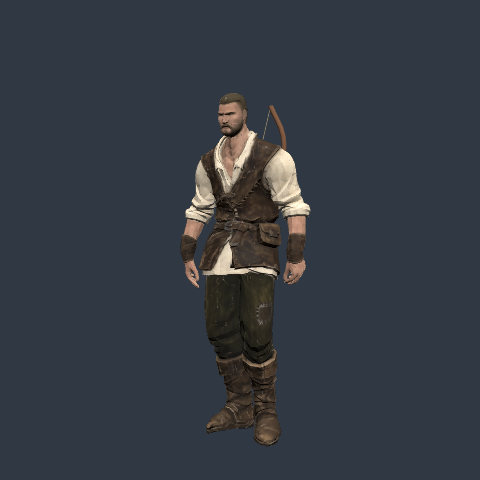
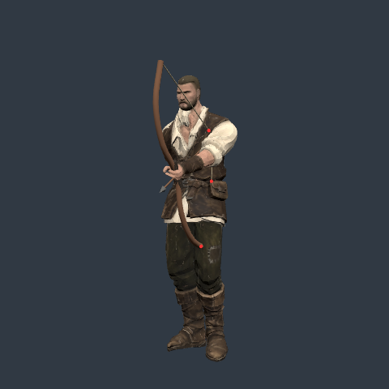
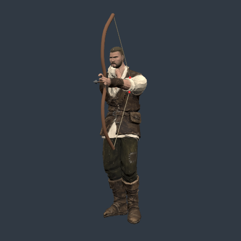

# Drawn bow surface-crossing repro

Published source baseline: 0.0.18 · 421d34b at https://ael-dev3.github.io/Tervain/.

The existing visual gate checks the slung bow while walking/running. This diagnostic adds aimed poses against the delivered hero surface: **12/12 carried samples are clear; 8/12 aimed samples cross non-hand surface triangles**. No bow, pose, material or asset is changed.

```sh
node tools/repro-bow-surface.mjs --out artifacts/bow-surface --expect baseline
```

The fixture loads the delivered textured hero, fits the fingers as the game does, and uses the actual HeroAnimationController and PlayerHuntingVisual. At each sample it deforms the body with the CPU twin of the installed dual-quaternion shader. It casts the bow limb's actual curve centreline (96 segments), the two transformed string centrelines, and the grip centreline against those surface triangles. Triangles substantially assigned to hand/finger bones are excluded to avoid flagging the intended grip.

| Pose | Samples with crossings / samples | Crossing centreline segments |
| --- | ---: | ---: |
| Carried idle | 0 / 4 | 0 |
| Carried walk | 0 / 4 | 0 |
| Carried run | 0 / 4 | 0 |
| Aim down 26.6° | 4 / 4 | 10 |
| Aim level | 2 / 4 | 4 |
| Aim up 26.6° | 2 / 4 | 4 |

Draw fractions are 0.25, 0.5, 0.75 and 1. Each state advances 15 native 60 Hz animation ticks before each sample. Root position is fixed: this is a character workbench, not a keyboard/terrain replay. Walk/run travel inputs are 1.65/3 m/s. The report's `time` field is the supplied pose-time parameter and, for aiming, the draw fraction.

Downward aiming crosses the lower-body surface with the lower limb; the string also crosses the torso. Level/upward aiming produces string crossings at the higher draw fractions. The shared native report includes the part and world-space point of each sampled contact.

| Carried idle | Downward draw | Level draw |
| --- | --- | --- |
|  |  |  |

These are **pose comparisons, not before/after fix images**. Red markers identify the computed surface crossings and are diagnostic overlays. The images use delivered geometry/textures and native software WebGL under neutral fixture lights. [Complete report and source hashes](proofs/bow-surface/report.json).

The carried poses provide negative controls and the drawn poses reproduce the positive findings. `--expect baseline` asserts the recorded 0/12 versus 8/12 counts; after a pose correction, `--expect clear` can check that no sampled centreline crosses the tested surface. `captureValid` only means the fixture rendered and its assertions ran. `qualityPass` remains null.

Limits: this samples centrelines, so it can miss grazing contacts from the wood/cord radius. It checks surface crossings rather than closed-volume penetration, and cloth/contact intent still needs visual review. It does not cover every gait frame, terrain adjustment, transition, camera angle or full-game draw input. A geometry finding does not certify a visible artifact in every camera view. No 60 fps, hardware, or visual-quality pass is claimed.

Minimal fix direction for review: keep the drawn nock/string and lower limb outside the skinned torso at the tested pitch/draw combinations while retaining the aim direction. Carried offsets are already clear in this matrix. The diagnostic leaves that pose/appearance decision to the production implementation.
