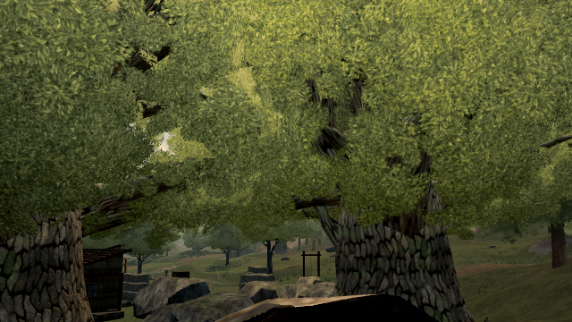

# Canopy contact cutoff correctness

Source head: `216318286a644029ad0ba7fd6e410c8924995653`.
Baseline: published 0.0.33 · b317734, High; original helper source from b31773468.

A sampled contact search may stop as soon as it finds wood inside its cutoff. That witness cannot classify contact against a smaller cutoff. `detachedClumpSet` previously searched at max(gap, reach), then classified at reach. The fix searches at reach and leaves the spanning/link radius unchanged.

## Actual live geometry

Near-LOD, alpha:false, native retained geometry. Distances below are world metres, converted by each target's uniform scale for the shared local-space helper. The independent `auditCanopies` uses its own contact traversal. The grouping gap is 1.5 m in the tight-reach cases.

| Stable label | Species/asset | World position | Scale | Before flags at reach 0.75 m | Fixed / independent audit |
| --- | --- | --- | ---: | ---: | ---: |
| tree:wild:79:22 | oak/hero-oak-b | (119.956350, 1.516843, -23.714841) | 1.437450 | 5,200 | 3,082 / 3,082 |
| tree:wild:70:35 | oak/verdant-sentinel | (62.325785, 0.668290, 56.798736) | 1.181231 | 4,093 | 1,827 / 1,827 |
| tree:wild:42:45 | oak/hero-oak | (-112.963823, 0.080602, 117.012692) | 1.324303 | 4,986 | 2,968 / 2,968 |

The total false overcount is 6,402 cards. These are corrected flags, not foliage removed, moved, or visually repaired. The 1.0 m reach cases also match the independent audit (see reports). Default 1.5 m reach / 0.75 m gap masks are identical, including detached-clump grouping. The active generator calls this helper with local reach 1.5 / MAX_TREE_SCALE (MAX_TREE_SCALE = 1.46, hence reach ≈ 1.0274) and gap 0.75; before and after therefore pass exactly the same contact cutoff on that production path.

| Charged diagnostic operations, three trees | Before | After |
| --- | ---: | ---: |
| Custom reach 0.75 m / gap 1.5 m | 1,429,432 | 1,986,227 |
| Custom reach 1.0 m / gap 1.5 m | 1,355,884 | 1,782,302 |
| Default reach 1.5 m / gap 0.75 m | 1,176,232 | 1,176,232 |

Correct smaller-radius classifications require more diagnostic traversal/grouping work. This is not a performance claim. The default renderer has no new per-frame work. Source shaders, textures, placements, triangles and submission code are unchanged.

## Rendered and compiled controls

The reusable tool runs both helpers against actual published tree geometry, checks all counts against the independent audit, hashes every retained geometry/index/vertex attribute (60 geometry/LOD pairs), and verifies queries do not mutate them. Instanced draw-coverage attributes are excluded from the source-geometry inventory.

The native High/MSAA4 scene is frozen at hour 15, camera (138, 6.957362, -9), looking at (125.047519, 9.564176, -15.430061), FOV 38. Time, wind and shadow-map updates are held after initialization. Software WebGL is restored before the kept images; no raster suppression is used for them. The control frame, original-helper frame and corrected-helper frame are pixel-identical. The nonblank image standard deviations are recorded. All three frames submit 563 draws / 9,244,972 triangles, with zero console errors.

The compiled candidate runs the same proof and compares its entire retained default geometry inventory to the published baseline. These controls show no geometry/rendering change; they do not prove visible floating crowns fixed. Alpha:false sampled contact flags are not an art verdict, and are not exact nearest distances.

## Reproduce

After installing dependencies and building the candidate:

```sh
node tools/repro-live-canopy-contact-cutoff.mjs --url https://ael-dev3.github.io/Tervain/ --out baseline-proof
node tools/repro-live-canopy-contact-cutoff.mjs --url CANDIDATE_BUILD_URL --baseline-report baseline-proof/report.json --out candidate-proof
```

Set CHROME to an installed Chrome/Chromium executable. Software-rendered runs use SwiftShader. The optional scoped loading raster shim is restored and High/MSAA4 asserted before captures; it is never applied to the stock budget run. The script rejects blank images, pixel drift, geometry mutation, incomplete or disagreeing audit results, changed default work, and console errors. Original and corrected source SHA-256 values are in each report.

## Validation and scope

29 tests across canopyContactThreshold, canopyFlaggedSet, canopySnapReach, canopyAudit and canopyVerticalGap pass. On unchanged helper source, the two newly added smaller-reach supported-card cases fail; the other three controls pass. Production type check/build pass. The correction does not touch visual styling, tree placement, menus, or gameplay.

The native macro depicts the contextual crown; it is not proof that any particular detached mass has been repaired. Static floating foliage remains open. Exploratory geometry repairs were rejected and are not part of this source head. Software rendering and operation counts are not hardware FPS, heat or full-load-time measurements.

Compiled candidate 216318286 versus live b317734: all 60 retained geometry/LOD pairs match. Live before.png versus candidate after.png also has **0 changed pixels / 0 changed channels / maximum channel difference 0**. See cross-build-pixels.json. The three control renders within each run are independently pixel-identical, with no console errors.




## Exact-head stock budget

[Actual budget receipt](BUDGET.md): exit 0, head 216318286a644029ad0ba7fd6e410c8924995653, live revision b317734 for both live probes. Four completed frames per probe; maximum draws 285 → 285, triangles 3,048,306 → 3,048,306, console errors 0 → 0. No triangle allowances, gate edits, startup raster suppression or reduced samples. Candidate endpoint is anonymized in the transcript.

Command: `node tools/play-gate.mjs --url CANDIDATE_BUILD_URL --budget-url https://ael-dev3.github.io/Tervain/ --head 216318286a644029ad0ba7fd6e410c8924995653` (REPRO_INIT_FILE unset).

All 15 current-head build, test and software-WebGL CI jobs pass. The exact-head receipt supplies the play-gate status. Hardware frame timing remains outside this software proof.
