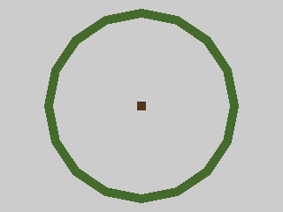

# Empty leaf-box centres must not count as support

The crown audit sampled each leaf component's bounding-box centre when searching for wood contacts. A connected hollow component can surround wood without touching it: its box centre sits in the hole, so that phantom point makes the audit call a detached island supported. Alpha-aware clipping can also create hollow visible regions, so the contact sampler must not assume the centre lies on the resulting surface.

Project the centre onto the component's actual triangles before testing wood contacts. Keep the existing vertex samples and connectivity algorithm. Projection work runs once per unique source component and consumes the existing operation budget. No rendering or foliage changes.

## Before/after proof

A ring with inner radius 2 surrounds a 0.2-wide wood box at its empty centre. The gap threshold is 0.75. The visible ring is well beyond the support gap, but the old detector finds a phantom contact at its box centre.

| Control | Before candidates | After candidates |
| --- | ---: | ---: |
| Wood inside the ring's empty centre | 0 | 1 |
| Wood touching the ring rim | 0 | 0 |
| Filled leaf face crossing wood, corners far away | 0 | 0 |

The last control prevents replacing the centre with vertices alone, which would falsely reject real face-interior contacts. [Native software-WebGL receipt and source hash](canopy-surface-proof/report.json) compares the baseline production detector against the updated source. Decoded RGB screenshots are identical: the audit changes; the geometry and picture do not.

```sh
node tools/repro-canopy-surface.mjs --baseline 0b45a36 --out canopy-surface-proof
npx vitest run tests/presentation/canopyAudit.test.ts
npm run build
```

The script accepts `--driver` for another CDP launcher. It reads the baseline detector from Git, runs both in separate native browser fixtures and fails unless the false negative is detected, both attachment controls remain supported, and pixels match. Ten detector tests, typecheck and build pass.

| Before detector | Updated detector |
| --- | --- |
|  |  |

## Limits

This is a controlled detector bug, not a count of affected live trees or a foliage appearance fix. Alpha transparency and shader wind still require their separate adapters/visual checks. Bounding-box proximity still links leaf components; sparse vertex/surface sampling remains approximate. The report scope changes to describe surface sampling, so baseline comparisons should recapture their baseline rather than compare incompatible sampling methods. Hardware/live-video coverage is not claimed.
