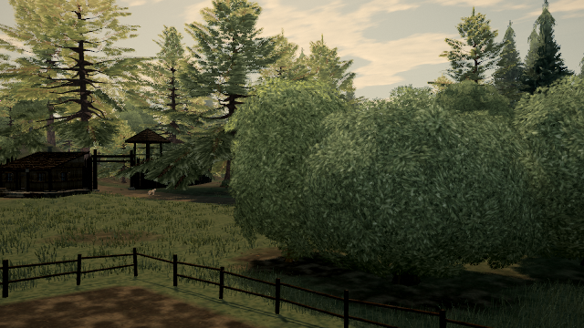

# Captured orchard leaf wind

Source PR #711 (`4953c476c88e1872dc56586f273f9fbd8564f76c`), published baseline 0.0.33 `b317734`.

## Confirmed defect

`lighterForReflection` borrows middle-detail geometry for near trees in water/window captures. It already switches wood to its middle material, but leaves and their depth prepass retain near materials. Two native orchard templates have whole-crown near wind and hierarchical middle wind. Their borrowed leaf geometry therefore carries branch attributes that the old capture programs ignore, while the borrowed wood uses its hierarchy. The colour/depth program mismatch with the borrowed geometry is observable directly in the compiled GLSL, not inferred from an audit distance alone.

The fix switches existing middle leaf and depth materials only when near/middle hierarchy flags differ. Nested/stale-callback restoration remains in the existing capture records. Pine atlas resolution and all other matching profiles keep their current materials. Geometry, leaf positions, normal/colour formulas, textures and authored wind data are unchanged.

Target: `tree:orchard:0:2`, root (-49.9716302, 0.1150919, 30.6619735). The same fixed camera looks at that crown from root+(11,5,14), FOV45. It is a controlled native capture-substitution view, not a player walk, a full water/window walkthrough, or proof that static detached crown masses are repaired.

## Method and independent reference

`tools/repro-live-capture-leaf-wind.mjs` supports `--url <build-url> --native candidate --frames 3 --out proof-output`; omit `--native candidate` for the published original. Default is six poses (one wind-off control and five wind-enabled phases). The probe asserts that each build's actual capture callback initially selects its expected material mode, rather than silently assuming candidate code is active.

The High/post/MSAA4 framebuffer is 640×360 at DPR1. Wind direction/strength parameters, scrolling and phase are recorded/fixed; actors/world simulation, post time and the warmed sun shadow map are held. The camera and label do not change between modes. Every pair has an exact restored baseline control. Wind off must be pixel-identical.

The independent reference draws the native **middle meshes** using the same borrowed geometry, packed matrices, colours, distance coverage, bounds and render order. The near leaf meshes are hidden only for this reference draw; all fields are restored afterward. The reference retains the middle meshes' native wind programs. This is separate from merely repeating the candidate assignment on near meshes. Corrected capture pixels must equal that middle-mesh reference exactly.

Software render/finish markers in raw JSON exclude PNG serialization and are not hardware GPU/CPU frame times, pacing evidence or acceptance criteria. No Mac FPS or heat improvement is claimed.

## Cost and scope

- Main-camera near/middle rendering and all rest-geometry audits are unchanged.
- No draw, triangle, geometry-buffer, texture-object or source shader-formula addition. The correction selects existing middle programs and existing input buffers.
- Affected captured leaves activate their existing wind/pivot inputs and hierarchy math. The wind-enabled hierarchy needs three meaningful gust/turbulence lookups rather than the old whole-crown path's two, before driver optimization; no fragment shader code is edited. This is a small capture-only correctness cost, explicitly justified by the geometry/program mismatch and independent pixel reference. It is not advertised as a performance win.
- Capture JS adds bounded attribute checks for active near leaf batches and material forwarding; there is no new world per-frame update loop. Hardware cost remains unmeasured.
- The native population contains two affected orchard templates and nine placements; seven are packed in the measured view (three tree-4949 and four tree-4815). The earlier tree scan did not establish a safe static-clump geometry edit: selected near crowns had no wholly unsupported candidates despite many beyond-wood-reach subsets. The broad floating foliage issue stays open.

Twenty-two foliage integration tests and production build pass. The strengthened capture regression fails on original code: its fixture gives the middle model a distinct hierarchy/material and checks both leaf passes, unchanged profiles, nesting and stale restoration callbacks. The original test fixture shared materials and did not expose this case; the final regression does.

## Captured profile cost witness

`profile-metadata.json` was read from the actual compiled candidate: both affected colour/depth pairs have identical maps, normal maps and material defines before/after, and neither profile uses baked-crown shading. This isolates the changed program feature to the branch hierarchy; fragment sampling style is preserved. The packed middle models contain 6,912 vertices / 10,368 indices and 6,796 vertices / 10,194 indices, at counts three and four. That is **71,880 submitted index references per leaf pass**, before driver vertex caching and camera culling; it is not a measured count of GPU texture fetches or an entire-frame work estimate. The existing middle hierarchy activates one extra meaningful gust lookup per executed leaf vertex versus the generic path, plus its branch math and `_wind`/`_pivot` inputs. This capture-only correction has an explicit cost, justified by using the matching model program.

## Completed results

Published original: six completed pairs (wind off plus five phases at 3.00–3.20 s). Actual compiled candidate: three completed pairs (wind off plus two phases). Every corrected frame equals the independent reference, every restoration is exact, and both reports have zero console errors. The actual callback is checked before the session-only modes are selected.

| Metric | Original capture | Corrected capture |
| --- | ---: | ---: |
| Mismatched leaf colour/depth wind programs | 4 | 0 |
| Reference error at phase 3.00 (RGB channels) | 211,001 | 0 |
| Reference error at phase 3.00 (pixels) | 72,510 | 0 |
| Reference-error channel observations across five wind phases | 1,050,506 | 0 |
| Reference-error pixel observations across five wind phases | 361,319 | 0 |
| Wind-disabled changed pixels | 0 | 0 |
| Captured-view total draws / triangles, all phases | 380 / 5,610,309 | same |
| Stock gate max draws / triangles | 285 / 3,048,306 | same |
| Console errors | 0 | 0 |

Observations summed across phases are not unique pixels or detached-card counts. All modes' RGB hashes and camera matrices match across the three shared phases of the separately loaded live and compiled-candidate reports: [cross-build controls](cross-build-controls.json). This validates the repeated source modes with the recorded wind, not a claim about arbitrary gameplay captures.

| Original capture, phase 3.00 | Corrected capture, same camera/phase |
| --- | --- |
|  |  |

[Independent reference](reference-001.png) · [restored original](restored-001.png) · [wind-off original](before-000.png) / [wind-off correction](after-000.png).

[Quarter-speed comparison](comparison-quarter-speed.mp4) is illustrative lossy video. [Original lossless](before-lossless.mkv) and [corrected lossless](after-lossless.mkv) retain the full 640×360 native framebuffer; every decoded frame hash matches its PNG. The wind-off control is excluded from motion clips. [Video verification](video-verification.json) records the exact hashes, cadence and dimensions.

[Live raw report](live-report.json), [live offline pixel summary](live-summary.json), [compiled-candidate raw report](candidate-report.json), [candidate summary](candidate-summary.json), [profile cost metadata](profile-metadata.json), [selected static tree scans](selected-tree-scans.json), [validation](validation.json), [exact-head stock receipt](budget-gate.md).

The interrupted concurrent software attempts are not accepted receipts. The completed reports above were captured sequentially after fixing the probe's wind-freeze order; the stock receipt corresponds to the final source head. No hardware frame timing or static-clump clearance is claimed.

## Repeat

This proof branch includes the source PR head and read-only offline helpers:

```sh
node tools/repro-live-capture-leaf-wind.mjs --frames 6 --out capture-live
node tools/measure-capture-leaf-wind.mjs capture-live capture-summary.json
node tools/encode-capture-leaf-wind.mjs capture-live capture-video
```

For a built candidate, pass `--url BUILD_URL --native candidate --frames 3`. The probe freezes direction/scroll after native world preparation and records the actual values. Use one full-world browser at a time on software rendering; compare completed reports, not partial progress. Tests: `npx vitest run tests/presentation/foliageEngine.test.ts`; build: `npm run build`. The original implementation fails the strengthened capture-binding regression (one failure; unrelated cases deliberately skipped in that negative control).
