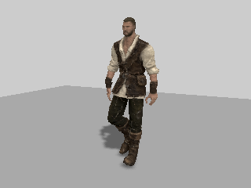
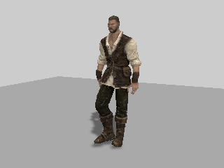

# Upload only the skin motions

The custom skin shaders replace Three's matrix skinning in colour, depth and distance passes. They read two RGBA texels per joint. The old layout nevertheless uploaded four matrix texels before those motions and rounded the combined buffer to a square. This continues #408's controlled repro with a production layout change.

Keep full matrices in `skeleton.boneMatrices` for CPU skinning, bounds and collision queries. Put only dual quaternions in a rectangular bone texture, starting at texel zero. Compare only that GPU buffer when deciding whether an update needs uploading. Pose generation, weights, geometry, materials and lighting are unchanged.

## Delivered-hero proof

Baseline: `0b45a36`, the live 0.0.15 revision confirmed by the Pages manifest. Both sides load the delivered hero GLB with its authored `Casual_Walk` clip and original materials, and render 121 poses at 1/60-second intervals. Instrumentation counts WebGL upload calls only for the exact bone-texture arrays. Colour rendering and a directional shadow pass use the production skin hooks.

| Measurement | Before | After |
| --- | ---: | ---: |
| Hero bone texture, 66 joints | 6,400 bytes | 2,112 bytes |
| Bone uploads across 121 poses | 774,400 bytes | 255,552 bytes |
| CPU matrix buffer | 6,400 bytes including padding | 4,224 bytes, all 66 matrices |
| Changed RGB pixels across four captured poses | — | 0 |

Each pose also compares hashes of every matrix/motion word and exact CPU positions sampled every 997 vertices. All match. The upload reduction is 67%. The focused tests additionally exercise 36-joint textures (4,096 → 1,152 bytes), 120 changing poses, unchanged-pose upload suppression, bind changes, exception restoration and renderer layout preservation.

[Machine-readable receipt](compact-bone-proof/report.json) records the production source hash. The reusable script produces all four image pairs and full pose data:

```sh
node tools/repro-compact-bone-texture.mjs --baseline 0b45a36 --out compact-bone-proof
npm run build
npx vitest run tests/presentation/npcSkinUploads.test.ts tests/presentation/npcSkinning.test.ts tests/presentation/heroAnimation.test.ts tests/presentation/residentRig.test.ts
```

The script accepts `--driver` for an alternative CDP launcher. It starts its own Vite server, loads the baseline skin module from Git without changing the checkout, and exits unsuccessfully on mismatched pose data, any changed captured pixel, or no upload reduction.

| Pose | Before | After |
| --- | --- | --- |
| 30 |  |  |
| 120 |  |  |

## Limits and compatibility

This is software WebGL on an isolated actual-hero scene, not hardware frame timing or attribution of the roughly 700 MiB whole-run total in `LATEST.md`. Point-light shadows, the full world and hardware play gate still need their normal integration checks. Depth and distance hooks share the same zero-base layout; the captured directional shadow exercises depth.

Diagnostics must read the motion offset from `npcDualQuaternion.base` (now zero), not assume `bones * 4`. The metadata keeps `texture` as width and adds `height`. CPU consumers continue to read all matrices from `skeleton.boneMatrices`; this array intentionally no longer aliases GPU texture data. No matrix or animation data is discarded.
