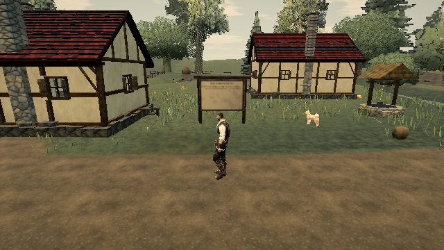

# Contact-query collection churn

Related live movement/turn-stutter lead: https://ael-dev3.github.io/Tervain/ and #326. Baseline source: 0.0.16 · 9ab40b3.

Every direct narrow-phase support, movement or ceiling query spreads all loose props and optional rocks into a new combined array. These queries are called repeatedly during movement. Index the existing prop and rock collections in the same order instead; contact casts, normal filters and nearest-hit tie behavior are unchanged.

| Deterministic native Rapier workload | Before | After |
| --- | ---: | ---: |
| Combined contact arrays materialized | 1,416 | 0 |
| Exact shape casts | 12,735 | 12,735 |
| Query results | 1,416 | 1,416, exactly equal |

The corpus uses actual terrain coordinates, the nine authored loose props, and a finite native rock surface. Props-only/props-plus-rocks modes, disabled props, restored positions before stepping, accepted/rejected normals and hit ordering are exercised. Every hit handle, time of impact, normal and witness is compared exactly against baseline. The receipt counts only combined contact arrays, not total allocations or heap bytes; the props-only empty fallback array is also removed but not counted. This does not establish a turn-hitch root cause or a hardware frame-time improvement.

[Receipt](contact-cast-collections/receipt.json).

```sh
node tools/repro-contact-cast-collections.mjs receipt.json
npx vitest run tests/worldPhysics.test.ts tests/world/rockContacts.test.ts tests/world/rockSupportBroadphase.test.ts
npm run build
```

34 focused physics/rock tests and production build pass. The [software-WebGL receipt](contact-cast-collections/software-webgl.json) passes all seven assertions (native game ready, WebGL2/SwiftShader, render counters, nonblank 640×360 capture and request cleanup). The candidate stationary view reports 144 draw calls, 910,599 triangles and 4,608 upload bytes per render; these are functional counters, not an improvement claim.

 Hardware play gate remains required before shipping.
