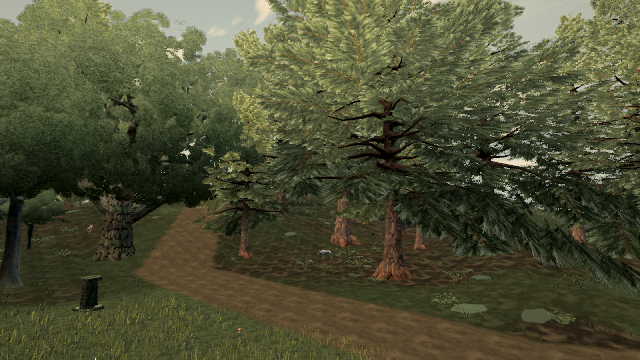
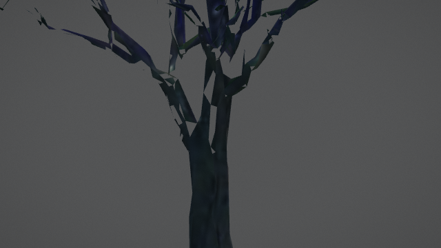
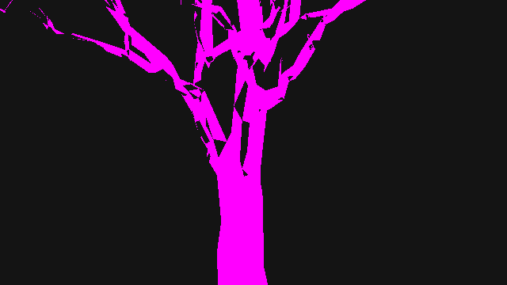

# Skip zero-weight distant bark detail reads

Source head: `de2cf53223572bfef0ab1f77ca0ed399ed9b8478`.
Published baseline: 0.0.33 · b317734, High. Stock budget uses its own unmodified run; the paired render diagnostics are separate.

## Reproduced cost and fix

`installBarkDetail` in treeMaterials.ts fetches colour and relief/roughness from three triplanar axes each: six texture-sampling sites. Its existing distance weight is zero at 100 m and beyond, so all fetched values have zero blend/height contribution there.

The candidate skips these reads when that weight is zero. UV gradients are formed before divergent control flow and passed to `textureGrad`; mip selection is therefore defined even when neighbouring fragments take different branches. Colour/roughness blending and the height derivatives remain outside the branch, preserving the normal gradient across the cutoff. The bark program key is bumped. No geometry, texture, tint, distance, density, placement or visual-style parameter changes.

| Source work | Original | Candidate |
| --- | --- | --- |
| Positive-detail fragment sampling sites | 6 | 6 |
| Zero-detail fragment sampling sites | 6 | 0 |
| Control flow / mip inputs | Unconditional reads; implicit gradients | One distance predicate; explicit shared UV gradients |
| Per-frame game JS / submission / uniform source | Existing | No added work |
| Texture storage / geometry | Existing | Unchanged |

The predicate and explicit gradients are a real shader trade-off in the active region. This receipt does not establish an overall GPU or frame-time gain. No hardware FPS, Mac heat, GPU bus-traffic or total-forest saving is claimed.

## Five forest poses

The forest report uses the native published High scene, postprocessing and MSAA4 at 640×360. It substitutes the source-exact old/new sampling blocks into the same native material objects, preserving opaque sort order. The normal five-pose path starts at (-210, 0), advances 2.6/60 m per pose and turns 0.003 radians per pose. Time/wind are frozen; shadows are warmed for each pose before the kept comparison. Scoped loading raster suppression is restored and High/MSAA4 asserted before kept renders.

Eight native bark material callbacks execute the candidate sampling code. All five before/after RGB pairs and restored-baseline controls are exact. Per-pose draws and triangles match; their maxima are 321 draws / 5,283,438 triangles. Texture count stays 274. These are the diagnostic forest poses, not the stock budget viewpoint.




## Active-material cutoff controls

The fixture explicitly asserts that its selected material belongs to the bark-detail hook and that the instrumented callback ran. It borrows native `tree:wild:70:35` (oak/verdant-sentinel), geometry, textures, material and authored placement. One white-tinted instance is drawn in an isolated lighting scene through native High post/MSAA4. Field of view scales with distance to expose the bark at 30, 60, 99, 100 and 120 m. This is a shader macro, not a gameplay camera or a tree-art proposal.

Every distance pair is exact, as is every restored-baseline control. The macro stays at 5 draws / 8,916 triangles. The same five controls pass on the compiled source head.




### Cross-browser control

Independent live and compiled sessions differ by at most 1/255 per RGB channel. Crucially, the identical cross-browser differences occur with original sampling enabled on both sides. Each session's original/candidate pair differs by zero. `cross-browser-controls.json` contains all three comparisons; absolute cross-browser identity is not claimed.

## Diagnostic coverage and derived request count

The single-sample 640×360 marker renders only the same native wood at 120 m. Red means a positive detail weight; magenta means zero detail weight. It finds 0 red and 26,999 magenta pixels. Multiplying that coverage by the source sampling sites yields **161,994 → 0** sampling opportunities for the corresponding production shaded fragments.

The marker shader substitutes diagnostic output. It is not a count of hardware requests issued by that marker program; compiler elimination, overdraw, helper invocations, MSAA shading frequency, anisotropic filtering and cache traffic are unmeasured. This is not a whole-forest cost estimate.



## Reproduce and validation

```sh
node tools/repro-live-bark-distance.mjs --url BUILD_URL --out OUTPUT_DIRECTORY
node tools/repro-live-bark-distance.mjs --url BUILD_URL --macro-only true --out MACRO_DIRECTORY
```

Set CHROME to an installed Chrome/Chromium executable. Software-rendered runs use SwiftShader. The full probe runs five forest poses, five cutoff macros, the marker, restore controls, source-hash and console/GL assertions. The reports here come from a forest acquisition and separate active-material macro acquisitions; their production sampling-helper SHA-256 is identical. The final probe combines those checks.

Ten related tests and production build/type check pass. Reverting just treeMaterials.ts to original code produces the expected regression failure; three other controls pass. Actual reports/images are retained, including restore images. Failed diagnostic acquisitions are excluded.

Timing fields (`softwareDrawMs` in the earlier forest acquisition, `submissionWallMs` thereafter) are browser submission-window wall readings taken before canvas readback, **not software-GPU frame duration or whole-frame JS CPU**. They were noisy and are not used to claim speedup.

## Scope

This is a shader-work reduction with paired rendering proof. Static floating crowns, branch placement, roots, grass sparkle and the hardware 60 Hz/heat target remain open. A prior read-only live check found no leaf vertices outside the existing whole-tree bounds across all 60 retained geometry/LOD pairs; no bounds or geometry expansion is included.

## Exact-head stock budget

[Completed stock output](BUDGET.md) for de2cf53223572bfef0ab1f77ca0ed399ed9b8478: live b317734 for both live probes, four completed frames per probe, maxima 285 draws / 3,048,306 triangles in both live and candidate, zero console errors. No startup raster suppression, altered gate, triangle allowance or sample reduction. Candidate endpoint is anonymized.

The report is actual completed stdout and the process ended. The tool's separate exit-status handle became unavailable after reconnection; an independently captured OS exit status is not claimed. The script prints this PASS result only on its successful budget path.

Command: `node tools/play-gate.mjs --url CANDIDATE_BUILD_URL --budget-url https://ael-dev3.github.io/Tervain/ --head de2cf53223572bfef0ab1f77ca0ed399ed9b8478` with REPRO_INIT_FILE unset. All 15 current-head CI build, test and software-WebGL jobs pass.
