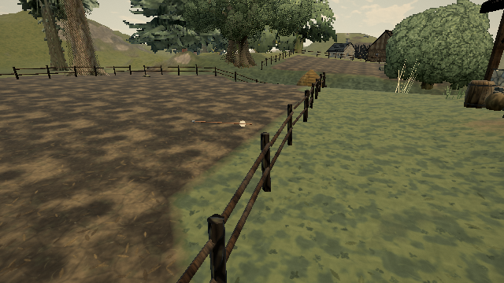

# Arrows stopped by the invisible fence movement wall

Reference: [published 0.0.18 · 421d34b](https://ael-dev3.github.io/Tervain/), bow-flight/impact checklist in [#326](https://github.com/ael-dev3/Tervain/issues/326).

The static fence collider extends 60 cm above its rendered bounds to prevent walking or ordinary jumping onto rails. Projectile queries used that same extended volume. On all nine native field segments, a horizontal trace **30 cm above the highest fence geometry** hits empty air at the movement barrier.

## Fix

Keep the movement collider unchanged. Exclude that collider from the general projectile ray and test its actual height interval separately, using the original box with a vertically clipped ray. This retains a later real hit when the shot descends from the cap, including shots starting inside it. The dirty first-frame query path uses the same rule when a fence is toggled before the next simulation step. Other scenery, cargo and actor contacts still compete by nearest distance.

Precomputed horizontal bounds reject distant fences before a backend cast. Rays above the real top require no additional direct fence casts. No extra physics bodies, rendering changes, audio changes or per-frame background work are introduced.

## Reproduce

Aim a bow just above a field fence, below its invisible movement-wall top, and release. The original arrow lodges in mid-air. The fixture measures this at every native field segment and renders a matched flight near the first segment:

```sh
node tools/repro-live-fence-arrow-cap.mjs --out fence-arrow-proof
npx vitest run tests/fenceProjectiles.test.ts tests/worldPhysics.test.ts tests/presentation/playerMotion.test.ts --testTimeout=90000
npm run build
```

The first variant uses unmodified live physics. Comparison worlds run the original/candidate physics with the same published terrain and static colliders. Loose cargo and actors are omitted only from those comparison worlds; the short controlled segments have matching original/live contacts. Actual native arrow meshes and flight integration are used at 120 Hz, then drawn in the native scene. This isolates collision queries rather than claiming a full keyboard bow-release or hardware performance gate.

A temporary mirror may fetch the same published assets through verified HTTPS when the browser lacks the public certificate authority. TLS and the game's asset checksums stay enabled.

## Receipt

[Full measurements](proofs/fence-arrow-cap/report.json):

| Measure | Live/original | Candidate |
| --- | ---: | ---: |
| False hits above nine native fences | 9 | 0 |
| Below-top fence controls still hit | 9 | 9 |
| Controlled arrow after 10 × 1/120 s | Lodged after 0.80 m | Flying past 1.67 m |

The flight starts 30 cm above the maximum fence bounds; the small ballistic drop does not bring it into the real fence. The candidate's above-top probes perform zero extra direct fence casts; the counters record cropped fence casts only, not all physics work.

**84 tests and production build pass.** Regressions cover rotated rails, both directions, actual fence hits, descending shots, cap-inside origins, scenery behind the fence, inactive fences and reactivation before a step. They also check that raw physics retains the extended collider and canonical player movement still blocks there. The original query fails both new tests.

This fixes the invisible upper movement extension. The existing conservative fence volume below its rendered maximum still blocks spaces between individual rails; exact rail/post projectile meshes remain outside this change. No Mac frame-time improvement or hardware PASS is claimed.



