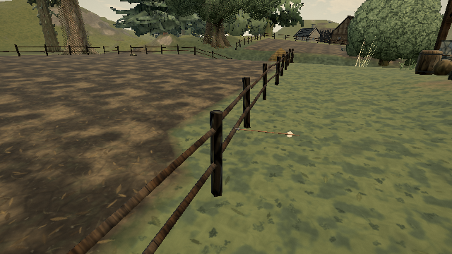

# Arrows through fence openings

Published reproduction: [Pages](https://ael-dev3.github.io/Tervain/), 0.0.18 · 421d34b. Stacked on #623, which removes the invisible upper cap; the solid box below it still catches arrows between visible rails.

## Matched software-WebGL receipt

The replay uses the native terrain, field placements and seeded production fence builder. All 5,102 positions and 4,180 oriented triangles match the published wood meshes. All nine movement bounds remain unchanged. Independent native mesh raycasts witness the clear openings and visible wood controls.

| Check | Published / parent | Candidate |
| --- | ---: | ---: |
| False hits in nine clear openings | 9 | 0 |
| Visible wood controls blocking arrows | 9 | 9 |
| Native arrow after ten 1/120 s steps at 20 m/s | lodged at 0.80 m | flying at 1.67 m |

The candidate copies the rendered posts and rails once into query-only triangle colliders. Their collision groups are zero: no new physical contact pairs or navigation obstacles. Continuous movement barriers remain intact. Custom fences without triangle metadata keep the parent's cropped-box fallback. Cost: nine query sensors and 111,384 bytes of source triangle buffers, plus unmeasured backend acceleration structures. This is a collision correctness fix, not a frame-rate claim.

[Raw receipt](proofs/fence-projectile-mesh/report.json) · [negative control](proofs/fence-projectile-mesh/negative-control.json)




## Reproduction and validation

```sh
node tools/repro-live-fence-mesh.mjs --url https://ael-dev3.github.io/Tervain/ --out /tmp/fence-mesh-proof
npx vitest run tests/fenceProjectileMesh.test.ts tests/fenceProjectiles.test.ts tests/worldPhysics.test.ts tests/presentation/playerMotion.test.ts --testTimeout=90000
npm run build
```

The receipt was captured through a temporary verified HTTPS mirror because the sandbox browser could not trust the Pages certificate; asset integrity checks stayed enabled. The script defaults to Pages. It compares published physics, parent physics and candidate physics against the same native scene, and renders native arrow flight through the normal render pipeline. It does not boot a complete candidate application. Geometry matches are exact; the arrow's intentional movement means the screenshots are not pixel-identical.

86 regression tests pass and the production build passes. Restoring parent physics makes the new gap regression fail (one failure, one passing capture test); restoring the candidate passes. Coverage includes rays from both sides, visible wood, movement blocking, isolated geometry capture and activation changes before stepping. Hardware play-gate verification remains pending; software timing does not establish Mac frame pacing.
