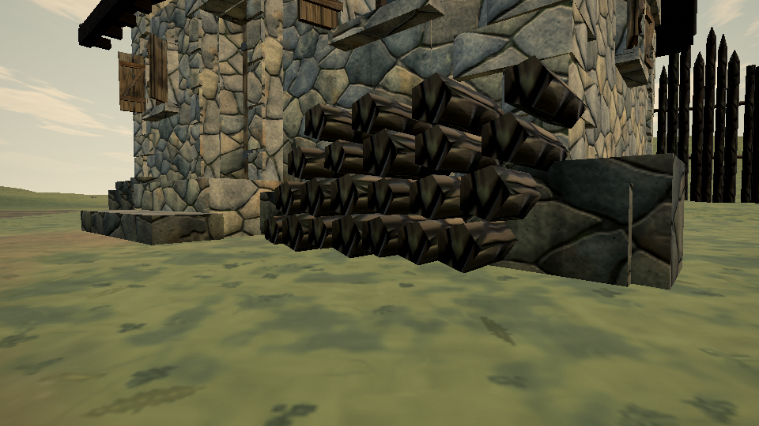
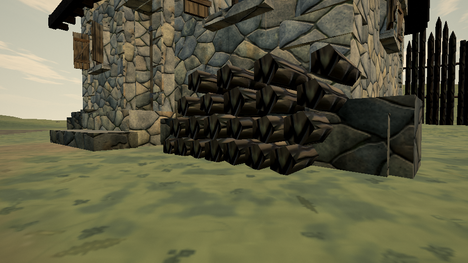
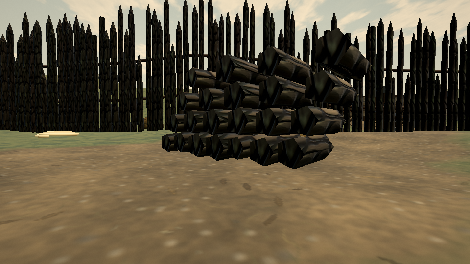
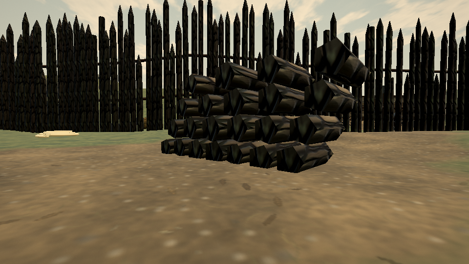

# Standalone firewood ground contact

Reproduced on [published Pages](https://ael-dev3.github.io/Tervain/), 0.0.18 · 421d34b. The work-supply pile at (-87, 36) and the keeper-cottage pile near (-92.01, 59.04) use only the terrain height at their centre. Their lowest-row log support points hover over the soil.

| Pile | Largest measured support gap before | Rigid shift | Support gaps after |
| --- | ---: | ---: | ---: |
| Work supplies | +4.24 cm | −5.24 cm | −5.14 to −1.00 cm |
| Keeper cottage | +4.30 cm | −5.30 cm | −5.12 to −1.00 cm |

Positive support probes: **14 → 0** across two piles. Negative gaps mean the support point sits slightly inside the soil. The whole stack moves by one constant vertical offset, preserving all log shapes, relative positions, normals, UVs, colors, indices and decorative random draws. The helper samples the lowest authored vertex of each bottom-row log in world coordinates, then lowers the stack until each probe is at least 1 cm into soil. It only runs for these two standalone outdoor calls; building-yard piles keep their existing grounding path. There is no per-frame work.

## Matched native-scene evidence

The replay extracts each actual published pile: 528 contiguous vertices and 440 complete triangles, representing 22 capped logs. The first seven logs are the support row. It rejects ambiguous extraction or triangles crossing the extraction boundary. It passes those native positions into the candidate's production grounding solver, changes only their vertical coordinates and renders through the native pipeline with existing materials and terrain. This verifies the solver on actual published geometry; it is not a full candidate application startup or a hardware performance gate.

[Raw receipt](proofs/firewood-grounding/report.json) · [negative control](proofs/firewood-grounding/negative-control.json)






## Reproduce

```sh
node tools/repro-live-firewood-grounding.mjs --url https://ael-dev3.github.io/Tervain/ --out firewood-ground-proof
npx vitest run tests/presentation/woodpileGrounding.test.ts tests/presentation/buildingPropGrounding.test.ts tests/scenarios/forestArrival.test.ts --testTimeout=90000
npm run build
```

25 tests and the production build pass. Restoring the original builder makes all four new rotated-slope cases fail; the preservation control still passes. Tests cover the actual two terrain placements, preservation of the stack's attributes and random sequence, and exclusion of previously authored geometry. The sandbox capture used a temporary verified HTTPS mirror because its browser did not trust the Pages certificate; asset integrity checks stayed enabled. Hardware play-gate verification is pending.

This fixes the two witnessed firewood ground gaps, not every prop or unsupported hanging sign in #326. Outdoor bench feet are tracked separately in #622.
