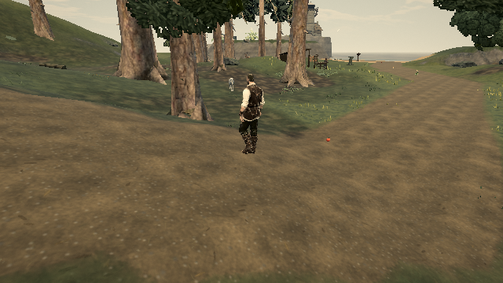

# Skip motion calculations for pinned forest-floor vertices

The published **0.0.18 · 421d34b** forest-floor shader evaluates wind before multiplying its displacement by `tvRise`. Root and buried vertices with `tvRise == 0` therefore evaluate gusts, sway, actor contacts and strike response for a displacement that is discarded. The trample calculation has the same zero weight.

The change encloses the motion block in `if (tvRise > 0.0)`. The existing rise function, moving-vertex calculations, geometry, materials and placement remain the same. The shared patch serves colour, depth and distance materials; its program cache key advances.

## Published-build reproduction

```sh
node tools/repro-live-floor-pinned-motion.mjs --out floor-pinned-proof
```

The tool defaults to https://ael-dev3.github.io/Tervain/. It loads the native world with motion enabled, moves to world position **(-180, 12)**, and retains the actual packed floor instances, material hooks and wind uniforms. It varies only the floor-motion block inside the published shader, preserving its other patches, including distance fading.

A floating-point software-WebGL point capture samples every source vertex of the first visible instance in each of eight floor batches. Instrumented captures count logical wind-function entries and trample lookups; separate position captures compare the resulting vertices. These counts are not hardware instruction counts or timing measurements. The eight sampled instances are a subset of the visible population, not a whole-frame workload estimate.

| Sampled batch | Vertices | Wind evaluations before | After |
| --- | ---: | ---: | ---: |
| Shrub 0 | 320 | 320 | 300 |
| Litter 2 | 120 | 120 | 120 |
| Fern 0 | 616 | 616 | 602 |
| Shrub 1 | 320 | 320 | 300 |
| Fern 2 | 616 | 616 | 602 |
| Fern 1 | 616 | 616 | 602 |
| Moss 0 | 240 | 240 | 98 |
| Fungi 0 | 57 | 57 | 42 |
| **Total** | **2,905** | **2,905** | **2,666** |

All eight position hashes match before/after. Moving foliage remains active: the largest captured displacement from rest is **0.038898 m** in both versions. Geometry, packed instance matrices and counts also retain the same hash.

The frozen native scene, rendered through its post pipeline, has **zero changed pixel channels**, **122 draw calls** and **661,742 triangles** in both captures. Both screenshots were inspected. Native trample-fetch counts are zero in this capture, so it establishes no trample-bandwidth saving.

[Rendered receipt](proofs/floor-pinned-motion/report.json)

| Before | After |
| --- | --- |
|  |  |

## Verification and limits

- 49 tests pass across foliage engine, forest floor, pine integration and bark detail; production build passes.
- Repeating the repro with `--candidate-ref ee6c8d344 --images 0` supplies the unchanged parent as the candidate. It fails the reduction assertion as expected: 2,905 → 2,905 evaluations, `pass: false`. [Negative-control receipt](proofs/floor-pinned-motion/unchanged-parent-control.json).
- This is a shader-cost reduction with identical captured output. Hardware frame times, power and M5 performance remain unmeasured. The tracked GPU data remains `live16`; this does not close the canopy-quality, root-contact or grass-shimmer reports.
