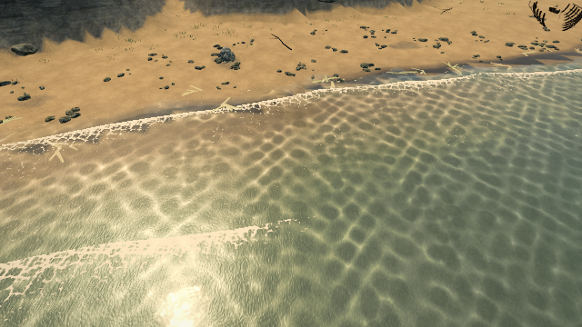
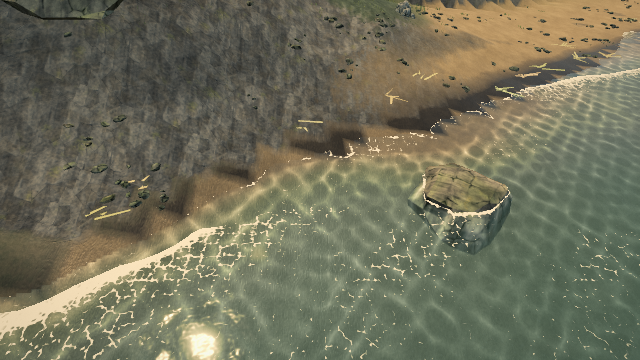

# Reflected trees omitted by main-camera packing

Reproduced on [Pages](https://ael-dev3.github.io/Tervain/) **0.0.19 · 77c6866**. Related to foliage visibility in [#326](https://github.com/ael-dev3/Tervain/issues/326); uses #628's scoped forest selection.

Looking down toward shallow water, the main camera can exclude trees that the mirrored camera sees above the shoreline. The planar capture reused the main camera's packed colour instances. Changing detail models could not recover the missing trees. A preliminary inland case selected extra trees without changing the final image and was rejected as a visible repro; the two shoreline cases below change both the reflection buffer and the final post-processed picture.

The fix selects trees once Three.js has prepared the reflected camera and its oblique water-plane projection, before render-list construction. It then applies the existing middle-model swap. The capture delegates and restores the scene's existing render hook and restores detail and forest selection on success or a render exception. Cached reflections do no new selection work. Tree/water geometry, shaders and materials are unchanged.

## Proof

[Raw receipt](proofs/forest-water-reflection/report.json). The replay uses native published targets, materials, buffers and the Grade/post/MSAA path at Medium, 640×360. It substitutes the production `WaterRenderPass.captureReflection` and forest capture scope. A zero-dt adapter invokes the published forest's selection because the published module exposes `update`, not its closure refresh. Simulation, grain and the shadow map are fixed. These are controlled camera poses, not hardware frame-time measurements.

| View (camera → aim) | Final picture changed pixels | Reflection changed pixels | Opaque changed pixels | Repeat / cached changed pixels |
| --- | ---: | ---: | ---: | ---: |
| `(-310, 8, -40) → (-300, 0, -40)` | 6,046 | 11,039 | 0 | 0 / 0 |
| `(-335, 8, -90) → (-325, 0, -90)` | 4,987 | 19,431 | 0 | 0 / 0 |

Both opaque HDR colour buffers remain byte-identical. Corrected full-frame and HDR-reflection repeats match; stationary Reduced Motion reuses the corrected capture with zero capture draws or selection calls. Forest buffers/counts/visibility/bounds and the original scene hook restore in every mode.

| Before | After |
| --- | --- |
|  |  |
|  |  |

## Capture cost and review limit

| View | Capture draws before → after | Capture triangles before → after |
| --- | ---: | ---: |
| `(-310, 8, -40) → (-300, 0, -40)` | 119 → 176 | 929,315 → 2,763,085 |
| `(-335, 8, -90) → (-325, 0, -90)` | 97 → 162 | 835,051 → 2,305,909 |

This is a correctness fix with **higher reflection work**, not a performance win. The opaque input is unchanged; the reflected content previously missing now costs additional draws and triangles. Hardware frame pacing needs review before shipping, especially on integrated GPUs. Texture-object counts are not GPU-memory bytes. The software receipt does not claim a 60 fps pass.

```sh
node tools/repro-live-forest-reflection.mjs --url https://ael-dev3.github.io/Tervain/ --out forest-reflection-proof
npx vitest run tests/presentation/waterRenderPass.test.ts tests/presentation/forestCaptureView.test.ts
npm run build
```

39 focused tests and production build pass. The new reflection orchestration tests check the prepared world camera/projection, selection-before-detail order, cached-capture control and restoration after a render error. They fail with the parent water pass restored. The replay fails on readback errors, source changes, nonrepeatable pixels, changed opaque input or failed state/hook restoration.
