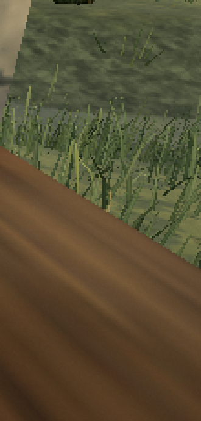
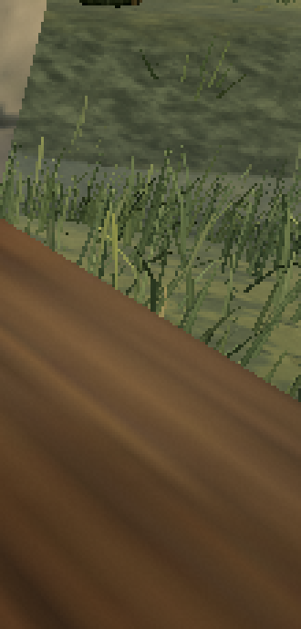

# Grass root contact across terrain facets

On published [0.0.18 · 421d34b](https://ael-dev3.github.io/Tervain/), grass clumps sit 2 cm below the terrain at their centre. Each blade's root then uses a plane fitted with central differences. When a clump spans a ridge or a terrain-triangle boundary, that plane can rise above the actual ground away from its centre. Software-WebGL root captures reproduce the gap near the fence bank and village loop.

Keep the existing slope, seeds, blade shapes and horizontal placement. At tile generation, check the plane over the possible root footprint against the terrain facets. Its extrema occur at footprint corners, facet crossings and interior terrain vertices. Keep placements with safe clearance; lower unsafe planes to give their root anchors 2 cm of soil overlap. A footprint wholly within one facet needs no additional height samples. This changes physical placement, without changing the shader or adding a draw, texture or attribute.

The footprint is a conservative square enclosing the shader's root disk. It can lower a clump more than its particular seed strictly requires; the receipt reports the largest adjustment. The check concerns blade-root centre anchors, not every edge or upper vertex of a bent blade.

## Reproduce

```sh
node tools/repro-live-grass-contact.mjs --out grass-contact-proof
```

The default URL is the published build. The software replay loads Low; the placement code is shared by all presets. The replay obtains native grass geometry, atlas-independent blade shader, seeds and instance attributes across four views. A point capture executes the native root calculation at `t=0` and writes each surviving root position to a float target. Each result is compared with the game's physical terrain. Point packing checks whole selected tiles, including roots outside the viewport; the observation count is not a count of visible scene pixels. The candidate applies its production seating helper to those stored Float32 clumps. Before/after scene screenshots use native rendering with these base heights overlaid.

Views cover the fence bank near **(-2,37)**, village near **(18,20)**, wooded slope near **(-121,95)** and village loop near **(-12,45)**. The bank views face the recorded bad-root positions. Repeated roots across views are observations, not unique plants.

| Root replay, 20 tile observations | Published placement | Candidate |
| --- | ---: | ---: |
| Emitted root observations | 19,098 | 19,097 |
| Anchors more than 0.1 mm above terrain | 97 | 0 |
| Anchors more than 30 mm above terrain | 4 | 0 |
| Highest root relative to terrain | +36.93 mm | −7.69 mm |
| Clump observations whose base is lowered | 0 | 403 of 3,933 |

All **19,097 common emitted roots retain identical xz coordinates**. The remaining root crosses a LOD threshold after its height changes. The unchanged-parent control retains all 97 floating observations and reports `pass: false`; repeat with `--candidate-ref 28654a1ac --images 0`.

The root count can change slightly because the shader's LOD distance includes height. Common emitted roots must retain exactly the same horizontal coordinates. Shape, slope and tint buffers must remain identical. The checker fails if floating anchors remain, if common roots move horizontally, if the native witness is empty, or if the production generator is not wired to the tested helper.

[Rendered receipt](proofs/grass-facet-contact/report.json) · [unchanged-parent failing control](proofs/grass-facet-contact/unchanged-parent-control.json)

| Native scene before | Candidate placement overlay |
| --- | --- |
|  |  |

The table shows a 110×230-pixel grass crop enlarged 3× with nearest-neighbour sampling. [Full before frame](proofs/grass-facet-contact/before.png) · [full after frame](proofs/grass-facet-contact/after.png). Native building occlusion remains in the manually positioned camera view.

The scene images provide context; the float-root captures quantify the small contact gaps. This is not a whole-build video quality score, a grass-sparkle fix, or hardware performance proof.

## Cost and validation

The replay measures **34,060 extra terrain-height queries over 3,933 clump observations** (8.66 per clump on average), performed during tile generation. Existing centre/slope sampling and habitat work remain. This is additional streaming CPU work, not a performance win. The largest conservative base lowering is **135.34 mm**; 3,530 of the 3,933 clump observations retain their existing base height. There are no added shader operations, attributes or GPU buffers.

Three context views remain pixel-identical. The focused village view changes 6,521 colour channels. These are placement-overlay screenshots, not a whole candidate build receipt.

- **21 tests pass** across the new contact checks, grass engine and complete slope-write checks. The arrival-route test now checks roots against terrain under the footprint rather than assuming the centre height alone establishes contact.
- Production type-check/build pass.
- Software-WebGL root replay passes; the unchanged-parent run fails with the original gaps.
- Hardware play/streaming gate remains outstanding. The extra generation cost needs that gate before folding; no frame-time gain is claimed.
