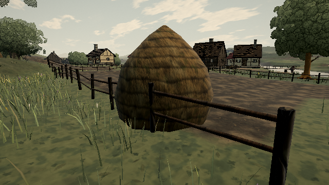

# Grass clumps overlapping settlement fences and hay

Grass constructs its `Habitat` from a collision snapshot. Settlement fences and haystacks were registered afterwards, so their footprints never reached that snapshot. Register settlement geometry before creating grass; attach the settlement at the existing scene order.

```sh
node tools/repro-grass-obstacles.mjs --url http://127.0.0.1:4173/ --expect before --out before.json --shot before.png
# Build and serve the fixed revision.
node tools/repro-grass-obstacles.mjs --url http://127.0.0.1:4173/ --expect after --out after.json --shot after.png
```

The native compiled world's grass is updated at every fence and hay collider: nine fence runs and three haystacks. Submitted clump roots are tested with their actual radius scale and the generator's 0.08 m padding. **160 footprint overlaps → zero**, with nonempty grass populations at every location. Receipts include every obstacle coordinate/count. Cameras and simulation inputs are diagnostic fixtures; geometry, tile generation and obstacle registration are native game code.

[Before receipt](grass-obstacle-proof/before.json) · [After receipt](grass-obstacle-proof/after.json)




This checks generated base footprints, not every possible wind/trampling displacement of a blade tip. It does not claim that all dynamic tip clipping is solved. No grass density, color, geometry, shader or fence shape changes. Eighteen related loading/grass tests, type checking, production build and actual-build assertions pass.
