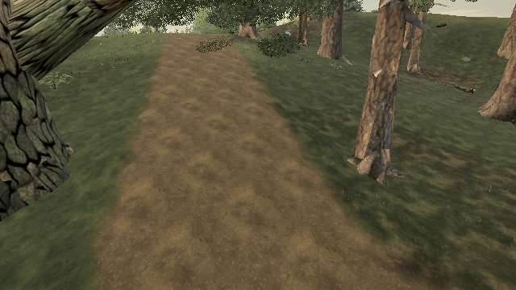
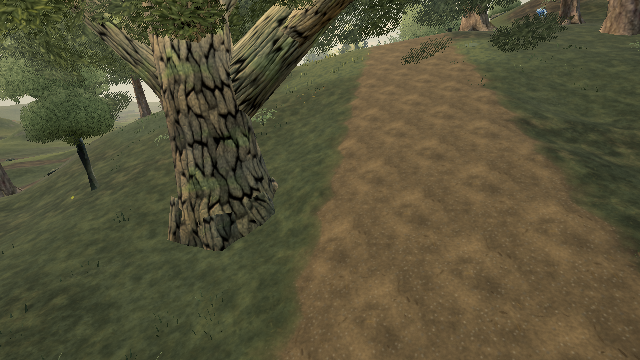

# Reuse settled grass tile selection

Reproduced on [published Pages](https://ael-dev3.github.io/Tervain/), **0.0.19 · 77c6866**, in the woodland view near (-180, 12). After streaming finishes, an unchanged camera still repeats tile distance, rank and draw-range selection on every simulation update. The existing request-grid cache skips requests, but leaves this retained-tile loop running.

Keep the completed selection until the camera position changes. Pending reserve work still runs; disable/re-enable invalidates the cache. View-frustum culling and capture-camera selection remain in their original per-draw callbacks, so turning without translation still culls against the current view. No shader, density, range or visual policy changes.

## Matched software-WebGL proof

The replay drains reserve work before measuring. It runs the published, original-source and candidate update methods on the same native tile buffers, then compares counters, tile-state hashes, a camera-height move, disable/re-enable, near/far capture cameras and ordinary post/MSAA renders at two orientations.

| Low, 110 prepared tiles, 120 updates | Published | Candidate |
| --- | ---: | ---: |
| Tile distance queries | 13,200 | 0 |
| Rank selections | 9,120 | 0 |
| Changed RGB pixels at two orientations | — | 0 |

All tile-state and capture-selection hashes match. Camera movement and re-enabling each still run 110 distance queries and 76 rank selections. A hidden-grass control changes 687 pixels, establishing visible grass coverage. Whole-scene draw calls remain 246 / 353 and triangles remain 1,892,578 / 1,978,774 at the two orientations; texture objects remain 263. These are paired counters, not hardware timings, texture-memory bytes or an FPS improvement claim. This reduces settled-view CPU work; it does not claim to fix grass shimmer or the Mac frame-pacing goal.

[Low receipt](proofs/grass-settled-selection/low.json) · [negative control](proofs/grass-settled-selection/negative-control.json)






## Reproduce

```sh
node tools/repro-live-grass-settled-selection.mjs --url https://ael-dev3.github.io/Tervain/ --quality low --out grass-settled-proof
npx vitest run tests/presentation/grassSettledSelection.test.ts tests/presentation/grassInnerBand.test.ts tests/presentation/grassMainDistance.test.ts tests/presentation/grassCaptureRanks.test.ts tests/presentation/grassCatchupReserve.test.ts tests/presentation/grassEngine.test.ts --testTimeout=90000
npm run build
```

**24 tests and production build pass.** The new settled-view regression fails on original source; the reserve/capture control passes. Coverage checks unchanged stats and selections, immediate movement refresh, changed draw decisions after a larger move, cache invalidation on re-enable, continued reserve generation while stationary and independent capture selection/restoration.

The sandbox used a temporary verified HTTPS mirror because its browser did not trust the Pages certificate; asset integrity checks stayed enabled. The replay replaces only the production update method on native layers; this is not a complete candidate application startup. Hardware play gate remains pending. The GPU record in `docs/perf/LATEST.md` is still the older live16 run; it is not new evidence for this change.
