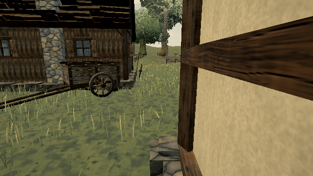

# Skip overwritten grass slope-buffer clears

Published **0.0.18 · 421d34b** clears the complete slope scratch buffer before every grass-tile generation. The grass generator then writes all four slope channels for every accepted instance. Only that accepted prefix is copied to the tile, so the initial clear is redundant, including for empty tiles.

`TileLayerOptions.writesSlope` lets a complete writer skip that clear. Grass opts in. The default remains a zeroed slope buffer for generators that leave optional channels unwritten. A tile-pool reuse test covers both contracts.

## Reproduction

```sh
node tools/repro-live-grass-slope-clear.mjs --out grass-slope-proof
```

The default URL is https://ael-dev3.github.io/Tervain/. The tool obtains the published near/far grass generator closures through CDP, retaining their actual terrain, habitat and exclusion inputs. It replays the baseline and candidate `TileLayer` implementations through camera offsets **(0,0), (13,0), (26,12), (0,0)** from the village view near **(18,20)**, with identical streaming quotas.

Eight generator controls prefill the scratch slope array with `NaN`; every accepted channel must be finite and match the zero-initialized result. The replay compares every retained tile's four attribute arrays, bounds, draw range and instance count after every camera position. The candidate's production opt-in must be present.

| Low-profile replay | Before | After |
| --- | ---: | ---: |
| Tile fills | 124 | 124 |
| Accepted clumps over all fills | 23,500 | 23,500 |
| Full slope-buffer clears | 124 | 0 |
| Float elements zero-filled | 257,424 | 0 |
| Rendered draw calls | 105 | 105 |
| Rendered triangles | 570,640 | 570,640 |

All four tile-state hashes match. Baseline, candidate and untouched live-scene captures have identical pixels through the native post pipeline. Screenshots were inspected. The avoided zero-fill covers **1,029,696 logical CPU bytes** across this replay, not GPU uploads or measured physical memory traffic. Generation and its accepted writes still run.

[Rendered receipt](proofs/grass-slope-scratch/report.json) · [unchanged-parent control](proofs/grass-slope-scratch/unchanged-parent-control.json)

| Before | After |
| --- | --- |
|  |  |

The unchanged-parent control, captured before the fix, retains all 124 clears and reports `pass: false`. It can be repeated with `--candidate-ref 95adda3ed --images 0`.

Validation: **21 tests pass** across slope scratch reuse, grass engine, capture ranks, catch-up reserve and pass pixels; production build passes. This is a streaming-work reduction, not a per-frame or hardware timing measurement. Hardware play-gate proof remains pending; canopy quality and grass shimmer remain open.
