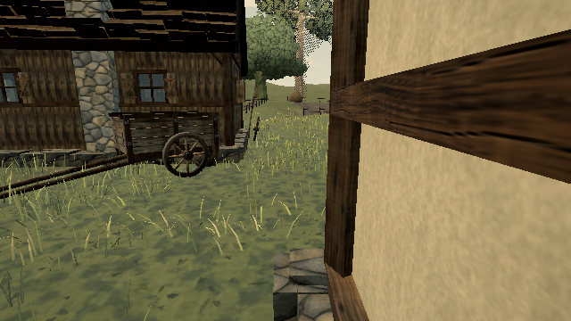

# Upload only active grass mover uniforms

The grass interaction field has room for 48 movers. Even after the field cull reduces the active count, its Vector4/Vector2 uniform arrays retain all 48 slots. Three flattens and submits every slot at each stamp pass. On published **0.0.18 · 421d34b**, the paired arrays therefore submit **1,152 bytes** even with zero or one active mover.

Keep the shader's existing capacity and mover-count loop. Pack the uniforms into reusable Float32 storage and submit cached views ending at the active count. The zero-mover case retains one unused slot because Three's flat-array path requires a nonempty numeric array. Views are created once per field, rather than on each step; full batches still submit all 48 movers. No shader variant or draw is added.

## Reproduction

```sh
node tools/repro-live-grass-uniform-prefix.mjs --out grass-uniform-proof
```

The tool defaults to https://ael-dev3.github.io/Tervain/. It obtains the published interaction field and its native 32-mover snapshot near **(18,20)**. The native original constructor, parent source and candidate source replay 60 updates covering walking, scrolling, a 103-stamp burst and catch-up. Every update's half-float field must match the native original exactly; the field must also be nonempty. The parent already includes the field mover cull, and the candidate retains its complete active-count sequence.

Actual calls to `uniform4fv` for `uMovers` and `uniform2fv` for `uMoverVel` are intercepted. Cached published-program locations are obtained from the native material's program metadata; newly compiled programs are tracked through `getUniformLocation`. Bindings are restored afterwards.

| 60-update replay | Native original | Parent | Candidate |
| --- | ---: | ---: | ---: |
| Mover array bytes | 26,112 | 26,112 | 2,672 |
| Velocity array bytes | 13,056 | 13,056 | 1,336 |
| **Combined payload bytes** | **39,168** | **39,168** | **4,008** |
| Uniform calls | 68 | 68 | 68 |
| Passes, including one scroll | 35 | 35 | 35 |
| Scene draw calls | 117 | 117 | 117 |
| Scene triangles | 644,502 | 644,502 | 644,502 |

All versions retain the same all-frame field hash and pass-layout hash. Both source-model scene captures match the native-original capture with **zero changed pixel channels**. Screenshots were inspected.

Controlled single-step checks cover the boundaries:

| Active movers | Before payload | After payload | Field bytes |
| --- | ---: | ---: | --- |
| 0 | 1,152 | 24 | Identical |
| 1 | 1,152 | 24 | Identical |
| 48 | 1,152 | 1,152 | Identical |

[Rendered receipt](proofs/grass-uniform-prefix/report.json) · [pre-fix unchanged-parent control](proofs/grass-uniform-prefix/unchanged-parent-control.json)

| Before | After |
| --- | --- |
|  |  |

The pre-fix control retains 39,168 bytes in both source replays and reports `pass: false`. Repeat it with `--candidate-ref bd34643b1 --images 0`.

## Validation and scope

**41 tests pass** across trample frames, grass engine, pass pixels and the existing shared-field brush tests; production build passes. Mock renderers decode the new packed uniforms and compare exact Float32 values, matching the conversion that WebGL already performed.

This is a Low-profile software-WebGL replay. Bytes are the measured API payload for two uniform arrays, separate from buffer/texture upload totals. They do not establish driver memory traffic, hardware frame-time improvement, or M5 performance. Hardware play-gate proof and the broader foliage-quality items remain open.
