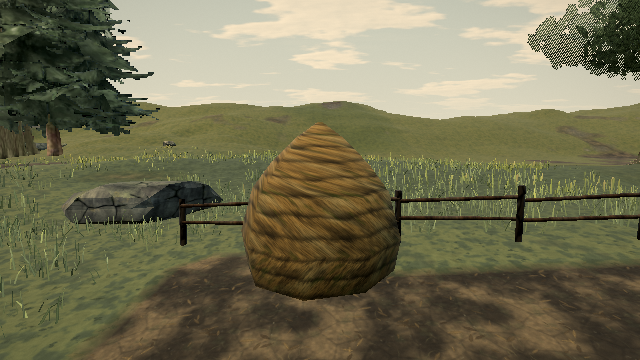

# Skip exclusion work after habitat density reaches zero

Published [0.0.18 · 421d34b](https://ael-dev3.github.io/Tervain/) keeps checking interaction circles and field rectangles after a raster node's openness has become exactly zero. The remaining attenuation factors cannot change that value. This is avoidable CPU work when fresh habitat tiles are generated during streaming.

Skip the soft-circle bucket lookup on already bare nodes, and stop each exclusion loop once a preceding factor clears the node. Wetness, dryness, crown shade and slope still evaluate normally. Positive-density nodes retain the original factor order. There is no new cache, shader or GPU path.

## Reproduce against the published world

```sh
node tools/repro-live-habitat-bare-work.mjs --out habitat-bare-proof
```

The tool defaults to the live Pages URL and loads Low for software rendering. It obtains the actual world habitat, terrain, planted-crown index, exclusions and native grass generators. It swaps only the raster node method between native original, parent source and candidate source, rebuilding the caches each time.

The replay samples 324 points around the walk-fence, run-round, bow and resume locations **(-2,37)**, **(-12.3,44.8)**, **(-4,46)** and **(-268,27)**. It also regenerates existing native grass tiles near **(46,68)**, applies their generated buffers and renders them through the native scene/post path. This is a controlled source-method replay on a published world, not a complete candidate-build or hardware timing gate.

| Raster work in this replay | Before | After |
| --- | ---: | ---: |
| Evaluated nodes | 10,404 | 10,404 |
| Soft-circle distance checks (`Math.hypot`) | 6,689 | 3,726 |
| Of those, checks after openness was zero | 2,963 | 0 |
| Field rectangle checks | 31,212 | 19,960 |
| Of those, checks after openness was zero | 11,252 | 0 |

This removes **14,215 unnecessary exclusion checks**. These are executed source-operation counts, not measured CPU milliseconds, physical GPU operations or a claimed cause of a particular missed refresh.

The independent native-original control and both source models retain identical hashes for:

- **52,020 Float32 raster words** across 36 cached tiles;
- all 324 sampled habitat records;
- packed base, shape, tint and slope data for **8,172 clumps**.

The regenerated native control also matches the original scene's packed attributes. Native, before and after render **66 calls / 316,798 triangles**, with **zero changed pixel channels**. The native-original row is not instrumented; its zero operation-counter fields mean unmeasured, not zero work.

[Rendered receipt](proofs/habitat-bare-exclusions/report.json) · [pre-fix unchanged-parent control](proofs/habitat-bare-exclusions/unchanged-parent-control.json)

| Before | After |
| --- | --- |
|  |  |

The images were inspected. The pre-fix control keeps the same wasted checks in both models and reports `pass: false`. Repeat it with `--candidate-ref 3c5f95b30 --images 0`.

## Validation

- **29 tests pass** across habitat, grass engine and grass contact tests. New tests cover already bare ocean nodes and overlapping circles that clear a node, including preservation of the other habitat channels.
- Production type-check/build pass.
- Software-WebGL replay passes with independent native controls, identical raster/attribute hashes and pixel-identical images.
- Hardware play gate remains outstanding. No live completion, frame-time improvement or 60 fps claim is made.
