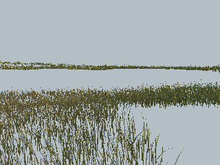

# Reuse the habitat node's road sample

Each habitat node computed its road weight for openness, then `groundSplat` recomputed the same value for ground-layer weights. Reuse that same-point scalar through an optional sampler argument. Other callers retain the existing calculation when no sample is provided. No global cache, field formula, physics or shader changes.

## Production-source before/after

The counter repro uses actual terrain and stock exclusions at 1,920 deterministic queries around fence, inside-window, meadow and forest locations. It builds 30 cold habitat tiles. A diagnostic transform counts calls to the actual `roadWeight` implementation; that counter is not production code.

| Measurement | Before | After |
| --- | ---: | ---: |
| Road-weight evaluations | 17,340 | 8,670 |
| Changed cached Float32 words, 43,350 compared | — | 0 |
| Changed interpolated samples | — | 0 |

[Call receipt with both source hashes](habitat-road-proof/calls.json). The baseline habitat uses the default ground-layer sampler path; its formulas remain unchanged when the new optional input is absent.

A native High grass fixture also compares all 712 attribute buffers (15,409,216 bytes), population statistics, actual renderer counters and decoded RGB screenshots. All match: actual renderer submissions are 21 draws / 620,193 triangles on both sides. [Native receipt](habitat-road-proof/pixels.json).

| Before | After |
| --- | --- |
|  |  |

```sh
node tools/repro-habitat-road-reuse.mjs --out habitat-road-calls.json
node tools/repro-habitat-road-pixels.mjs --baseline 0b45a36 --out habitat-road-pixels
npx vitest run tests/presentation/groundHabitat.test.ts tests/presentation/groundContacts.test.ts tests/presentation/grassEngine.test.ts
npm run build
```

The pixel script accepts `--driver` for another CDP launcher. Twenty-five focused tests, typecheck and build pass; tests compare ground-layer words with ordinary and supplied road samples, including zero.

This removes duplicate road evaluation; it is independent of #414's exclusion index. No hardware frame-time improvement or resolution of the tracked 32 ms frames is claimed. The native fixture lacks post/MSAA and registered crown assets, so it is not a shimmer or full-world gate. Supplied sampler inputs must describe the same point as the ground-layer query.
