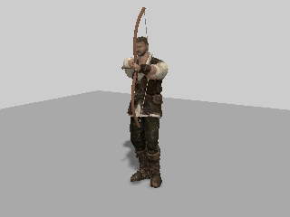
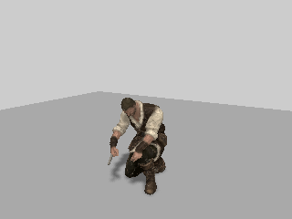

# Reuse hunting overlay restoration records

Aiming and skinning save the base joint transforms before applying an overlay, then restore them before the next animation pose. `restorePose()` clears the active map each frame; previously every first modification recreated a snapshot object and cloned its position and quaternion. Keep a private weak cache of records and copy the new base transform into a cached record on its first modification each frame. The active map still clears on restoration. This preserves fresh animation poses and independent actors.

## Repro and proof

Baseline `0b45a36`, confirmed by the live Pages manifest. Both sides load the delivered hero and the production hero controller/overlay, original materials and attachments. The 121-step deterministic sequence includes aiming/draw, skinning, switching to a slung bow and unequipping. Clone instrumentation runs only around pose generation, after asset loading and construction.

| Measurement | Before | After |
| --- | ---: | ---: |
| Vector/quaternion clone calls over 121 steps | 6,216 | 4,236 |
| Changed local position/quaternion/scale values | — | 0 |
| Changed RGB pixels across four captured poses | — | 0 |

This removes 1,980 clone calls (32% of this sequence's measured calls). New cache records allocate their vectors/quaternions once, on first use; that cold allocation is not counted as a clone. The measurement is clone calls, not total heap allocations. Rendering uses software WebGL with production colour and directional-shadow skin hooks. Every local transform of every object in the rig is compared exactly at every step; four before/after poses are compared as decoded RGB.

[Receipt with production source hash](hunting-pose-proof/report.json). Re-run:

```sh
node tools/repro-hunting-pose-records.mjs --baseline 0b45a36 --out hunting-pose-proof
npm run build
npx vitest run tests/presentation/playerHunting.test.ts tests/presentation/heroAnimation.test.ts
```

The script accepts `--driver` for another CDP launcher and `--baseline-only true` to record the initial repro. It reads the baseline overlay from Git without changing the checkout, starts a temporary Vite server, and fails for any transform/pixel difference or no clone reduction. Full generated pose data and all four image pairs are retained in the output.

| | Before | After |
| --- | --- | --- |
| Aim |  |  |
| Skin |  |  |

33 bow/hero tests pass, including repeated aim/skin transitions against changing walk base poses on two independently constructed rigs. Typecheck and build pass. This does not attribute the tracked 32 ms bow frames to garbage collection, prove hardware timing improvement, or change the overlay's pose mathematics. Full-world hardware play gate remains required.
