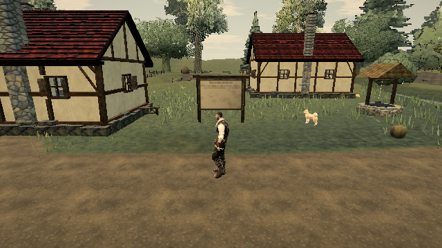

# Reuse foliage depth-pass matrix capacity

Live reference: [0.0.18](https://ael-dev3.github.io/Tervain/), revision `421d34b`.

The depth-only foliage pass immediately shares the colour pass's instance matrix and colour attributes. Its constructor nevertheless allocated a full matrix buffer and filled every slot with identity before discarding it. Constructing with zero instances avoids that temporary payload and its initialization; the shared attribute still supplies the full capacity. Both passes retain the existing zero draw count until the forest packs visible instances.

## Reproduce

```sh
node tools/repro-live-leaf-prepass-allocation.mjs --out leaf-prepass-proof
npx vitest run tests/presentation/leafTargetCoverage.test.ts tests/presentation/foliageEngine.test.ts tests/presentation/leafBurstIdle.test.ts --testTimeout=90000
npm run build
```

The replay loads the published forest and measures both constructors with the native leaf-batch capacities. Later target-coverage hooks are shared between variants, isolating the constructor argument that matches the published source. A controlled split-depth pipeline is added to the Low world; this is not a claim that Low normally enables this pass. Each variant renders the same whole scene through the game's renderer. Hiding foliage provides a nonempty-image control.

The regression test checks that constructing the depth pass invokes no identity writes, that both attributes retain identity with the colour pass, that the final instance remains readable, and that the colour buffer remains usable after depth-pass disposal. It fails with the original constructor argument.

The accompanying receipt records CPU matrix payload and initialization counts, rendered channels, draw calls, triangles and texture count. These are not measured heap size, GPU upload bytes, texture-memory bytes, startup-time savings, hardware frame times, or a grass-shimmer fix. A software renderer supplies image proof; hardware verification remains outstanding.

When Chrome lacks the public site's certificate authority, a temporary mirror may fetch the same published assets through verified HTTPS. TLS checks and the game's asset checksums remain enabled. This does not change the published build.

## Receipt

[Report and captures](proofs/leaf-prepass-allocation/report.json): 60 native batches, total capacity 1,023 instances.

| Measure | Before | After |
| --- | ---: | ---: |
| Discarded CPU matrix payload | 65,472 bytes | 0 bytes |
| Constructor identity writes | 1,023 | 0 |
| Draw calls | 137 | 137 |
| Triangles | 869,582 | 869,582 |
| Texture count | 102 | 102 |

Before/after changed channels: **0**. Hiding foliage changed **65,480** channels. Matrix and colour attributes remain shared. The candidate passed 24 focused tests and the production build. Restoring the original constructor made the new regression fail with 73 unexpected identity writes (two other tests still passed); the candidate was restored afterward.



