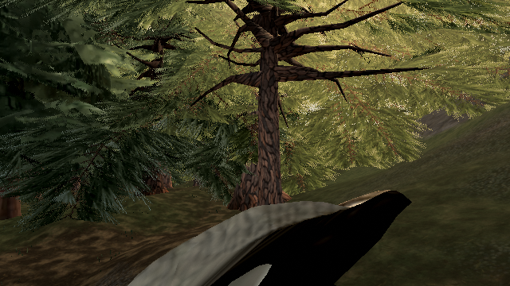

# Leaf-island contact must lie on foliage

Reproduced on live **0.0.33 · b317734**. The load-time island repair accepts a triangle's opaque bounding-box centre as a contact point. That centre can lie outside the triangle plane, or in a transparent hole. The same phantom point can prevent the later nearest-contact stage from moving the island.

In this witnessed triangle the centre is also **0.033982 local metres off the triangle plane**; it is not a point on the rendered leaf surface.

The correction keeps box-centre/radius rejection as a broad phase, but accepts and chooses wood contacts using retained foliage-surface samples. It changes no material, alpha cutoff, wind, reach or connectivity thresholds. No foliage is deleted and no triangles are added.

A scan of the live High forest's retained near/middle templates finds one middle-detail procedural pine template that the old repair leaves unchanged and the corrected repair moves. This is a rest-geometry contact finding, not a complete crown-quality score or proof that all remaining floating clumps are fixed.

## Native rendered reproduction

`tree:wild:70:3`, pine/procedural, world position **(61.335, 13.527, −145.577)**. The largest instance scale for its shared middle leaf template is **2.216006**. The false contact is 0.216606 local metres from wood, inside the 0.270757 reach; the two retained opaque surface samples are 0.378099 and 0.344572 metres away, both outside it. The box-centre point therefore falsely passes contact. [Raw witness and hashes](proofs/leaf-surface-contact/surface-witness.json). Nine position vertices change; that leaf template retains **2,208 triangles**.

The native Low preset displays middle-detail trees nearby. Three eye-height inspection views, fixed hour 15 and zero wind, borrow the **compiled candidate positions** into the published scene. Independent Low-preset inspection of compiled head **5c312082e** confirms its vertex count and every non-position attribute hash match live. The candidate has no remaining phantom-contact witness, and the strict surface repair makes zero further moves. Materials, wood and the remainder of the scene stay native. These are inspection poses, not a recorded input-driven walk.

| View | Before / after draws | Before / after triangles | Changed pixels |
| --- | ---: | ---: | ---: |
| East | 229 / 229 | 1,740,179 / 1,740,179 | 1,081 |
| Southwest | 29 / 29 | 276,471 / 276,471 | 376 |
| Northwest, occluded | 170 / 170 | 1,176,932 / 1,176,932 | 0 |

Every restored baseline matches its original RGB exactly. Zero console/GL errors. These are fixed-wind software-renderer captures, not hardware frame-time measurements. High normally retains near trees; this evidence is specifically a middle-detail repair, not a High crown redesign.




[Three full before/after/restored sets and report](proofs/leaf-surface-contact/report.json). The initial [template scan](proofs/leaf-surface-contact/template-probe.json) suppresses raster and makes no image or performance claim.

## Reproduce

Run the evidence utilities from the accompanying proof branch, `codex/leaf-island-surface-proof`. The production change and budget head are `5c312082e`.

```sh
npx vitest run tests/presentation/leafIslands.test.ts tests/presentation/leafIslandSurfaceContact.test.ts tests/presentation/canopyBaseline.test.ts
npm run build
node tools/repro-leaf-island-surface-contact.mjs leaf-surface-proof
node tools/inspect-leaf-surface-contact.mjs leaf-contact.json
```

The image tool accepts another build URL as its second positional argument. The contact inspector also accepts a build URL, and preserves the published baseline source at b317734 for its false-contact witness. To reproduce the actual compiled geometry comparison, pass the compiled inspector JSON as the image tool's third positional argument. [Live geometry](proofs/leaf-surface-contact/live-geometry.json), [compiled geometry](proofs/leaf-surface-contact/compiled-geometry.json), and [attribute comparison](proofs/leaf-surface-contact/compiled-comparison.json) are retained. The first exploratory run reapplied the new repair to an already repaired live template; its position hash differed from cold compiled initialization, so its images were rejected as release proof. Only captures using the compiled positions are retained here.

## Costs and validation

| Cost | Delta |
| --- | --- |
| Rendered inspection draws / triangles | 0 / 0 at each of three poses |
| Material / shader instructions / texture taps | Unchanged |
| Per-frame JS / uploads | No runtime-loop changes |
| Initialization | Surface-contact queries replace the box-centre acceptance; load-time cost not benchmarked |

22 focused tests pass, including two regressions that fail on the baseline. Type check and production build pass. No claim of improved hardware FPS or heat.

## Exact-head compiled budget

Stock producer/sampler, no raster-suppression preload, head **5c312082e**, allowance 0, actual exit 0. Two same-revision live probes, maximum over four completed samples per probe:

| Metric | Live b317734 | Candidate 5c312082e |
| --- | ---: | ---: |
| Maximum draws | 285 | 285 |
| Maximum triangles | 3,048,306 | 3,048,138 |
| Console errors | 0 | 0 |

`play-gate: PASS 5c312082e`

[Scrubbed exact-head receipt](proofs/leaf-surface-contact/budget.md). The 168-triangle difference is not an attributed geometry/performance saving; the repaired target retains its triangle count. Pacing is advisory and no hardware timing claim is made.
