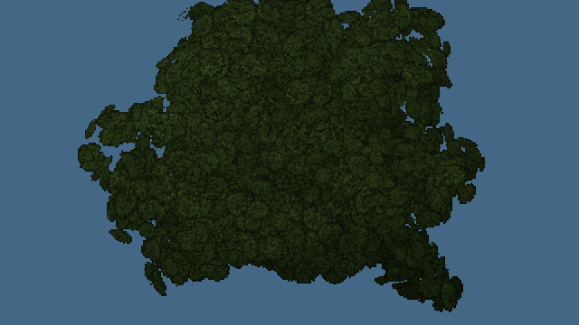
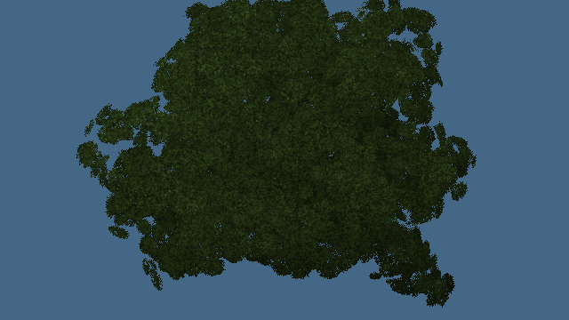

# Match leaf coverage to the capture target

Published [0.0.18 · 421d34b](https://ael-dev3.github.io/Tervain/) uses alpha-to-coverage leaf materials. High's main target has MSAA, but the water reflector explicitly requests `samples: 0` and the window cube target also has zero samples. The leaf shader still takes its multisample ramp in those captures. Without coverage samples, surviving partial-alpha fragments cover a whole pixel, expanding the apparent cutout silhouette. The prior Low-profile fix does not cover these High secondary passes.

Select the existing multisample ramp or single-sample cutout with a per-target uniform. Keep the material/program variant stable across captures. Copy the render callback to the depth twin so its cutout uses the current target before colour draws. Opaque fallback fragments write full alpha after the existing cutout; transparent materials retain their alpha.

## Reproduce

```sh
node tools/repro-live-leaf-target-coverage.mjs --out leaf-coverage-proof
```

The default URL is the published build. The replay uses its actual oak `tree:wild:40:42` geometry, atlas and shader hooks, then overlays parent/candidate alpha blocks. It exercises a controlled High-style material on targets with **4 → 0 → 4 samples**, both directly and through the real split depth/colour pipeline. A separate reference disables alpha-to-coverage to select the existing single-sample cutout. Geometry hashes and the multisample colour capture must remain identical. This isolates the target mismatch without rebuilding an entire High world.

| Coverage witness, 640×360 native crown | Before | After | Existing single-sample reference |
| --- | ---: | ---: | ---: |
| Single-sample covered pixels, direct | 107,814 | 103,047 | 103,047 |
| Single-sample covered pixels, split depth/colour | 107,814 | 103,047 | 103,047 |
| Four-sample covered pixels, both pipelines | 107,132 | 107,132 | — |

The excess **4,767 covered pixels** disappear. Both corrected single-sample masks exactly match the reference hashes. Four-sample before/after colour images have **zero changed channels**; the repeated four-sample mask is identical after the intervening single-sample pass. The selection uniform follows **1 → 0 → 1**. The older failing control labels this readback count as `samples`. Readback binds a resolved single-sample framebuffer, so its `readbackSamples` is reported separately from the requested target's `targetSamples`.

[Rendered receipt](proofs/leaf-target-coverage/report.json) · [pre-fix failing control](proofs/leaf-target-coverage/unchanged-parent-control.json)

| Single-sample capture before | After |
| --- | --- |
|  |  |

The snapshots were inspected. They show an isolated native crown under controlled lighting, not a whole-scene quality score. The correction changes capture coverage intentionally; tree geometry, textures, lighting constants and four-sample main-view shading remain unchanged. It does not claim to fix canopy art, detached branches or hardware frame time.

## Checks

- 20 tests across leaf-target coverage and the existing foliage engine suite pass, including depth-first target changes, prior callback chaining, cached default-framebuffer capability and unchanged Low hooks.
- Production type-check and build pass.
- Software-WebGL rendered comparison passes. The pre-fix unchanged-parent run fails as expected.
- Hardware play/video gate remains outstanding; no hardware PASS or live fix is claimed.
