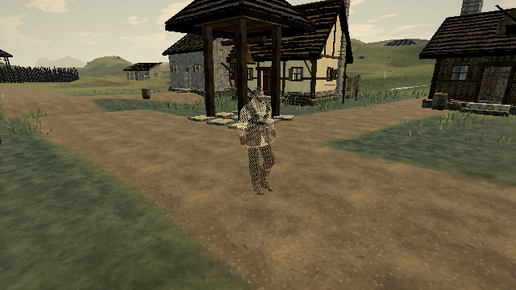

# Hero near-fade material iteration

Published reference: [0.0.18 · 421d34b](https://ael-dev3.github.io/Tervain/); tracking [#326](https://github.com/ael-dev3/Tervain/issues/326).

The hero's fade update traverses his meshes every simulation step, including ordinary full-coverage play, to discover newly equipped materials. For each single-material mesh it creates a temporary `[mesh.material]` array solely to iterate one item. The same pattern occurs in the one-off `patchAll` path used to prepare equipment.

Branch directly for a single material; retain iteration for material arrays. This removes those short-lived arrays while preserving traversal, late-equipment discovery, material patching, shader keys, coverage, and visibility. It does not cache or skip hierarchy scans.

## Published-build proof

```sh
node tools/repro-live-near-fade-materials.mjs --url https://ael-dev3.github.io/Tervain/ --out near-fade-proof
npx vitest run tests/presentation/nearFade.test.ts
npm run build
```

The tool loads the published hero and native fade patcher. It runs the actual before/after `apply` and `patchAll` methods against that same hierarchy, recording the ordered material identities. It instruments only the old code's single-material list expressions. This is a source-level construction count, not total heap allocation, GC attribution, or measured elapsed frame time.

| Measurement | Before | After |
| --- | ---: | ---: |
| Single-material meshes on the sampled native hero | 24 | 24 |
| Temporary single-material lists in 120 apply calls | 2,880 | 0 |
| Temporary single-material lists in one patchAll call | 24 | 0 |
| Ordered material patch calls | identical | identical |
| Coverage and visibility over 120 calls | identical | identical |
| Frozen native Grade/post software-WebGL pixels at half coverage | identical | identical |

All three existing near-fade tests and the production build pass. [Receipt](../../proofs/near-fade-materials/report.json); [ordered patch-call records](../../proofs/near-fade-materials/patch-order.json.gz).

| Before | After |
| --- | --- |
|  |  |

The captures deliberately set half coverage on both versions to exercise the same dither path. No assets or production visual behavior change. Counts apply to this loaded hero and can vary with equipped gear. This method-level intervention is not a complete candidate-build playthrough, a claim that village hitches are solved, or a hardware performance receipt. Hardware play-gate approval remains required.
