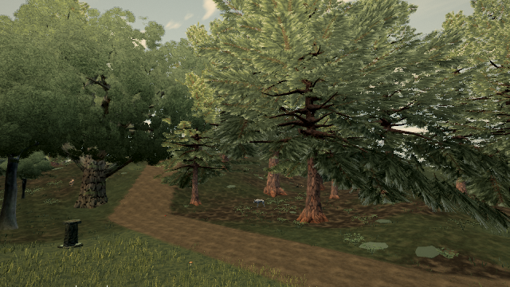
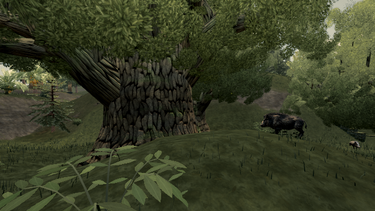

# Near-leaf bounds: negative rendered result

Published 0.0.33 · b317734. **No production PR.** A local trial bounded the near leaf batch by near + middle reflection geometry instead of every source LOD. Its smaller radius is geometrically valid, but the tested views do not save draws or triangles.

| Resumed camera X/Z/yaw/pitch | Draws before / after | Triangles before / after | Upload bytes before / after | RGB / restore |
| --- | ---: | ---: | ---: | --- |
| -210 / 0 / 0.8 / -0.09967 | 456 / 456 | 6,242,951 / 6,242,951 | 26,880 / 26,880 | exact / exact |
| -210 / 0 / 3 / 0 | 230 / 230 | 3,692,559 / 3,692,559 | 13,440 / 13,440 | exact / exact |

[Raw resumed records](report.json). Five preceding forest/meadow/bow controls also had exact RGB/restores and no reported cost reduction before the run was paused; these two resumed views are not a reconstructed continuous seven-pose replay. Native High post/MSAA4, 640×360, fixed time per pair. A renderer-session bounding-sphere swap keeps geometry/materials/packing fixed. Draw counts use renderer info and must be nonzero. An earlier instrumentation-counter pilot was invalid and excluded.

| Forest edge before | Candidate |
| --- | --- |
|  |  |

| Reverse before | Candidate |
| --- | --- |
|  |  |

The savings assertion failed as intended. Fifteen focused tests and build passed on the local trial, but that does not establish a useful performance fix. Its stock budget run was interrupted at the requested pause; no PASS is claimed. The local application change is not proposed. No foliage-quality, hardware frame-time or heat improvement is claimed.
