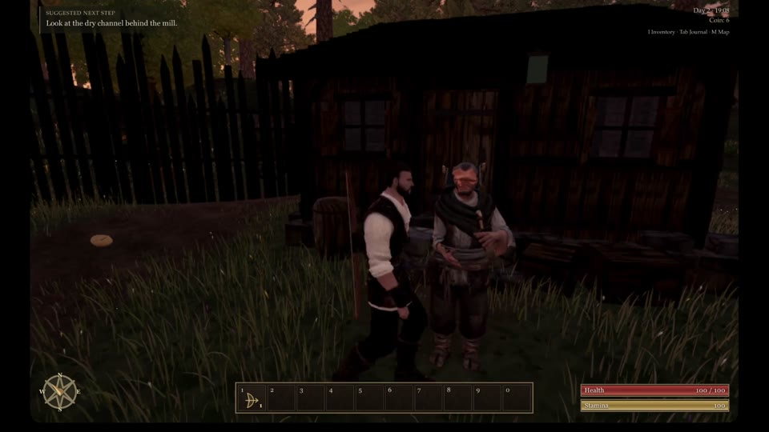

# Native NPC bone-collapse check

A finite-vertex audit can miss a zero-scale head: collapsing a bone still leaves finite posed positions. The new reusable check reports nonfinite scales, local scales at or below `1e-8`, singular/nonfinite world transforms, and exact head/torso anchor collapse. It does not impose artistic proportions or change rigs.

```sh
node tools/repro-npc-bone-collapse.mjs --url "$BUILD_URL" --out npc-bone-proof
```

The command opens native Chrome software WebGL, waits for the full cast, explicitly completes hidden model adoption, then checks named actors and all tagged NPC rigs in the scene (including ambient people and enemies). Shader warmup is disabled in this CPU-only structural fixture. Unloaded stand-ins and missing skeleton coverage cannot count as a successful checked skeleton. Optional `--driver` selects a CDP launcher module; this run used the isolated launcher from #397.

## Actual compiled-build result

- 12 named actors and 17 scene NPC rigs checked; each scene rig has 36 bones.
- No collapsed/nonfinite bone transform or coincident head/torso anchor at this sampled state.
- A temporary zero-scale head on an actual NPC leaves **44,607 posed vertices finite**: the former finite-vertex condition still passes.
- The new check reports `collapsed-local-scale` and singular inherited transforms. Restoring the original scale passes again.
- Five independent regression tests cover valid/mirrored transforms, finite collapsed vertices, collapsed ancestors/axes, nonfinite scales, coincident anchors and an empty scene. Type check passed.

[Native receipt](npc-bone-proof/report.json). Its build is `62af8c8d1`; NPC application source and assets are unchanged from live `0b45a36a0` (the candidate application change concerns idle quarry dust).

## Video reference

Frame extracted at 4 seconds from the supplied 0.0.15 · 0b45a36 playtest, showing the NPC beside the house:



This is reference evidence for the reported appearance, not proof of a structural pass or a visual fix. The native check rules out zero-scale bone collapse only at its sampled state. It does not establish correct face geometry, skin weights, shader output, every animation frame, the exact recorded NPC state, or the cause of the reported missing head. Further geometry/rendered-pose investigation remains necessary.
