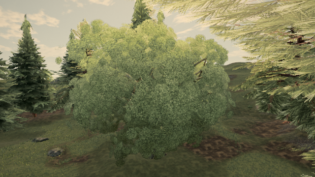

# Authored oak branch wind: cost and motion study

**Study only; no production PR or hardware-performance verdict.** Published 0.0.27 · 163ee68 compared with experimental source **cf0df55f6**. Card placement, connectivity thresholds, geometry budgets, palette and lighting code are unchanged.

## Actual data-loss path

The hero-oak GLBs already declare `_WIND` and `_PIVOT` on wood and foliage. `prepare` preserves/transforms their lowercase runtime attributes. `deriveBranchWood` deliberately returns null for wood that already has `_wind`. Rebuilding near/middle leaf cards then supplies no reader for that existing field; the rebuilt canopy has no branch attributes, and `settle` strips the wood attributes too.

There is also a separate copy loss in `snapDetachedClumps`: it copies only positions/normals/UVs. Preserving those attributes alone (**933ee79ca**) did **not** restore the selected live tree, so that trial is not represented as a restored-wind result.

The measured control reads the existing authored wood field, maps the rebuilt cards through the existing `deriveBranchLeaf`, and preserves attributes through the snap copy. The production acceptance threshold remains **50%**. On `tree:wild:45:12`, world (-92.579774, 6.201665, -89.192551), **6,000/6,000 cards** find a field; both wood and leaves retain `_wind`/`_pivot`. The reader uses a **linear load-time search** for this experiment and is not proposed as a shipping implementation. No clumps are newly moved or removed by this change.

## Native whole-scene measurements

High, browser 1440×900 at device scale 2; preset-capped render buffer **2160×1350**, MSAA4, ANGLE SwiftShader. Hour 15; wind strength 1, wind time 3, sway time 3. [Separately recorded baseline controls](proofs/oak-authored-wind/baseline-controls.json) were applied explicitly to the reader control. Camera, sun, cloud/grade clocks and wind scroll/direction match. Actors remain fixed. The captured shot/reduced-motion wind vector has steady push 0.056 and gust strength 0; overriding field strength to 1 executes the wind shaders, but this is a calm-wind comparison, not a full-gust stress run.

Two unmeasured renders warm each pose. Query samples are serial, **8 live / 4 study**, with a completion/readback outside the query. The first attempt timed out and contributes no accepted result. No raster suppression was used. These are **software timer-query milliseconds**, including all native rendering passes and any changed raster coverage, not isolated shader instruction timing or Mac frame pacing. The observed p95 is the maximum at these small sample counts.

| Pose | Draws, live → study | Triangles, live → study | Mean query ms, live → study | Delta | Observed p95 ms, live → study |
| --- | ---: | ---: | ---: | ---: | ---: |
| Oak | 251 → 251 | 2,919,454 → 2,919,454 | 19,018.59 → 19,128.98 | +0.58% | 19,189.26 → 19,202.78 |
| Forest | 216 → 216 | 2,135,865 → 2,135,865 | 17,087.96 → 17,128.97 | +0.24% | 17,982.26 → 17,520.58 |

Those values are about **19 seconds / 17 seconds** per software-rendered frame, not 19/17 milliseconds. Live query ranges were 18,848.90–19,189.26 ms and 16,702.52–17,982.26 ms. The small net changes are within that observed spread; this is not an equivalence test or proof of zero cost.

Mean wall-clock submission ms: oak **5.69 → 4.78**, forest **3.95 → 4.98**. They include driver/scheduler effects and are **not isolated JS thread CPU**. A JS frame-CPU no-increase verdict is not established.

Static shader cost is nonzero: the active fallback requires one gust fetch per wood vertex and two per leaf vertex; hierarchy requires three. The restored field adds two vertex attributes (seven floats per vertex) where absent. It adds no draws, triangles or texture images, and no application-frame loop. Do not infer zero shader cost from equal geometry budgets or noisy whole-frame means.

**Stock software draw/triangle budget gate: PASS**, exact compiled source cf0df55f6. Live and study maxima are both **285 draws / 3,061,929 triangles**, zero console errors, no triangle allowance. Four samples per probe; live takes the maximum of two probes. [Receipt](proofs/oak-authored-wind/budget.txt); preview address omitted. The stock gate does not time GPU work; the query table above is a separate adjacent check. Stock gate source SHA-256: `08fcfec34d3427779a9ce40153467e23c912d41d4759cd2d06d3f653840c61d2`.

## Motion evidence

[Side-by-side clip](proofs/oak-authored-wind/paired.mp4): **live left, study right**. Twelve same-camera native post/MSAA images sample wind time 3 through 4.8333 s at **6 samples/s**. These are coarse synthetic phase samples, not real-time footage, a flicker metric or a motion-quality PASS; fast leaf flutter is undersampled. Full-resolution timing and 640×360 motion captures are separate phases of the same run.

A fresh native 0.0.27 control at 640×360 finds **0 changed RGB channels** between live and study with wind strength 0. A fresh live active-phase-3 capture also repeats the original live phase-3 frame with **0 changed channels**. These are static/context controls, not pixel identity during intentionally different wind motion. [Control counts](proofs/oak-authored-wind/static-controls.json), [live still](proofs/oak-authored-wind/still-before.png), [study still](proofs/oak-authored-wind/still-after.png).

[Before queries](proofs/oak-authored-wind/before.json), [study queries and field metadata](proofs/oak-authored-wind/after.json), [phase differences](proofs/oak-authored-wind/motion-differences.json). The pixel differences demonstrate the comparison, not visual improvement or unchanged pixels during wind.

Reproduce using `tools/measure-oak-wind-cost.mjs` against the published build and a preview built from cf0df55f6. Supply `docs/perf/proofs/oak-authored-wind/controls.json` with `--controls`; require `--require-wind true` on the reader control. The helper records compiled revision and rejects missing wood/leaf wind attributes. Build/typecheck and 15 related tests pass; the two copy-regression cases fail against the original copying behavior.

A production change would need an indexed authored-field reader, load-cost measurement, stronger paired timing and motion review. The prototype is intentionally left for that decision; it is not a budget-neutral fix claim.
