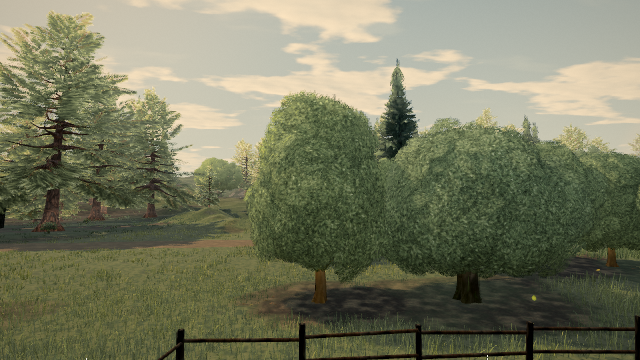
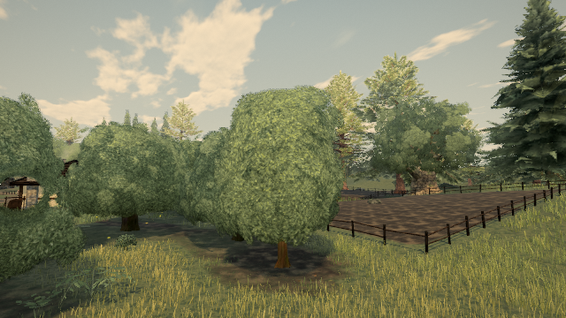

# Orchard contact recheck on 0.0.27

Published build: **0.0.27 · 163ee68**, High. This is a fresh inspection, not a fix or a before/after comparison.

`tree:orchard:0:2`, world (-49.971630, 0.115092, 30.661973), still has 298 detached-subset components in one clump under the structural audit (`lod:0`, `alpha:false`, `gap:0.75`, `woodReach:1.5`). The whole crown is one connected chunk with zero whole-disconnected candidates. Existing cutout-aware repair reports zero islands, moves or drops.

All 5,674 leaf cards retain a matching wood wind/phase/pivot reference. No triangle has inconsistent per-corner wind/pivot data (11,348 triangles checked). This excludes those specific attribute faults; it does not prove correct animation or close the foliage-quality report. Infinity in the capped maximum-distance result serializes as null and must not be interpreted as zero.

The two native software-WebGL inspection images use the existing orchard camera poses: 12 m from the target at angles 0 and 4.188 radians, camera height +4 m and look height +5 m, hour 15. Forest visibility is updated before the postprocessed render. Geometry inspection used raster suppression; the images did not. The images show a connected crown but do not resolve every leaf contact. No whole-crown translation or new connectivity change is justified by these checks.

## Separate attribute-loss finding

The same compiled release has no `_wind` or `_pivot` attributes on either wood or leaves for three sampled instances of the same oak template (positions in the report). These are three instances, not three independent templates.

Source cause: `snapDetachedClumps` in `src/presentation/canopy.ts` creates a replacement geometry and copies only normals and UVs after positions. Its caller in `src/presentation/meshyTrees.ts` derives branch attributes immediately beforehand; `settle` subsequently removes wood branch attributes when the leaves have none. A stationary source fixture with zero moved clumps also loses both attributes. Thus dropping them is not required by a placement change.

A naive attribute-preserving patch would change motion and enable the hierarchical shader. It cannot be called pixel-identical during wind or shader-budget neutral: the fallback has one gust fetch for wood and two for leaves, while the hierarchical path requires three (before any compiler elimination of unused fallback work). Restoring animation needs explicit shader-cost review and motion proof. **No production patch or PASS receipt is claimed.** This report does not change the shared connectivity rule or tree placement.

Run the source witness with `node docs/perf/proofs/orchard-live27/wind-attribute-repro.mjs`. It asserts the current attribute-loss behavior; it is not a passing fix test.

[Raw measurements](proofs/orchard-live27/report.json). Hardware performance, crown quality, strict white grass specks and the broader playtest remain open.
