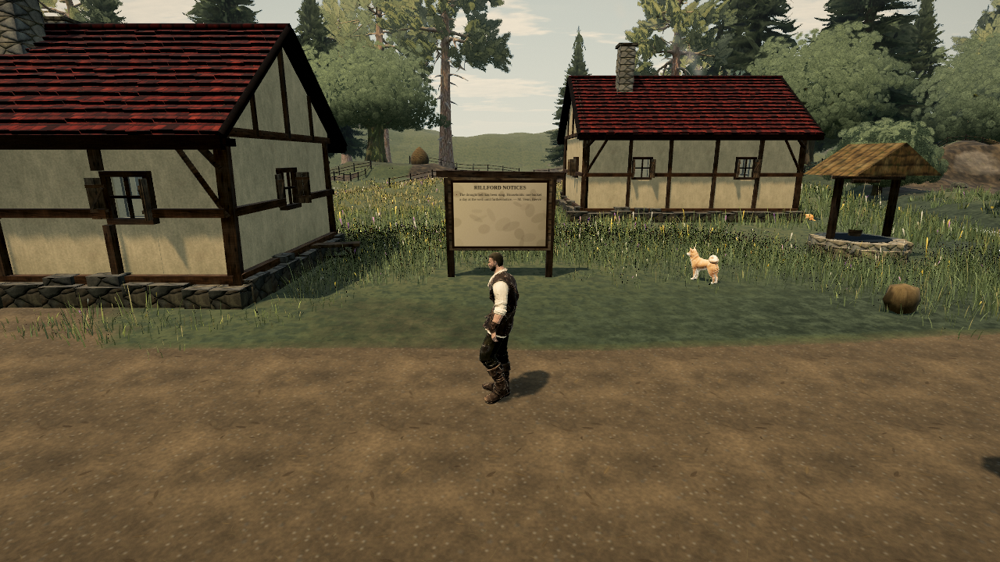
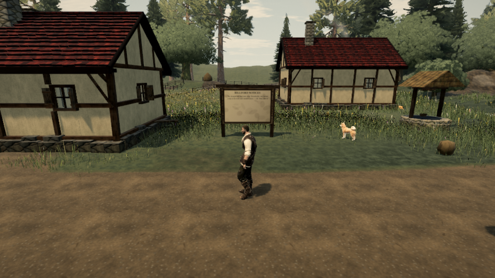

# High-density pixel budget

High quality capped device pixel ratio at 2, rendering four device pixels per CSS pixel before offscreen passes. Cap high-density rendering at 1.5 while retaining high geometry, shading and shadow settings. Low and medium ceilings, and ordinary DPR 1 screens, are unchanged. Dynamic resolution can still lower the ceiling.

```sh
node tools/repro-render-pixel-cap.mjs --url http://127.0.0.1:4173/ --expect before --out before.json --shot before.png
# Build and serve the fixed revision.
node tools/repro-render-pixel-cap.mjs --url http://127.0.0.1:4173/ --expect after --out after.json --shot after.png
```

The actual high-quality journey is loaded in SwiftShader. The device metrics are set to 640×360 at DPR 2, automatic resolution changes are disabled, native resize is called, and three complete world renders are measured.

| Counter | Before | After |
| --- | ---: | ---: |
| Requested quality | high | high |
| Renderer ratio | 2 | 1.5 |
| Canvas and grade target | 1280×720 | 960×540 |
| Drawn pixels | 921,600 | 518,400 |
| Draw calls per captured render | 303 | 304 |
| Triangles per captured render | 2,840,467 | 2,840,527 |
| Source upload bytes per captured render | 6,912 | 6,912 |

**43.75% fewer canvas/grade pixels**. Draw/triangle counts vary slightly between captures; no draw, geometry or upload reduction is claimed. This deliberately trades some high-density sampling resolution for lower fill and target-storage demand. It does not establish thermal improvement or a hardware 60 fps pass. Other texture assets and shadow resolution are unaffected.

[Before receipt](pixel-cap-proof/before.json) · [After receipt](pixel-cap-proof/after.json)




Five resolution tests, type checking, production build and built-game deterministic ratio/pixel/target assertions pass. This PR is stacked on the grass-exclusion fix so both receipts use the same product changes apart from the pixel cap.
