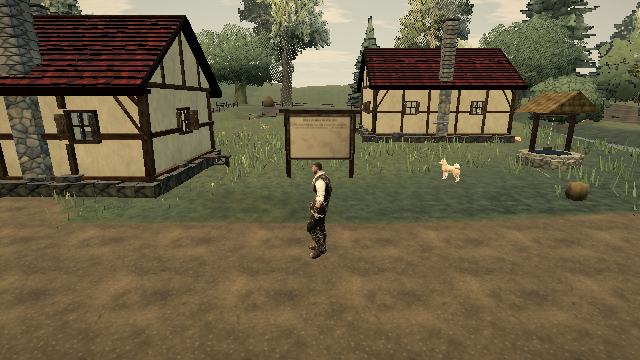

# Reuse private rigid-body interpolation history

Related live CPU/movement lead: https://ael-dev3.github.io/Tervain/ and #326. Baseline: 0.0.16 · 9ab40b3.

At every physics tick, each loose prop replaces its private previous-pose object and cloned position/quaternion records. They never escape into published poses. Copy the same native values into those private records instead; restore/reset keep their existing behavior and public snapshots stay independent.

| Native rigid-body workload | Before | After |
| --- | ---: | ---: |
| Updates / fixed physics steps | 500 / 650 | 500 / 650 |
| History factory calls in fixed steps | 5,850 | 0 |
| Plain history records constructed | 17,550 | 0 |
| Current/interpolated prop poses compared | 9,000 | 9,000, exactly equal |

Two native Rapier worlds run the same impulses, tumbling, throw, restore and reset under mixed 60/120/30 Hz, zero-dt and 50 ms update intervals. Every private history value and both current/interpolated public outputs match exactly; 6,178 sleeping pose samples are included. Previously returned snapshots remain unchanged as simulation continues. The source uses the same native translation/rotation reads and sleeping flag; those Rapier wrapper allocations and final public-pose allocations remain. Counts apply only to three plain records built by the previous-pose factory. No heap-byte or hardware frame-time improvement is claimed.

[Deterministic receipt](prop-history-reuse/receipt.json).

```sh
node tools/repro-prop-history-reuse.mjs receipt.json
npx vitest run tests/worldPhysics.test.ts tests/world/rockContacts.test.ts tests/world/rockSupportBroadphase.test.ts
npm run build -- --mode software
```

34 physics/rock tests pass. Production software-mode build/typecheck and all seven native [software-WebGL assertions](prop-history-reuse/software-webgl.json) pass. The stationary candidate view reports 144 draw calls, 910,599 triangles and 4,608 uploaded bytes per complete render; no rendering-cost improvement is claimed.

 Hardware play gate remains required before shipping.
