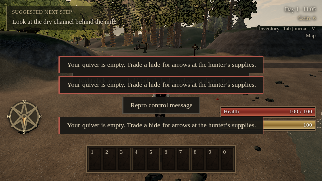
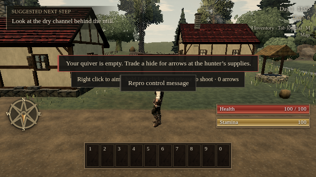

# Duplicate empty-quiver warning

The HUD's 1.5-second last-message cooldown was shorter than a warning's visible lifetime. A later empty shot, or an intervening message, could stack an identical warning. Compare all currently visible messages by text and severity instead. Expired or evicted messages can appear again; severity and styling are unchanged.

```sh
node tools/repro-quiver-toast.mjs --url http://127.0.0.1:4173/ --expect before --out before.json --shot before.png
# Build and serve the fixed revision.
node tools/repro-quiver-toast.mjs --url http://127.0.0.1:4173/ --expect after --out after.json --shot after.png
```

The actual built game's bow controller receives three empty attack presses: one immediately, one after 1.6 seconds, and one after an unrelated toast. Assertions: empty warnings **3 → 1**, unrelated message **1 → 1**, remaining arrows **0 → 0**, launched arrows **0 → 0**. Input is a scripted fixture; the game, controller and HUD are native compiled code.

[Before receipt](quiver-toast-proof/before.json) · [After receipt](quiver-toast-proof/after.json)



